# Capítulo VII: Product Implementation, Validation & Deployment

Este capítulo documenta cómo se configuró, implementó, probó, desplegó y validó AuxIA. La solución se reparte en seis productos digitales y cada uno tiene su propio repositorio en la organización [Waqta-Labs](https://github.com/Waqta-Labs) de GitHub: el Backend API, el AI Service, el smart contract `DeliveryRegistry`, la Landing Page, la aplicación móvil (App de Campo) y la Web App. Los datos de este capítulo (commits, pruebas, endpoints y URLs de despliegue) se tomaron de esos repositorios y de los servicios desplegados.

## 7.1. Software Configuration Management

Esta sección reúne las decisiones que mantienen consistente el trabajo del equipo durante el ciclo de vida del producto: qué herramientas usa cada integrante, cómo se organizan los repositorios y las ramas, qué convenciones sigue el código y cómo se despliega cada producto.

## 7.1.1. Software Development Environment Configuration

La tabla agrupa las herramientas por tipo de actividad. Las que funcionan como servicio (SaaS) indican su URL de acceso; las que se instalan en el computador de cada integrante indican su ruta de descarga. Las bibliotecas de cada proyecto (Spring Boot, FastAPI, Flutter, Hardhat, React, Vite y sus dependencias) no aparecen aquí porque las instala el gestor de paquetes de cada repositorio a partir de su archivo de configuración (`pom.xml`, `requirements.txt`, `pubspec.yaml` y `package.json`).

| Actividad | Producto | Propósito en el proyecto | Ruta de referencia o descarga |
|---|---|---|---|
| Project Management | Trello | Product Backlog y tablero del Sprint. | https://trello.com |
| Requirements Management | UXPressia | User Personas, Empathy Maps, User Task Matrix e Impact Map. | https://uxpressia.com |
| Requirements Management | Miro | As-Is y To-Be Scenario Maps, EventStorming, Candidate Context Discovery, Domain Message Flows y Bounded Context Canvases. | https://miro.com |
| Product Design | Figma | Lean UX Canvas, wireframes, wireflows, mock-ups, user flows y prototipos. | https://www.figma.com |
| Software Architecture | Structurizr Local | Diagramas C4 (landscape, context, container, component y deployment) escritos en Structurizr DSL. | https://docs.structurizr.com/local |
| Software Architecture | PlantUML | Diagramas de clases de la capa de dominio de cada bounded context. | https://plantuml.com/download |
| Software Architecture | DataGrip | Diagramas de base de datos generados sobre la base PostgreSQL de Neon. | https://www.jetbrains.com/datagrip/download |
| Software Development | IntelliJ IDEA | Desarrollo del Backend API en Spring Boot. | https://www.jetbrains.com/idea/download |
| Software Development | Visual Studio Code | Desarrollo del AI Service, del smart contract, de la Landing Page, de la Web App y edición del informe en Markdown. | https://code.visualstudio.com/download |
| Software Development | Android Studio y Android SDK | Compilación de la aplicación Flutter para Android y emulador para probarla. | https://developer.android.com/studio |
| Software Development | Microsoft Build of OpenJDK 21 | JDK con el que se compila y ejecuta el backend. | https://learn.microsoft.com/java/openjdk/download |
| Software Development | Python 3.12 | Entorno de ejecución del AI Service. | https://www.python.org/downloads |
| Software Development | Node.js 22 | Entorno de Hardhat para compilar, probar y desplegar el smart contract. | https://nodejs.org/en/download |
| Software Development | Flutter SDK 3.44 (Dart 3) | Framework de la aplicación móvil. | https://docs.flutter.dev/get-started/install |
| Software Development | Node.js y npm | Ejecutan el servidor de desarrollo y la compilación de la Web App (Vite) y administran sus dependencias. | https://nodejs.org/en/download |
| Software Development | Git y GitHub | Control de versiones, pull requests y repositorios de la organización. | https://git-scm.com/downloads y https://github.com/Waqta-Labs |
| Software Development | GitHub CLI | Creación de ramas y pull requests desde la terminal. | https://cli.github.com |
| Software Testing | Docker Desktop | Contenedores temporales de PostgreSQL 18, Azurite y Anvil que usan las pruebas de integración del backend (Testcontainers). | https://www.docker.com/products/docker-desktop |
| Software Testing | GitHub Actions | Verificación automática (formato, análisis y pruebas) de la aplicación móvil en cada pull request. | https://github.com/features/actions |
| Software Testing | Google Chrome y Opera | Pruebas manuales de la Web App en dos navegadores y revisión de la consola y de la red con las herramientas para desarrolladores. | https://www.google.com/chrome y https://www.opera.com |
| Software Deployment | Microsoft Azure | App Service para el Backend API y el AI Service, y Blob Storage para las fotos de evidencia. | https://portal.azure.com |
| Software Deployment | Neon | Base de datos PostgreSQL 18 administrada, con un schema por bounded context. | https://neon.tech |
| Software Deployment | Vercel | Publicación de la Landing Page. | https://vercel.com |
| Software Deployment | Netlify | Publicación de la Web App desde el repositorio de GitHub. | https://www.netlify.com |
| Software Deployment | MapTiler Cloud | Mosaicos con las calles del mapa GIS. La clave se restringe a los dominios de la Web App. | https://www.maptiler.com |
| Software Deployment | Alchemy | Nodo RPC de la red de pruebas Sepolia. | https://www.alchemy.com |
| Software Deployment | MetaMask | Wallet de prueba que despliega el contrato y es su dueña. | https://metamask.io |
| Software Deployment | Sepolia Etherscan | Verificación del código del contrato y consulta de las transacciones de anclaje. | https://sepolia.etherscan.io |
| Software Documentation | Swagger UI (springdoc-openapi y FastAPI) | Documentación OpenAPI interactiva del Backend API y del AI Service. | https://auxia-backend.azurewebsites.net/swagger-ui.html |
| Software Documentation | Markdown en GitHub | Informe del proyecto y README de cada repositorio. | https://github.com/Waqta-Labs/ase-report |

### Tecnologías de la Web App

La Web App es una aplicación de una sola página en React y Vite. Estas son las tecnologías y bibliotecas principales; las versiones salen del `package.json` del proyecto y las demás dependencias se instalan con `npm install`.

| Tecnología | Versión | Uso en la Web App |
|---|---|---|
| JavaScript (JSX) | — | Lenguaje de toda la aplicación. Los componentes se escriben en JSX. |
| React y React DOM | 19.3.1 | Biblioteca de interfaz de usuario. |
| Vite y `@vitejs/plugin-react` | 8.3.6 | Servidor de desarrollo y empaquetado para producción. Define los alias `@app`, `@bc`, `@shared`, `@i18n` y `@assets`. |
| React Router | 7.18.5 | Rutas de la aplicación y carga diferida de cada pantalla. |
| TanStack Query | 5.107.1 | Consulta y caché de los datos del Backend API y del AI Service. |
| Axios | 1.21.1 | Cliente HTTP que usan los repositorios de la capa de infraestructura. |
| i18next y react-i18next | 18.0.1 | Internacionalización en español e inglés. |
| ESLint | 10.14.0 | Análisis estático del código. |
| Canvas 2D (API del navegador) | — | Mapa GIS propio: dibuja los límites del Perú, el mapa de calor de prioridad y los marcadores, sin biblioteca de mapas. |
| peru-geojson (juaneladio) | — | Límites de departamentos, provincias y distritos del Perú (licencia MPL-2.0). Se simplifican y se comprimen en tres archivos JSON que se cargan bajo demanda. |
| MapTiler (mosaicos raster) | — | Capa opcional de calles bajo el mapa propio. Se activa con la variable `VITE_MAP_TILES_URL`. |
| CSS | — | Hojas de estilo propias por bounded context, con variables de diseño (paleta, espaciados y tipografía) y sin framework de estilos. |

## 7.1.2. Source Code Management

El equipo usa GitHub como plataforma de control de versiones. Cada producto tiene su repositorio dentro de la organización Waqta-Labs y todos son públicos, de modo que el historial de commits y de pull requests sirve como evidencia del trabajo de cada Sprint.

| Producto | Repositorio | Tecnología | Versión publicada |
|---|---|---|---|
| Project Report | https://github.com/Waqta-Labs/ase-report | Markdown | 0.2.0 |
| Backend API | https://github.com/Waqta-Labs/auxia-backend | Java 21, Spring Boot 4.1.2 | 0.1.1 |
| AI Service | https://github.com/Waqta-Labs/auxia-ai-service | Python 3.12, FastAPI | 0.1.0 |
| Smart contract `DeliveryRegistry` | https://github.com/Waqta-Labs/auxia-smart-contracts | Solidity 0.8.28, Hardhat 3 | 0.1.0 |
| Landing Page | https://github.com/Waqta-Labs/site | HTML5, CSS3, JavaScript | 0.1.0 |
| Aplicación móvil (App de Campo) | https://github.com/Waqta-Labs/auxia-mobile | Flutter 3.44, Dart 3 | 0.1.0 en `develop`, sin release |
| Web App | https://github.com/Waqta-Labs/auxia-web | React 19.3.1, Vite 8.3.6, JavaScript (JSX) | Publicada desde la rama `release/v1.0` |

El repositorio del Backend API incluye, junto al código, los archivos `.feature` de las pruebas de aceptación en `src/test/resources/features/`, como pide el enunciado para los Web Services.

El repositorio de la Web App guarda el proyecto en la carpeta `auxia-web-app`; por eso el despliegue en Netlify usa esa carpeta como directorio base.

### GitFlow

Todos los repositorios aplican el modelo de ramas de GitFlow descrito por Driessen (2010):

| Rama | Se crea desde | Se integra en | Uso |
|---|---|---|---|
| `main` | — | — | Versiones publicadas. Solo recibe merges de `release/*` y `hotfix/*`. |
| `develop` | `main` | — | Integración del trabajo terminado. Es la rama por defecto de cada repositorio y no recibe commits directos. |
| `feature/<nombre>` | `develop` | `develop` | Una funcionalidad o una sección del informe. |
| `release/v<X.Y>` | `develop` | `main` y `develop` | Preparación de una versión. |
| `hotfix/<x.y.z>` | `main` | `main` y `develop` | Corrección urgente de una versión publicada. |
| `fix/<tema>` | `develop` | `develop` | Corrección puntual que no es una funcionalidad nueva. |

Las ramas se crean en GitHub a partir de `develop` y se integran mediante pull requests con merge commit, sin squash, para conservar los commits que este capítulo cita como evidencia. Las ramas no se borran después del merge.

Convenciones de nombres:

- **Feature branches:** `feature/` seguido de lo que se construye, en inglés y en kebab-case. Ejemplos del Sprint 1: `feature/emergency-registration`, `feature/delivery-traceability` (Backend API), `feature/urgency-score` (AI Service), `feature/delivery-registry-contract` (smart contract), `feature/landing-page` (Landing Page) y `feature/citizen-sos` (aplicación móvil). En el informe se usa `feature/chapter-<n>` para cada capítulo y `feature/chapter<n>-<tema>` para una parte de él.
- **Release branches:** `release/v` seguido de la versión mayor y menor, por ejemplo `release/v1.0` en la Web App. El Backend API y la Landing Page usaron `release/0.1.0` (y `release/0.1.1` el backend) durante el Sprint 1.
- **Hotfix branches:** `hotfix/` seguido del número de versión que corrigen. Durante el Sprint 1 no fue necesario ninguno.

Las versiones siguen Semantic Versioning 2.0.0 (Preston-Werner, s.f.) con el formato `MAJOR.MINOR.PATCH`. Mientras el producto está en desarrollo se usa la versión `0.y.z`. Cada release queda marcada con un tag `v<x.y.z>` en `main`; al cierre del Sprint 1 existen `v0.1.0` y `v0.1.1` en el Backend API y `v0.1.0` en el AI Service, el smart contract y la Landing Page.

Los mensajes de commit siguen Conventional Commits 1.0.0 (Conventional Commits, s.f.): `<type>(<scope>): <summary>`, en inglés, en imperativo y con un máximo de 72 caracteres en el título. Los tipos usados son `feat`, `fix`, `test`, `docs`, `refactor`, `perf`, `build`, `ci`, `style` y `chore`. Cada commit de los repositorios de código lleva un cuerpo que explica qué cambió y por qué; ese cuerpo es el que aparece en las tablas de evidencia de la sección 7.2.1. Ejemplos:

```text
feat: register deliveries and anchor their hash on the blockchain
test: cover the brigade suggestion rules and its endpoint
docs: document the sepolia deployment in readme
```

## 7.1.3. Source Code Style Guide & Coding Conventions

En todos los lenguajes, los nombres de paquetes, clases, métodos, variables, endpoints y mensajes de commit se escriben en inglés. Los textos que ve el usuario se traducen con archivos de internacionalización: inglés (`en_US`) y español latinoamericano (`es_419`) en el Backend API, y español e inglés en la aplicación móvil, la Landing Page y la Web App (react-i18next).

| Lenguaje | Producto | Guía adoptada | Cómo se verifica |
|---|---|---|---|
| Java | Backend API | [Google Java Style Guide](https://google.github.io/styleguide/javaguide.html). Paquetes por bounded context, cada uno con sus capas `domain`, `application`, `interfaces` e `infrastructure`; value objects e identificadores como `record`. | Revisión en cada pull request y `./mvnw verify`, que compila y corre todas las pruebas. |
| Python | AI Service | [PEP 8](https://peps.python.org/pep-0008/), aplicado con ruff: reglas `E`, `W`, `F`, `I`, `N`, `UP`, `B` y `SIM`, y líneas de hasta 100 caracteres. | `ruff check .` antes de cada commit. |
| Dart | Aplicación móvil | [Effective Dart](https://dart.dev/effective-dart) con `flutter_lints` y reglas adicionales en `analysis_options.yaml` (`strict-casts`, `strict-raw-types`, `prefer_final_locals`, `prefer_single_quotes`, entre otras). Archivos en `snake_case`. | `dart format` y `flutter analyze`, también en GitHub Actions. |
| Solidity | Smart contract | [Solidity Style Guide](https://docs.soliditylang.org/en/v0.8.28/style-guide.html). | `npx hardhat compile` y `npx hardhat test`. |
| HTML, CSS y JavaScript | Landing Page | [Google HTML/CSS Style Guide](https://google.github.io/styleguide/htmlcssguide.html) y [Google JavaScript Style Guide](https://google.github.io/styleguide/jsguide.html). Un solo `h1`, regiones `header`, `nav`, `main`, `section` y `footer`, atributos ARIA y contraste WCAG 2.1 AA. | Revisión en cada pull request en 390, 768, 1024 y 1440 px de ancho. |
| JavaScript (JSX) | Web App | Convenciones del proyecto: `camelCase` en archivos, funciones y repositorios, y `PascalCase` solo en las entidades del dominio. Paquetes por bounded context con las capas `domain`, `application`, `infrastructure` y `presentation`, y textos de la interfaz en archivos de traducción. | ESLint con el archivo `eslint.config.js` (`npm run lint`) y `npm run build`, que compila el proyecto. |
| Gherkin | Backend API | [Gherkin Reference](https://cucumber.io/docs/gherkin/reference/) y las convenciones de escritura de SpecFlow. | Cucumber ejecuta los archivos con `./mvnw verify`. |

Convenciones de los archivos `.feature`:

- Un archivo por user story o technical story, con el nombre `usNN_<tema>.feature` o `tsNN_<tema>.feature`.
- Se escriben en español con `# language: es`, de modo que las palabras clave son `Característica`, `Antecedentes`, `Escenario`, `Dado`, `Cuando`, `Entonces` e `Y`.
- La `Característica` repite el identificador, el título y la descripción de la historia del capítulo III, y cada `Escenario` corresponde a uno de sus criterios de aceptación.
- Los pasos se redactan en tercera persona y en presente, sin referencias a la interfaz, con datos del ejemplo del informe (la emergencia "Huaico Chosica 2026" y la zona "Sector Alto Perú").

Convenciones de las APIs:

- Recursos en plural y en kebab-case bajo el prefijo `/api/v1` (por ejemplo, `/api/v1/emergencies/{emergencyId}/zones`).
- Los errores del Backend API siguen el formato *problem details* del RFC 9457 (`application/problem+json`). Los del AI Service usan un formato único `{ "code", "message", "details" }`.
- Las validaciones responden 400, un recurso inexistente 404, una acción no permitida en el estado actual 409 y una regla de negocio incumplida 422.

## 7.1.4. Software Deployment Configuration

Cada producto se publica en la plataforma que corresponde a su tecnología. El Backend API y el AI Service corren en Azure App Service (suscripción Azure for Students), la base de datos en Neon, las evidencias en Azure Blob Storage, el contrato en la red de pruebas Sepolia la Landing Page en Vercel y la Web App en Netlify.

| Producto | Plataforma | URL |
|---|---|---|
| Backend API | Azure App Service | https://auxia-backend.azurewebsites.net/api/v1 (Swagger UI en `/swagger-ui.html`) |
| AI Service | Azure App Service | https://auxia-ai-service.azurewebsites.net (Swagger UI en `/docs`) |
| Base de datos | Neon (PostgreSQL 18) | Acceso privado desde el Backend API |
| Evidencias de entrega | Azure Blob Storage | Contenedor privado `evidences` |
| Smart contract `DeliveryRegistry` | Ethereum Sepolia | https://sepolia.etherscan.io/address/0xe678347E182cbf00031401C97284AaB1C6b8148c |
| Landing Page | Vercel | https://site-two-mu-26.vercel.app |
| Web App | Netlify | https://auxia-web.netlify.app |

### Backend API

1. **Base de datos.** El proyecto de Neon aloja los cinco schemas del capítulo V (`emergency_management`, `resource_management`, `traceability`, `identity_access` y `citizen_transparency`). Flyway aplica las migraciones al iniciar la aplicación y Hibernate solo valida el mapeo (`ddl-auto: validate`), así que el esquema nunca cambia sin una migración versionada.
2. **Almacenamiento.** Se crea la cuenta de Azure Storage `auxiaevidences`. La aplicación crea el contenedor privado `evidences` la primera vez que guarda un archivo.
3. **App Service.** Se crea el App Service `auxia-backend` de Linux con el stack Java 21 SE, en el grupo de recursos `rg-auxia`, la región Brazil South y el plan `asp-auxia` (B1), que comparte con el AI Service.
4. **Variables de entorno.** En la configuración del App Service se registran `SPRING_PROFILES_ACTIVE=prod` y las variables que lista el README del repositorio: conexión a Neon (`DB_URL`, `DB_USERNAME`, `DB_PASSWORD`), AI Service (`AI_SERVICE_URL`, `AI_SERVICE_API_KEY`), seguridad (`AUTH_JWT_SECRET`, `PLATFORM_ADMIN_KEY`), almacenamiento (`AZURE_STORAGE_CONNECTION_STRING`), blockchain (`BLOCKCHAIN_RPC_URL`, `BLOCKCHAIN_PRIVATE_KEY`), correo (`MAIL_*`), SINPAD (`SINPAD_*`) y orígenes permitidos (`CORS_ALLOWED_ORIGINS`). Ningún secreto se guarda en el repositorio.
5. **Construcción y publicación.** Desde la rama `main` se genera el JAR con `./mvnw clean package` y se publica en el App Service.
6. **Comprobación.** El sondeo de salud de la plataforma usa `/actuator/health/liveness`, que no despierta a la base de datos de Neon cuando la API está inactiva. La documentación queda disponible en `/swagger-ui.html`.

### AI Service

1. Se crea el App Service `auxia-ai-service` de Linux con el stack Python 3.12, en el mismo grupo de recursos, región y plan que el backend.
2. Se registra la variable `AI_SERVICE_API_KEY`, la misma que usa el Backend API. Sin ella el servicio no inicia.
3. Se publica el código de la rama `main`; la plataforma instala las dependencias de `requirements.txt`.
4. El comando de inicio es `uvicorn app.main:app --host 0.0.0.0 --port 8000`.
5. La comprobación usa `GET /health`, que no exige API key. Los demás endpoints solo responden al Backend API, que envía la clave en el header `X-API-Key`.

### Smart contract `DeliveryRegistry`

1. Se crea una wallet de prueba en MetaMask y se obtiene SepoliaETH de un faucet. Esa wallet queda como dueña del contrato y es la que usa el Backend API para registrar entregas.
2. Se crea una aplicación de Sepolia en Alchemy para obtener la URL RPC y una API key de Etherscan.
3. Se completan `PRIVATE_KEY`, `RPC_URL` y `ETHERSCAN_API_KEY` en el archivo `.env` local, que no se sube al repositorio.
4. Se despliega con `npx hardhat run scripts/deploy.js --network sepolia`. El script guarda la dirección, la red, el bloque y el ABI en `deployments/sepolia.json`, archivo que sí se versiona.
5. Se verifica el código fuente en Etherscan con `npx hardhat verify --network sepolia <dirección>`.
6. La dirección del contrato se registra en `BLOCKCHAIN_CONTRACT_ADDRESS` del Backend API.

### Landing Page

La Landing Page es un sitio estático (HTML, CSS y JavaScript) sin paso de construcción. El proyecto `site` de Vercel está conectado al repositorio de GitHub y publica en producción cada push a la rama `develop`; las demás ramas generan un despliegue de vista previa.

### Aplicación móvil

La aplicación Android se genera con `flutter build apk --release --dart-define=API_BASE_URL=https://auxia-backend.azurewebsites.net`. La URL del backend se define al compilar, por lo que el mismo código puede apuntar a otro entorno sin cambios.

### Web App

1. **Proyecto en Netlify.** Se crea el proyecto `AuxIA-Web` importando el repositorio `auxia-web` de GitHub. Netlify publica en producción cada push a la rama `release/v1.0`.
2. **Configuración de compilación.** Como el proyecto está en la carpeta `auxia-web-app`, esa carpeta es el directorio base. El comando de compilación es `npm run build` y el directorio publicado es `dist`. Estos valores y la versión de Node.js (20) están en el archivo `netlify.toml` del repositorio.
3. **Rutas de la aplicación.** `netlify.toml` redirige cualquier ruta a `index.html` con código 200, de modo que al recargar una pantalla interna (por ejemplo `/profile`) la aplicación de una sola página la resuelve en el navegador. Los archivos de `/assets` llevan caché de larga duración porque su nombre incluye un hash.
4. **Variables de entorno.** Se registran en Netlify `VITE_API_URL` (Backend API), `VITE_AI_URL` (AI Service), `VITE_USE_MOCKS=false`, `VITE_MAP_TILES_URL` y `VITE_MAP_ATTRIBUTION` (mosaicos de MapTiler). Vite las incrusta en el código al compilar, así que no son secretas: la clave de MapTiler se protege restringiéndola a los dominios `localhost` y `auxia-web.netlify.app` en el panel de MapTiler. Después de cambiar una variable hay que volver a desplegar.
5. **Orígenes permitidos.** El dominio `https://auxia-web.netlify.app` se agrega a `CORS_ALLOWED_ORIGINS` del Backend API y a los orígenes permitidos del AI Service. Sin ese paso el navegador bloquea el inicio de sesión por la política CORS.
6. **Comprobación.** Se abre la URL publicada, se inicia sesión contra el Backend API, se recarga una pantalla interna y se verifica que el mapa GIS cargue las calles.

### Deployment Diagram

El Deployment Diagram del capítulo IV muestra los mismos nodos: el navegador con la Landing Page y la Web App, el dispositivo móvil con la App de Campo, el Backend API y el AI Service en nodos separados de la nube, PostgreSQL y el almacenamiento de evidencias.

<p align="center">
  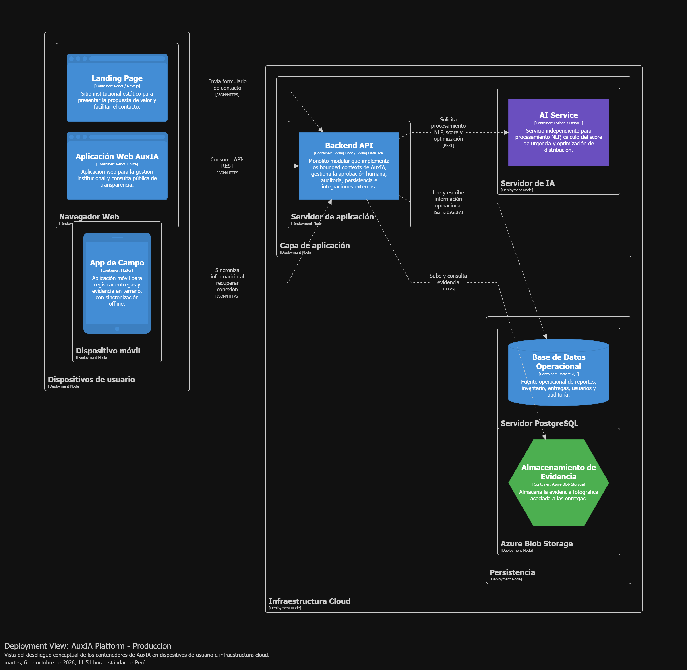
</p>

## 7.2. Solution Implementation

Esta sección registra el avance de cada Sprint en términos de producto y de trabajo colaborativo. Cada Sprint documenta su planificación, su backlog, los commits de desarrollo y de pruebas, la ejecución de lo implementado, la documentación de los servicios, el despliegue y la colaboración del equipo.

## 7.2.1. Sprint 1

El Sprint 1 se desarrolló entre el 26 de octubre y el 7 de noviembre de 2026, que son las fechas del primer y el último commit de los repositorios de código. En ese periodo se implementó y desplegó la primera versión del Backend API, del AI Service, del smart contract `DeliveryRegistry`, de la Landing Page y de la aplicación móvil.

## 7.2.1.1. Sprint Planning 1

El Sprint Planning 1 definió el alcance del primer Sprint a partir del Product Backlog de la sección 3.4. El equipo comprometió las historias de los tres productos que se construyeron primero: la Landing Page, el Backend API (junto con el AI Service y el smart contract `DeliveryRegistry`, que implementan sus mismas historias) y la aplicación móvil. Las historias de la Web App (Centro de Mando y Consulta pública) se dejaron para el Sprint 2.

| Campo | Valor |
|---|---|
| **Sprint #** | Sprint 1 |
| **Sprint Planning Background** | |
| Date | 2026-10-26 |
| Time | Por completar |
| Location | Por completar |
| Prepared By | Castillo Garay, Ainhoa Lucia |
| Attendees (to planning meeting) | Barturen Panez, Iker Gabriel / Castillo Garay, Ainhoa Lucia / Nakamurakare Teruya, Alex Tomio / Trillo Hernandez, Anghel Melanie |
| Sprint 0 Review Summary | No aplica: el Sprint 1 es el primer Sprint del proyecto. El trabajo previo fue la especificación de requisitos, el diseño y la arquitectura de los capítulos I a VI, que dejaron el Product Backlog de 40 historias. |
| Sprint 0 Retrospective Summary | No aplica: el Sprint 1 es el primer Sprint del proyecto, por lo que todavía no hay una retrospectiva previa. |
| **Sprint Goal & User Stories** | |
| Sprint 1 Goal | Entregar la primera versión funcional de la Landing Page, el Backend API (con el AI Service y el smart contract) y la aplicación móvil, de modo que el flujo de reporte de campo, priorización, distribución y entrega verificada en Blockchain funcione de punta a punta sobre servicios desplegados. Métrica de cumplimiento: todas las historias del Sprint cumplen los criterios de aceptación del capítulo III (64 escenarios de aceptación con Cucumber, 87 pruebas del AI Service, 13 del contrato y 31 archivos de pruebas de la app) y los productos quedan publicados (Backend API y AI Service en Azure, contrato en Sepolia y Landing Page en Vercel). |
| Sprint 1 Velocity | 146 Story Points comprometidos para el Sprint, con 395 horas de trabajo estimadas (2 horas por Story Point más las tareas generales). |
| Sum of Story Points | 146 |

Las historias incluidas en el Sprint 1 son las siguientes, en el orden del Product Backlog:

| User Story Id | Título | Story Points | Productos |
|---|---|---|---|
| US-27 | Conocer la propuesta de valor de AuxIA | 2 | Landing Page |
| US-01 | Registrar un reporte de campo en lenguaje natural | 5 | Backend API, App móvil |
| TS-01 | API para el registro y consulta de reportes de campo | 3 | Backend API |
| US-02 | Extraer automáticamente variables clave de un reporte | 8 | AI Service, Backend API |
| US-04 | Calcular el score de urgencia de una zona | 8 | AI Service, Backend API |
| TS-02 | API para el cálculo del score de urgencia | 5 | AI Service, Backend API |
| US-05 | Visualizar la explicación del score de una zona | 3 | Backend API |
| US-06 | Ordenar y filtrar zonas según score de urgencia | 3 | Backend API |
| US-09 | Consultar el inventario disponible | 3 | Backend API |
| US-08 | Registrar ingreso de recursos al inventario | 3 | Backend API |
| TS-03 | API para consulta y actualización de inventario | 3 | Backend API |
| US-11 | Generar una recomendación de distribución | 8 | AI Service, Backend API |
| TS-04 | API para generar la recomendación de distribución | 5 | Backend API |
| US-12 | Aprobar una distribución recomendada | 3 | Backend API |
| US-13 | Modificar una distribución recomendada | 5 | Backend API |
| US-15 | Registrar una entrega realizada con evidencia | 5 | Backend API, App móvil |
| US-16 | Generar un hash verificable de la entrega en Blockchain | 8 | Smart contract, Backend API |
| TS-05 | API para registrar una entrega y su hash en Blockchain | 5 | Backend API |
| US-18 | Excluir datos personales sensibles del registro en Blockchain | 3 | Backend API |
| US-17 | Consultar el estado de verificación de una entrega | 3 | Backend API |
| US-24 | Consultar el estado de atención de una zona | 3 | Backend API, App móvil |
| US-26 | Verificar la validez pública de una entrega mediante su código | 3 | Backend API |
| US-25 | Consultar el historial de entregas realizadas en una zona | 3 | Backend API |
| US-29 | Conocer cómo funciona la trazabilidad de la ayuda | 2 | Landing Page |
| US-03 | Corregir manualmente un reporte estructurado | 3 | Backend API |
| US-07 | Ajustar manualmente la prioridad de una zona | 3 | Backend API |
| US-14 | Justificar el rechazo o modificación de una recomendación | 2 | Backend API |
| US-10 | Recibir alerta de inventario bajo | 3 | Backend API |
| US-19 | Exportar el historial de entregas de una zona o periodo | 5 | Backend API |
| US-20 | Consultar el registro de cambios sobre una zona | 3 | Backend API |
| US-28 | Conocer la magnitud de la problemática atendida | 1 | Landing Page |
| US-30 | Conocer las funcionalidades para autoridades | 2 | Landing Page |
| US-33 | Exportar reportes en formato compatible con SINPAD | 5 | Backend API |
| US-35 | Registrar reportes y entregas sin conexión a internet | 8 | App móvil |
| US-21 | Iniciar sesión con credenciales institucionales | 3 | Backend API, App móvil |
| US-22 | Asignar roles y permisos según responsabilidad | 3 | Backend API, App móvil |
| US-23 | Registrar el cambio de turno entre responsables | 3 | Backend API |

## 7.2.1.2. Sprint Backlog 1

El objetivo del Sprint 1 es dejar funcionando la primera versión de la Landing Page, el Backend API (con el AI Service y el smart contract) y la aplicación móvil. El tablero del Sprint se gestionó en Trello, con las mismas columnas del Product Backlog, y las historias comprometidas se descompusieron en los tasks de la tabla. Todos los tasks terminaron en `Done` antes del cierre del Sprint, el 7 de noviembre de 2026.

<!-- Pendiente: agregar aquí la captura del Board del Sprint 1 en Trello y su enlace público. -->

**Sprint #:** Sprint 1

| User Story Id | User Story Title | Task Id | Task Title | Description | Estimation (Hours) | Assigned To | Status |
|---|---|---|---|---|---|---|---|
| US-27 | Conocer la propuesta de valor de AuxIA | T-01 | Construir el hero y la propuesta de valor | Desarrolla el encabezado y la sección principal responsive que explica qué es AuxIA y qué problema resuelve, según el mock-up L_01 del capítulo VI. | 4 | Por asignar | Done |
| US-01 | Registrar un reporte de campo en lenguaje natural | T-02 | Modelar el reporte de campo con zona pendiente | Crea el aggregate FieldReport, que puede quedar pendiente de asignar a una zona, y su persistencia con JPA y las migraciones de Flyway. | 4 | Por asignar | Done |
|  |  | T-03 | Exponer el registro de reportes de campo | Agrega los endpoints para registrar un reporte de una zona conocida o de una emergencia, con validaciones y errores RFC 9457. | 3 | Por asignar | Done |
|  |  | T-04 | Construir el SOS de un toque y el detalle de emergencia | Implementa en la app las pantallas A_03 y A_04: botón SOS con GPS, personas afectadas, estado del acceso, foto y audio de 5 segundos. | 3 | Por asignar | Done |
| TS-01 | API para el registro y consulta de reportes de campo | T-05 | Exponer la consulta de reportes de campo | Publica los endpoints GET de reportes estructurados por zona y por emergencia, y el endpoint público de SOS ciudadano (POST y GET /public/field-reports). | 6 | Por asignar | Done |
| US-02 | Extraer automáticamente variables clave de un reporte | T-06 | Extraer variables con el extractor rules-v1 | Implementa en el AI Service la lectura de daños, familias, personas, grupos vulnerables y necesidades de un reporte en español, en POST /field-reports/structure. | 8 | Por asignar | Done |
|  |  | T-07 | Estructurar el reporte al registrarlo | Implementa la Anti-Corruption Layer hacia el AI Service y guarda los datos estructurados en el reporte mediante eventos de dominio. | 8 | Por asignar | Done |
| US-04 | Calcular el score de urgencia de una zona | T-08 | Calcular el score con reglas ponderadas | Implementa en el AI Service el score rules-v1: suma ponderada de nivel de daño, población afectada, población vulnerable y necesidades. | 8 | Por asignar | Done |
|  |  | T-09 | Guardar y recalcular el score de cada zona | Guarda el UrgencyScore con su nivel de prioridad y versión del modelo, y lo recalcula al registrar una zona o un reporte. | 8 | Por asignar | Done |
| TS-02 | API para el cálculo del score de urgencia | T-10 | Exponer el endpoint del score en el AI Service | Publica POST /urgency-scores con su esquema de entrada y salida, autenticado con X-API-Key. | 5 | Por asignar | Done |
|  |  | T-11 | Exponer el score y el ranking de zonas | Agrega los endpoints de score por zona y de ranking de la emergencia en el Backend API. | 5 | Por asignar | Done |
| US-05 | Visualizar la explicación del score de una zona | T-12 | Devolver las variables que explican el score | Incluye en la respuesta los topFeatures con los puntos que aportó cada variable y exporta el reporte de la zona en PDF (GET /zones/{id}/report). | 6 | Por asignar | Done |
| US-06 | Ordenar y filtrar zonas según score de urgencia | T-13 | Ordenar y filtrar el ranking de zonas | Permite listar las zonas por score y filtrar por rango de score o por necesidad, con un orden estable de las necesidades. | 6 | Por asignar | Done |
| US-09 | Consultar el inventario disponible | T-14 | Consultar el inventario disponible y reservado | Agrega la consulta del inventario por organización con el stock disponible y reservado de cada recurso y el filtro por categoría. | 6 | Por asignar | Done |
| US-08 | Registrar ingreso de recursos al inventario | T-15 | Registrar y reponer recursos | Implementa el aggregate Inventory con su persistencia y los casos de uso para registrar un recurso y reponerlo. | 6 | Por asignar | Done |
| TS-03 | API para consulta y actualización de inventario | T-16 | Exponer los endpoints del inventario | Publica los endpoints para crear el inventario, consultarlo, registrar recursos, reponer y ajustar el stock con un motivo. | 6 | Por asignar | Done |
| US-11 | Generar una recomendación de distribución | T-17 | Recomendar la distribución con reglas proporcionales | Implementa en el AI Service el reparto rules-v1 de cada recurso entre las zonas priorizadas, sin exceder el inventario, con su cobertura y justificación. | 8 | Por asignar | Done |
|  |  | T-18 | Generar los planes de distribución y reservar el stock | Implementa el aggregate DistributionPlan, la integración con el AI Service y la reserva del stock en la misma transacción. | 8 | Por asignar | Done |
| TS-04 | API para generar la recomendación de distribución | T-19 | Exponer la recomendación de distribución | Publica POST /distribution-recommendations en el AI Service y POST /emergencies/{id}/distribution-plans en el Backend API, con las zonas sin atender o atendidas parcialmente. | 10 | Por asignar | Done |
| US-12 | Aprobar una distribución recomendada | T-20 | Aprobar el plan y asignar la brigada más cercana | Implementa la aprobación por una autoridad y la sugerencia de la brigada disponible más cercana a la zona (endpoint del AI Service y asignación automática). | 6 | Por asignar | Done |
| US-13 | Modificar una distribución recomendada | T-21 | Modificar las cantidades de un plan | Permite cambiar las líneas de la reserva activa antes de aprobar el plan y guarda quién lo cambió, cuándo y por qué. | 10 | Por asignar | Done |
| US-15 | Registrar una entrega realizada con evidencia | T-22 | Registrar la entrega con su evidencia | Implementa el aggregate Delivery, el guardado de la foto en Azure Blob Storage, el consumo del stock y el cierre del plan. | 5 | Por asignar | Done |
|  |  | T-23 | Construir la verificación de entrega en la app | Implementa la pantalla A_08: lectura del QR o código manual, firma, registro en cola local y seguimiento del anclaje. | 5 | Por asignar | Done |
| US-16 | Generar un hash verificable de la entrega en Blockchain | T-24 | Programar el contrato DeliveryRegistry | Escribe en Solidity el contrato que registra el hash SHA-256 de cada entrega bajo su UUID, con sus 13 pruebas en Hardhat. | 6 | Por asignar | Done |
|  |  | T-25 | Desplegar y verificar el contrato en Sepolia | Configura la red Sepolia, despliega el contrato y verifica su código en Etherscan. | 5 | Por asignar | Done |
|  |  | T-26 | Anclar el hash de cada entrega | Calcula el hash SHA-256 del registro canónico y lo envía al contrato con Web3j, con reintentos de los anclajes pendientes. | 5 | Por asignar | Done |
| TS-05 | API para registrar una entrega y su hash en Blockchain | T-27 | Exponer el endpoint de registro de entregas | Publica el endpoint que registra una entrega, genera su hash y lo ancla, y responde con el estado del anclaje. | 10 | Por asignar | Done |
| US-18 | Excluir datos personales sensibles del registro en Blockchain | T-28 | Excluir los datos personales del registro canónico | Define el CanonicalDeliveryRecord, que solo incluye identificadores, recursos y hashes, y nunca datos personales de la población. | 6 | Por asignar | Done |
| US-17 | Consultar el estado de verificación de una entrega | T-29 | Comparar el hash de la entrega con la cadena | Agrega la consulta que compara el hash guardado con el registrado en Sepolia y responde su estado de verificación. | 6 | Por asignar | Done |
| US-24 | Consultar el estado de atención de una zona | T-30 | Publicar el estado de atención de cada zona | Crea el contexto Citizen Transparency, con modelos de lectura proyectados desde eventos y endpoints públicos con caché de 60 segundos. | 3 | Por asignar | Done |
|  |  | T-31 | Construir la pantalla Mis reportes | Implementa la pantalla A_05 con el estado de cada SOS, la etapa del reporte y el seguimiento periódico de su avance. | 3 | Por asignar | Done |
| US-26 | Verificar la validez pública de una entrega mediante su código | T-32 | Verificar una entrega por su código público | Agrega el endpoint público que valida una entrega a partir de su código, sin exponer datos sensibles. | 6 | Por asignar | Done |
| US-25 | Consultar el historial de entregas realizadas en una zona | T-33 | Consultar el historial público de entregas | Agrega el endpoint público con el historial de entregas de una zona y su estado de verificación. | 6 | Por asignar | Done |
| US-29 | Conocer cómo funciona la trazabilidad de la ayuda | T-34 | Construir la sección del flujo del proceso | Desarrolla la sección que explica cómo la trazabilidad con Blockchain verifica cada entrega, según el mock-up L_03. | 4 | Por asignar | Done |
| US-03 | Corregir manualmente un reporte estructurado | T-35 | Corregir los indicadores de un reporte | Permite corregir o completar los indicadores con un motivo, conserva los valores originales del NLP y usa los corregidos para el score. | 6 | Por asignar | Done |
| US-07 | Ajustar manualmente la prioridad de una zona | T-36 | Priorizar una zona manualmente | Agrega la prioridad manual de una zona y la guarda en su historial de decisiones. | 6 | Por asignar | Done |
| US-14 | Justificar el rechazo o modificación de una recomendación | T-37 | Registrar la justificación de una decisión | Exige y guarda el motivo al rechazar un plan o modificar sus cantidades. | 4 | Por asignar | Done |
| US-10 | Recibir alerta de inventario bajo | T-38 | Generar alertas de stock bajo | Evalúa cada cambio de stock y abre una alerta cuando un recurso queda bajo su mínimo; la resuelve al reponerlo y la envía por correo a los administradores. | 6 | Por asignar | Done |
| US-19 | Exportar el historial de entregas de una zona o periodo | T-39 | Exportar las entregas en PDF | Genera el PDF de auditoría con las entregas de una zona o periodo, sus recursos, hash, transacción y estado de verificación. | 10 | Por asignar | Done |
| US-20 | Consultar el registro de cambios sobre una zona | T-40 | Guardar el historial de decisiones de cada zona | Registra cada decisión de una autoridad en un historial de solo agregación y lo expone en GET /zones/{id}/history. | 6 | Por asignar | Done |
| US-28 | Conocer la magnitud de la problemática atendida | T-41 | Construir la sección de indicadores de impacto | Desarrolla la sección con las cifras de la magnitud del problema, según el mock-up L_02. | 2 | Por asignar | Done |
| US-30 | Conocer las funcionalidades para autoridades | T-42 | Construir la sección de módulos para autoridades | Desarrolla la sección de módulos clave y de funcionalidades para las autoridades, según el mock-up L_02. | 4 | Por asignar | Done |
| US-33 | Exportar reportes en formato compatible con SINPAD | T-43 | Exportar reportes de campo en formato SINPAD | Genera el archivo de reportes de campo con las filas y validaciones del formato de SINPAD. | 5 | Por asignar | Done |
|  |  | T-44 | Integrar el envío a SINPAD con un simulador | Agrega el simulador de SINPAD y el envío por HTTP mediante una Anti-Corruption Layer, que devuelve el número de registro. | 5 | Por asignar | Done |
| US-35 | Registrar reportes y entregas sin conexión a internet | T-45 | Guardar los datos en una base local cifrada | Implementa la base SQLCipher de la app y el perfil local guardado en el almacenamiento seguro del teléfono. | 6 | Por asignar | Done |
|  |  | T-46 | Construir la bandeja de salida y la sincronización | Implementa el outbox y el motor que envía los reportes y entregas al recuperar la conexión, con reintentos tras un límite de tasa. | 5 | Por asignar | Done |
|  |  | T-47 | Mostrar la conectividad y administrar los mapas sin conexión | Muestra el estado de la red y de la sincronización, descarga regiones del mapa y completa la pantalla Red y almacenamiento (A_06). | 5 | Por asignar | Done |
| US-21 | Iniciar sesión con credenciales institucionales | T-48 | Autenticar con JWT y bloquear tras intentos fallidos | Implementa POST /auth/sign-in con tokens JWT y bloqueo de la cuenta tras cinco intentos fallidos seguidos. | 3 | Por asignar | Done |
|  |  | T-49 | Construir el inicio de sesión del brigadista | Implementa la pantalla A_10 y la sesión del brigadista, y la lectura de sus misiones desde GET /me/missions. | 3 | Por asignar | Done |
| US-22 | Asignar roles y permisos según responsabilidad | T-50 | Aplicar roles y permisos a la API | Protege cada endpoint con el rol del usuario y permite a un administrador de organización gestionar los usuarios de su organización. | 3 | Por asignar | Done |
|  |  | T-51 | Registrar brigadistas con aprobación | Implementa el registro de brigadistas desde la app (A_02) y su aprobación o rechazo por un administrador de la organización. | 3 | Por asignar | Done |
| US-23 | Registrar el cambio de turno entre responsables | T-52 | Registrar el cambio de turno | Agrega el traspaso de las zonas en curso al siguiente responsable y lo guarda en el historial de la zona. | 6 | Por asignar | Done |
| — | Tareas generales (sin User Story) | | | | | | |
|  |  | T-53 | Configurar el proyecto del Backend API | Crea el proyecto Spring Boot 4.1.2 con Maven, perfiles dev y prod, actuator, documentación OpenAPI con Swagger UI, mensajes en en_US y es_419 y manejo de errores RFC 9457. | 8 | Por asignar | Done |
|  |  | T-54 | Diseñar la base de datos con Flyway | Define los cinco schemas de los bounded contexts en PostgreSQL y las migraciones versionadas. | 6 | Por asignar | Done |
|  |  | T-55 | Gestionar brigadas y misiones | Implementa el aggregate Brigade con sus miembros, disponibilidad y asignaciones, y el endpoint GET /me/missions para la app. | 6 | Por asignar | Done |
|  |  | T-56 | Enviar notificaciones por correo | Envía por SMTP, en HTML con la identidad de AuxIA, los avisos de stock bajo, plan aprobado y entrega certificada. | 5 | Por asignar | Done |
|  |  | T-57 | Permitir los orígenes de la Web App (CORS) | Configura CORS para que la Web App pueda llamar a la API desde el navegador. | 1 | Por asignar | Done |
|  |  | T-58 | Reducir el consumo de la base cuando la API está inactiva | Cierra las conexiones ociosas y detiene el reintento de anclajes cuando no hay pendientes, para que Neon suspenda la base. | 2 | Por asignar | Done |
|  |  | T-59 | Escribir las pruebas del Backend API | Escribe 95 clases de pruebas unitarias y de integración (JUnit y Testcontainers) y 31 archivos .feature con 64 escenarios de aceptación (Cucumber). | 16 | Por asignar | Done |
|  |  | T-60 | Desplegar el Backend API en Azure | Crea la base en Neon, la cuenta de Azure Blob Storage y el App Service, registra las variables de entorno y publica las versiones 0.1.0 y 0.1.1. | 6 | Por asignar | Done |
|  |  | T-61 | Configurar el proyecto del AI Service | Crea el proyecto FastAPI con dependencias fijas, esquemas comunes, manejo de errores, validación de X-API-Key y el endpoint /health. | 4 | Por asignar | Done |
|  |  | T-62 | Escribir las pruebas del AI Service | Escribe 87 pruebas con pytest en 12 archivos para los extractores, el score, la distribución y la sugerencia de brigada. | 6 | Por asignar | Done |
|  |  | T-63 | Desplegar el AI Service en Azure | Crea el App Service de Python con el comando de inicio y la variable AI_SERVICE_API_KEY. | 2 | Por asignar | Done |
|  |  | T-64 | Configurar el proyecto del smart contract | Crea el proyecto Hardhat 3 con OpenZeppelin y documenta el despliegue. | 3 | Por asignar | Done |
|  |  | T-65 | Configurar el proyecto de la app móvil | Crea el proyecto Flutter con el sistema de diseño, el cliente de la API, la localización es/en, la navegación por rol y el flujo de CI en GitHub Actions. | 8 | Por asignar | Done |
|  |  | T-66 | Construir el registro y la selección de rol | Implementa la pantalla A_01 y la credencial de brigadista pendiente de aprobación. | 4 | Por asignar | Done |
|  |  | T-67 | Escribir las pruebas de la app móvil | Escribe 31 archivos de pruebas de dominio, gateways, base local, sincronización, cubits, pantallas y accesibilidad. | 10 | Por asignar | Done |
|  |  | T-68 | Corregir los problemas de la prueba de extremo a extremo | Ajusta el mapa de misiones, el estado de la barra de sincronización y el seguimiento del SOS tras una entrega. | 4 | Por asignar | Done |
|  |  | T-69 | Construir la landing page responsive | Desarrolla el sitio estático en HTML, CSS y JavaScript con la navegación y el pie de página, según los mock-ups del capítulo VI. | 6 | Por asignar | Done |
|  |  | T-70 | Alinear la landing con los mock-ups aprobados | Restaura la navegación, los textos y las proporciones aprobados, corrige el estado activo del menú y el logotipo. | 4 | Por asignar | Done |
|  |  | T-71 | Publicar la landing en Vercel | Conecta el proyecto site con GitHub, publica cada push a develop y prepara la versión 0.1.0. | 2 | Por asignar | Done |

La estimación de horas de cada historia es el producto de sus Story Points por 2 horas, repartido entre sus tasks. Las tareas generales no dependen de una historia en particular y se estimaron por separado.

## 7.2.1.3. Development Evidence for Sprint Review

Durante el Sprint 1 se mergearon 29 pull requests en el Backend API, 18 en la aplicación móvil, 8 en el AI Service, 4 en el smart contract y 4 en la Landing Page, incluidos los de las ramas de release. El avance de cada producto fue el siguiente:

- **Backend API:** los cinco bounded contexts del capítulo V. Emergency Management registra emergencias, zonas y reportes de campo, calcula el score de urgencia con el AI Service y gestiona los planes de distribución hasta su aprobación. Resource Management lleva el inventario, las alertas de stock bajo, las brigadas y sus misiones. Traceability registra cada entrega con evidencia, calcula su hash y lo ancla en Sepolia. Identity Access maneja organizaciones, usuarios, roles, el inicio de sesión con JWT y el registro de brigadistas desde la app. Citizen Transparency publica el estado de atención de cada zona. Además se implementaron la exportación a SINPAD (con un simulador del servicio), las notificaciones por correo y la recepción del SOS ciudadano con foto y audio.
- **AI Service:** los cuatro endpoints del contrato con el backend: estructuración de reportes de campo, score de urgencia con sus variables explicativas, recomendación de distribución que no excede el inventario y sugerencia de la brigada disponible más cercana.
- **Smart contract:** `DeliveryRegistry`, con registro y lectura del hash de cada entrega, desplegado y verificado en Sepolia.
- **Landing Page:** la página institucional responsive, alineada con los mock-ups aprobados del capítulo VI.
- **Aplicación móvil:** los dos roles de la App de Campo. El ciudadano envía un SOS de un toque aun sin señal y sigue el estado de sus reportes. El brigadista inicia sesión, ve las misiones de su brigada y verifica una entrega con evidencia anclada en Blockchain. Todo se guarda primero en una base local cifrada y se sincroniza al recuperar la conexión.

La tabla lista los commits de implementación de cada repositorio. Los commits de pruebas están en la sección 7.2.1.4. La columna Commit Message Body muestra la primera oración del cuerpo de cada commit; el texto completo está en el historial de cada repositorio.

| Repository | Branch | Commit Id | Commit Message | Commit Message Body | Committed on (Date) |
|---|---|---|---|---|---|
| Waqta-Labs/auxia-backend | develop | 23517e5 | Initial commit | — | 26/10/2026 |
| Waqta-Labs/auxia-backend | feat/create-project | 6afbaf4 | build: bootstrap spring boot 4.1.2 project with maven wrapper | Adds the Spring Boot 4.1.2 project for Java 21 with Web, Validation, Data JPA, PostgreSQL, Actuator, Security and springdoc. | 26/10/2026 |
| Waqta-Labs/auxia-backend | feat/create-project | 6a39e5f | feat: add dev and prod profiles with actuator health checks | Adds dev as the default profile and a prod profile, and exposes the actuator health and info endpoints. | 26/10/2026 |
| Waqta-Labs/auxia-backend | feat/create-project | f54597e | feat: add open security configuration until identity access | Adds a stateless security filter chain that permits every request, so Swagger UI and the actuator work while there are no users yet. | 26/10/2026 |
| Waqta-Labs/auxia-backend | feat/create-project | a14033e | feat: add openapi documentation with swagger ui | Adds the OpenAPI metadata of the AuxIA Backend API, with the project version, and serves Swagger UI at /swagger-ui.html so every endpoint can be tested from the browser. | 26/10/2026 |
| Waqta-Labs/auxia-backend | feat/create-project | 36e85fb | feat: add i18n message source for en_US and es_419 | Adds the messages bundles in English and Latin American Spanish and a locale resolver that reads Accept-Language, answering any Spanish variant in es_419 and everything else in en_US, as the course requires for the web services. | 26/10/2026 |
| Waqta-Labs/auxia-backend | feat/create-project | d3df216 | feat: add global error handling with problem details | Adds a controller advice that answers every error as an RFC 9457 problem detail with localized title and detail. | 26/10/2026 |
| Waqta-Labs/auxia-backend | feat/create-project | 9104549 | docs: add readme with setup and run instructions | Documents the stack and Spring Boot version, the database environment variables and the .env file, the dev and prod profiles, how to run and test the API, and the language and error conventions. | 26/10/2026 |
| Waqta-Labs/auxia-backend | feature/emergency-registration | ceabcac | feat: add emergency aggregate | Emergency groups the zones affected by the same disaster. | 26/10/2026 |
| Waqta-Labs/auxia-backend | feature/emergency-registration | 1fa62f0 | feat: add zone aggregate | Zone keeps the impact and attention status of an area affected by an emergency: name, optional geolocation, population impact and damage level. | 26/10/2026 |
| Waqta-Labs/auxia-backend | feature/emergency-registration | b505eab | feat: add field report aggregate with pending zone assignment | US-01 asks to mark a report without an identifiable zone as pending zone assignment, so FieldReport becomes its own aggregate: it always belongs to an emergency and references its zone by identifier once it is known. | 26/10/2026 |
| Waqta-Labs/auxia-backend | feature/emergency-registration | 7767fb4 | build: add flyway with a baseline of the current schema | Flyway now owns the schema of the five bounded contexts and Hibernate only validates it. | 26/10/2026 |
| Waqta-Labs/auxia-backend | feature/emergency-registration | a3c7313 | feat: add population column to zones | V2 adds emergency_management.zones.population, the total number of people living in the zone (PopulationImpact.population). | 26/10/2026 |
| Waqta-Labs/auxia-backend | feature/emergency-registration | 4dc4804 | feat: allow field reports without a zone | V3 lets a field report exist without a zone, so it can stay pending zone assignment (US-01, scenario 2). | 26/10/2026 |
| Waqta-Labs/auxia-backend | feature/emergency-registration | a36771f | feat: persist emergencies, zones and field reports with jpa | JpaEmergencyRepository, JpaZoneRepository and JpaFieldReportRepository implement the domain repositories over the emergency_management schema. | 26/10/2026 |
| Waqta-Labs/auxia-backend | feature/emergency-registration | 4ecef70 | feat: add emergency endpoints | EmergencyController exposes the emergency use cases of chapter V: - POST /api/v1/emergencies registers an emergency (201 with Location). | 26/10/2026 |
| Waqta-Labs/auxia-backend | feature/emergency-registration | 1b6f790 | feat: add zone endpoints | ZoneController exposes the zone use cases of chapter V: - POST /api/v1/emergencies/{emergencyId}/zones registers a zone (201). | 26/10/2026 |
| Waqta-Labs/auxia-backend | feature/emergency-registration | 003c3e5 | feat: add field report endpoints | FieldReportController exposes the field reports of US-01 and TS-01: - POST /api/v1/zones/{zoneId}/field-reports registers a report of a known zone (201). | 26/10/2026 |
| Waqta-Labs/auxia-backend | feature/emergency-registration | 8dd4e0e | docs: document endpoints and database migrations in readme | Describe the Emergency Management package layout, the twelve endpoints of phase 1 and how the zone of a field report is identified. | 26/10/2026 |
| Waqta-Labs/auxia-backend | feature/ai-service-integration | cf73fa0 | feat: store the structured data of field reports | Adds StructuredFieldData with the indicators extracted by the NLP and the variables that could not be identified, and FieldReport.markProcessed, which accepts it only once (US-02). | 26/10/2026 |
| Waqta-Labs/auxia-backend | feature/ai-service-integration | 24cd6d6 | feat: store the urgency score of zones | Adds UrgencyScore with its top features, priority level and model version, and the UrgencyScoringService domain interface. | 26/10/2026 |
| Waqta-Labs/auxia-backend | feature/ai-service-integration | db3dd60 | feat: add ai service gateways for structuring and scoring | Adds RestFieldReportStructuringGateway and RestUrgencyScoringGateway, the Anti-Corruption Layer to the AI Service (TS-C04). | 26/10/2026 |
| Waqta-Labs/auxia-backend | feature/ai-service-integration | 6831359 | feat: structure field reports and recalculate urgency scores automatically | Registering a zone or a field report, structuring a report and assigning it to a zone now publish domain events. | 26/10/2026 |
| Waqta-Labs/auxia-backend | feature/ai-service-integration | 8f2f990 | feat: add urgency score, zone ranking and structuring endpoints | GET /api/v1/emergencies/{id}/zones now ranks the zones by urgency score and filters them by score range or need (US-06). | 26/10/2026 |
| Waqta-Labs/auxia-backend | feature/ai-service-integration | 0c6dbda | docs: document the ai service integration in readme | Adds the AI_SERVICE_URL and AI_SERVICE_API_KEY variables, the new endpoints, how the urgency score is kept up to date, the most severe data rule, the score not available without population and what happens while the AI Service is down. | 26/10/2026 |
| Waqta-Labs/auxia-backend | feature/ai-service-integration | c110b6a | fix: list the needs of a ranked zone in a stable order | ZoneRankingEntry copied the needs with Set.copyOf, so the ranking listed them in a different order on each call. | 26/10/2026 |
| Waqta-Labs/auxia-backend | feature/inventory-management | e765232 | feat: add inventory aggregate | Adds the Inventory aggregate of Resource Management with its StockItem and Reservation entities. | 26/10/2026 |
| Waqta-Labs/auxia-backend | feature/inventory-management | 6c98fd5 | feat: persist inventories with jpa | Maps Inventory to the inventories table of the resource_management schema, with stock_items, reservations and reservation_lines as its children. | 26/10/2026 |
| Waqta-Labs/auxia-backend | feature/inventory-management | 1baa7b5 | feat: add inventory use cases and context facade | Adds the command handlers to create an inventory, register a resource, restock it (US-08), adjust it with a reason (TS-03) and reserve or release the resources of a distribution plan, and InventoryQueryService (US-09). | 26/10/2026 |
| Waqta-Labs/auxia-backend | feature/inventory-management | 104ced1 | feat: add inventory endpoints | Adds InventoryController: create the inventory of an organization, get it by id or by organization with the available and reserved stock of each resource and an optional category filter (US-09, TS-03), register a resource, restock it (US-08) and adjust it with a reason, which answers 409 when it removes more than the available quantity. | 26/10/2026 |
| Waqta-Labs/auxia-backend | feature/inventory-management | dde2fb0 | docs: document the inventory in readme | Adds Resource Management to the structure and documents the inventory endpoints, the available and reserved quantities, the rules that answer 400 and 409, and the context facade for the other bounded contexts. | 26/10/2026 |
| Waqta-Labs/auxia-backend | feature/ai-service-integration | 432f6dc | feat: update the population impact of a zone | Adds PATCH /api/v1/zones/{id}/population-impact: the counts sent replace the current ones and the others keep their value, so a zone registered without population can get one. | 26/10/2026 |
| Waqta-Labs/auxia-backend | feature/ai-service-integration | 3003236 | feat: export the report of a zone as pdf | Adds GET /api/v1/zones/{id}/report, a PDF with the emergency, the population impact of the zone, its urgency score with the points each variable added and the model version, and its field reports (US-05, scenario 2). | 26/10/2026 |
| Waqta-Labs/auxia-backend | feature/ai-service-integration | c45bce9 | docs: document the population update and the zone report in readme | Adds PATCH /api/v1/zones/{id}/population-impact and GET /api/v1/zones/{id}/report to the endpoints, and explains how a zone without population gets its score and what the PDF includes. | 26/10/2026 |
| Waqta-Labs/auxia-backend | feature/brigade-management | fc2e8d4 | feat: add brigade aggregate | Adds the Brigade aggregate of Resource Management (Staff aggregate of chapter IV) with its StaffMember and BrigadeAssignment entities. | 26/10/2026 |
| Waqta-Labs/auxia-backend | feature/brigade-management | 14c3764 | feat: persist brigades with jpa | Maps Brigade to the brigades table of the resource_management schema, with staff_members and brigade_assignments as its children. | 26/10/2026 |
| Waqta-Labs/auxia-backend | feature/brigade-management | d44e9f0 | feat: add brigade use cases | Adds the command handlers to create a brigade with a unique name in its organization, add and remove members and put it on or off duty, and BrigadeQueryService, which lists the brigades of an organization by status. | 26/10/2026 |
| Waqta-Labs/auxia-backend | feature/brigade-management | d1af234 | feat: add brigade endpoints | Adds BrigadeController with the endpoints of section 5.2.2: create a brigade, list the brigades of an organization by status, get one with its members and its assignment in progress, add and remove members, and change its availability. | 26/10/2026 |
| Waqta-Labs/auxia-backend | feature/brigade-management | d69f922 | docs: document the brigades in readme | Adds the brigade endpoints and the rules of availability, leaders and assignments. | 26/10/2026 |
| Waqta-Labs/auxia-backend | feature/identity-access | 88fac3f | feat: add organization and user account aggregates | Adds the domain of Identity Access: Organization, which can be suspended and reactivated, and UserAccount, which belongs to one organization, authenticates with PasswordHashingService, locks after five failed sign-ins in a row and only answers true or false (US-21). | 26/10/2026 |
| Waqta-Labs/auxia-backend | feature/identity-access | 230c288 | feat: persist organizations and user accounts with jpa | Maps Organization and UserAccount to the organizations and user_accounts tables of the identity_access schema, with the RUC as CHAR(11) and the email in lowercase. | 26/10/2026 |
| Waqta-Labs/auxia-backend | feature/identity-access | 2fc086f | feat: issue access tokens and hash passwords | Adds JJWT 0.13.0 and the token infrastructure of Identity Access: JwtTokenIssuer signs a token with the user, its organization and its role, JwtTokenVerifier checks its signature, issuer and expiration, and JwtSigningKeyProvider names each key with a kid so a new key can be added without invalidating the tokens already issued (R-05). | 26/10/2026 |
| Waqta-Labs/auxia-backend | feature/identity-access | 4da1ac2 | feat: add identity access use cases and context facade | Adds the command handlers to sign in, register an organization with its first administrator, suspend or reactivate it, register users and change their role or status, plus the query services and CheckAccessQueryHandler. | 26/10/2026 |
| Waqta-Labs/auxia-backend | feature/identity-access | afc7dd8 | feat: add authentication, organization and user endpoints | Adds POST /api/v1/auth/sign-in (US-21), the organization endpoints, where registering and suspending need the X-Platform-Key of the platform operator, and the user endpoints for an ORGANIZATION_ADMIN of the same organization (US-22), plus GET /api/v1/users/me. | 27/10/2026 |
| Waqta-Labs/auxia-backend | feature/identity-access | 435e186 | feat: secure the api with jwt and roles | Every endpoint needs a bearer token except the sign-in, the platform operator endpoints of organizations, the API docs and the health check. | 27/10/2026 |
| Waqta-Labs/auxia-backend | feature/identity-access | 8cd7a65 | fix: apply role changes and suspensions to issued tokens | The JWT filter trusted the role in the token, so a disabled user, a user of a suspended organization or a user whose role changed kept the old access until the token expired. | 27/10/2026 |
| Waqta-Labs/auxia-backend | feature/identity-access | 1a00139 | docs: document identity access, roles and api security in readme | Adds the Identity Access endpoints, the role of each action, the new AUTH_JWT_SECRET and PLATFORM_ADMIN_KEY variables, how to use a token in Swagger UI and how the tests sign in. | 27/10/2026 |
| Waqta-Labs/auxia-backend | feature/pending-fixes | 71c20ab | fix: show health details only to signed-in users | With the dev profile, the default one, /actuator/health showed every component to anyone, including the database and the disk with its path on the server. | 27/10/2026 |
| Waqta-Labs/auxia-backend | feature/pending-fixes | 854dcbf | build: load mockito as a startup agent in tests | Mockito attached its agent at runtime, which the JDK already warns about and will block in a future release. | 27/10/2026 |
| Waqta-Labs/auxia-backend | feature/pending-fixes | af4aaf6 | docs: document the health details of the dev profile | — | 27/10/2026 |
| Waqta-Labs/auxia-backend | feature/pending-fixes | 9de3aa8 | chore: keep swagger ui on in every profile | SpringDoc warned on each start that Swagger UI and /v3/api-docs were on by default, also in prod. | 27/10/2026 |
| Waqta-Labs/auxia-backend | feature/pending-fixes | 736de78 | docs: note that swagger ui stays on in prod | — | 27/10/2026 |
| Waqta-Labs/auxia-backend | feature/distribution-plans | 84ebf2f | feat: change the lines of an active reservation | A distribution plan holds one reservation, which the database keeps unique per plan. | 28/10/2026 |
| Waqta-Labs/auxia-backend | feature/distribution-plans | 6148873 | feat: add the distribution plan aggregate | DistributionPlan is proposed for one zone from a recommendation, with its coverage, justification and model version. | 28/10/2026 |
| Waqta-Labs/auxia-backend | feature/distribution-plans | 554cdcf | feat: persist distribution plans with jpa | V4 adds to distribution_plans the organization whose inventory the plan uses, its coverage, and who changed its quantities, when and why. | 28/10/2026 |
| Waqta-Labs/auxia-backend | feature/distribution-plans | 55b197d | feat: recommend distributions through the ai service | RestDistributionOptimizationGateway implements DistributionOptimizationService against POST /api/v1/distribution-recommendations: it sends the prioritized zones and the available inventory, and translates each allocation with its coverage, the justification and the model version. | 28/10/2026 |
| Waqta-Labs/auxia-backend | feature/distribution-plans | 7268951 | feat: add distribution plan use cases | GenerateDistributionRecommendationCommandHandler asks one recommendation across every zone of the emergency with an urgency score and identified needs, proposes a plan for each zone that receives resources and reserves its stock in the same transaction (US-11). | 28/10/2026 |
| Waqta-Labs/auxia-backend | feature/distribution-plans | cee01b2 | feat: add distribution plan endpoints | POST /api/v1/emergencies/{id}/distribution-plans recommends a distribution among the prioritized zones and answers with the proposed plans, the zones left partially or totally unattended and the zones left out (US-11). | 28/10/2026 |
| Waqta-Labs/auxia-backend | feature/distribution-plans | 65c18ed | docs: document the distribution plans in readme | — | 28/10/2026 |
| Waqta-Labs/auxia-backend | feature/distribution-plans | c59920f | feat: send what approved plans already give each zone | A zone with approved or executed plans can get another plan while it still has needs. | 28/10/2026 |
| Waqta-Labs/auxia-backend | feature/distribution-plans | 1c96862 | docs: document how approved plans count in a new recommendation | — | 28/10/2026 |
| Waqta-Labs/auxia-backend | feature/delivery-traceability | 8196f34 | refactor: share the ai service client between bounded contexts | — | 28/10/2026 |
| Waqta-Labs/auxia-backend | feature/delivery-traceability | 7e90879 | feat: assign the closest available brigade to approved plans | — | 28/10/2026 |
| Waqta-Labs/auxia-backend | feature/delivery-traceability | 2091a54 | feat: register deliveries with evidence and anchor their hash on the blockchain | — | 28/10/2026 |
| Waqta-Labs/auxia-backend | feature/delivery-traceability | bf76502 | feat: consume the stock and close the plan of a registered delivery | — | 28/10/2026 |
| Waqta-Labs/auxia-backend | feature/delivery-traceability | f1ef1f3 | fix: silence the content-length warning of the azure http client | — | 28/10/2026 |
| Waqta-Labs/auxia-backend | feature/citizen-transparency | 75efb7f | feat: publish the events that the public view projects | Emergency Management now announces new emergencies and calculated scores, and ZoneRegistered carries its emergency and name. | 30/10/2026 |
| Waqta-Labs/auxia-backend | feature/citizen-transparency | 6818296 | feat: show citizens the stage of attention of each zone | Adds Citizen Transparency: read models of each emergency and zone, projected from the events of Emergency Management and Traceability, and four public endpoints cached for 60 seconds with the stage, the delivery history and the verification link (US-24 to US-26). | 30/10/2026 |
| Waqta-Labs/auxia-backend | feature/manual-corrections | 6915994 | feat: let authorities correct reports and prioritize zones by hand | An authority can correct or complete the indicators of a structured report with a reason; the corrected values feed the score while the values of the NLP are kept (US-03). | 30/10/2026 |
| Waqta-Labs/auxia-backend | feature/stock-alerts | 039758c | feat: raise an alert when a resource runs low | Every change of stock evaluates, after its commit, the resources of the inventory: one below its minimum stock gets an open alert, written to the log through StockAlertNotifier, and the alert is resolved when the resource is restocked above it (US-10). | 30/10/2026 |
| Waqta-Labs/auxia-backend | feature/zone-history-and-shifts | e031dc1 | feat: keep the history of each zone and hand over shifts | Every decision of an authority on a zone (registration, plan modification, approval or rejection, manual priority, report correction) is added to an append-only history, listed by GET /zones/{id}/history (US-20). | 30/10/2026 |
| Waqta-Labs/auxia-backend | feature/audit-exports | ca3f2e8 | feat: export deliveries for audits and field reports for sinpad | GET /deliveries/report writes a PDF with the deliveries of a zone or period, their resources, record hash, transaction and verification status, and answers 404 when there are none (US-19). | 30/10/2026 |
| Waqta-Labs/auxia-backend | feature/validation-cleanup | 7fb7de1 | refactor: validate each item of a request list by its type argument | Moves @Valid from the lists of items to their type argument, as Hibernate Validator now asks, so the deprecation warning stops while each item is still validated (quantities and resources of plan modifications and deliveries). | 31/10/2026 |
| Waqta-Labs/auxia-backend | feature/validation-cleanup | 6173722 | docs: describe the columns of the zone entity as they are mapped | The javadoc of ZoneJpaEntity still said the last aid received was not mapped, which stopped being true with the traceability phase; it now describes the manual priority columns instead. | 31/10/2026 |
| Waqta-Labs/auxia-backend | release/0.1.0 | 116199e | chore: bump version to 0.1.0 | Sets the version of the first release, published to main for the deployment on Azure. | 01/11/2026 |
| Waqta-Labs/auxia-backend | feature/idle-resource-savings | d5216fe | perf: close idle database connections | The pool keeps no idle connection and closes each one after a minute idle, so Neon suspends its compute, and stops billing it, while nobody uses the API. | 01/11/2026 |
| Waqta-Labs/auxia-backend | feature/idle-resource-savings | a187571 | perf: stop the anchoring retry when nothing is pending | Once no delivery is left to retry, the scheduler stops reading the database until a new delivery is confirmed, instead of waking the database every five minutes. | 01/11/2026 |
| Waqta-Labs/auxia-backend | feature/idle-resource-savings | 6aebb69 | docs: describe how the database sleeps while the api is idle | Explains the connection pool limits, the liveness probe that does not wake the database and when the anchoring retry stops. | 01/11/2026 |
| Waqta-Labs/auxia-backend | release/0.1.1 | 444f298 | chore: bump version to 0.1.1 | Sets the version of the release that lets the database sleep while the deployed API is idle. | 01/11/2026 |
| Waqta-Labs/auxia-backend | feature/cors-configuration | 60bfa3b | feat: allow the web application origins through cors | The web application calls the API from the browser on another domain. | 02/11/2026 |
| Waqta-Labs/auxia-backend | feature/email-notifications | 1621f9d | feat: add the e-mail sender of the notification service | Sends plain text e-mails through any SMTP server with STARTTLS, such as Gmail with an app password, one per recipient and apart from the request. | 02/11/2026 |
| Waqta-Labs/auxia-backend | feature/email-notifications | 61ba924 | feat: notify low stock, approved plans and certified deliveries | The Notification Service of the report: low stock alerts go to the administrators, an approved plan to its authority and the administrators, and a certified delivery to the authorities with the link to its transaction. | 02/11/2026 |
| Waqta-Labs/auxia-backend | feature/sinpad-integration | e1fc350 | feat: add a simulator of sinpad | SINPAD of INDECI has no public API, so the integration is validated against a simulator under /sinpad-simulator. | 02/11/2026 |
| Waqta-Labs/auxia-backend | feature/sinpad-integration | 3d065b3 | feat: send the field reports of an emergency to sinpad | POST /api/v1/emergencies/{id}/sinpad-submissions sends the same rows and checks as the export file to SINPAD by HTTP, through an Anti-Corruption Layer that speaks its contract, and returns the registration number. | 02/11/2026 |
| Waqta-Labs/auxia-backend | feature/html-email-notifications | 531658f | feat: lay out the notification e-mails as html | Each e-mail now has the identity of AuxIA from the report: the Azul Noche header, an accent color for alerts, decisions and certifications, the facts in a table and a button to the transaction of a certified delivery, with a plain text version and AuxIA as the sender name. | 04/11/2026 |
| Waqta-Labs/auxia-backend | feature/citizen-field-reports | ea14bcd | feat: receive the sos of citizens from the mobile app | Adds POST and GET /api/v1/public/field-reports so a citizen can send an SOS without signing in and follow its progress. | 06/11/2026 |
| Waqta-Labs/auxia-backend | feature/citizen-field-reports | 65cb765 | docs: document the sos endpoints of citizens | Explains the contract of the public field reports, how an SOS is placed, its stages, the limit per address and the V10 migration. | 06/11/2026 |
| Waqta-Labs/auxia-backend | feature/citizen-sos-media | 4e39d7e | feat: send the photo, audio, score and eta of a citizen sos | Adds the photo and 5-second audio of an SOS (A_04) through a public idempotent PUT, kept in a private blob container that only signed-in users read, and returns the Urgency Score of the zone and the brigade ETA at 30 km/h in Mis reportes (A_05). | 06/11/2026 |
| Waqta-Labs/auxia-backend | feature/brigade-missions | 151d495 | feat: show each brigadist the missions of their brigade | Links a member of a brigade to its FIELD_BRIGADE account and adds GET /api/v1/me/missions with the assignments of that brigade, their zone, score, people, delivery and travel from the base at 30 km/h, so the mobile app no longer matches brigades by name (A_07). | 07/11/2026 |
| Waqta-Labs/auxia-backend | feature/brigade-registration | 5364712 | feat: let brigadists register from the app with approval | Adds the code of each brigade and the requests of brigadists (A_02): the phone sends name, phone, organization, brigade code and card photo with a secret of its own, an organization admin approves or rejects them, and the approved brigadist gets a FIELD_BRIGADE account in that brigade and signs in with the secret. | 07/11/2026 |
| Waqta-Labs/auxia-backend | feature/sos-progress-and-details | 775f473 | fix: end sos brigade on the way and use what the citizen marked | An SOS shows the brigade on the way only while its delivery is in progress, and the indicators of an SOS are completed with the people and access conditions the citizen marked (A_04), which GET /field-reports/{id}/sos also returns. | 07/11/2026 |
| Waqta-Labs/auxia-ai-service | develop | 68cde13 | Initial commit | — | 26/10/2026 |
| Waqta-Labs/auxia-ai-service | feature/project-setup | 2695f65 | build: set up fastapi project with pinned dependencies | Adds the pinned runtime and development dependencies (FastAPI, Pydantic, Uvicorn, pytest, ruff) for Python 3.12, the ruff and pytest configuration, and the .env.example with the shared API key variable. | 26/10/2026 |
| Waqta-Labs/auxia-ai-service | feature/project-setup | b498a93 | feat: add common schemas and global error handling | Adds the camelCase base model used by every request and response, and error handlers that answer validation errors with 400 and every error with the single format code, message and details. | 26/10/2026 |
| Waqta-Labs/auxia-ai-service | feature/project-setup | 1961fb4 | feat: add environment settings and api key validation | Reads the shared API key from AI_SERVICE_API_KEY and adds the dependency that rejects requests without a valid X-API-Key header with 401. | 26/10/2026 |
| Waqta-Labs/auxia-ai-service | feature/project-setup | af4bb51 | feat: add health endpoint and application factory | Creates the FastAPI application with its error handlers and an open GET /health that reports the service and model versions. | 26/10/2026 |
| Waqta-Labs/auxia-ai-service | feature/project-setup | 412cd88 | docs: document setup and backend contract in readme | Documents how to configure, run and test the service, and the contract agreed with auxia-backend: camelCase JSON, a single error format with 400 for validation, modelVersion in every response, and a request and response example for each endpoint. | 26/10/2026 |
| Waqta-Labs/auxia-ai-service | feature/field-report-structuring | 4a63947 | feat: add field indicators and structuring schemas | FieldIndicators holds the variables of a zone extracted from a field report: damage level, families and people affected, vulnerable groups and needs. | 26/10/2026 |
| Waqta-Labs/auxia-ai-service | feature/field-report-structuring | da3419d | feat: extract indicators from spanish field reports with rules | The rules-v1 extractor normalizes the text (lowercase, no accents) and reads counts written with digits followed by the group they count: families, people, children, elderly people and people with a disability. | 26/10/2026 |
| Waqta-Labs/auxia-ai-service | feature/field-report-structuring | 4b7abb7 | feat: add field report structuring endpoint | POST /api/v1/field-reports/structure returns the indicators of a field report, the variables that could not be identified and the model version. | 26/10/2026 |
| Waqta-Labs/auxia-ai-service | feature/field-report-structuring | f98d2b3 | docs: describe the rules-v1 extraction in readme | Explain how the structuring endpoint reads a field report: counts written with digits, the damage level dictionary where the highest level wins, and the needs dictionary. | 26/10/2026 |
| Waqta-Labs/auxia-ai-service | feature/urgency-score | 7d498bd | feat: add urgency score schemas | Adds the request and response of POST /api/v1/urgency-scores, with the priority levels and the variables that can appear in topFeatures. | 26/10/2026 |
| Waqta-Labs/auxia-ai-service | feature/urgency-score | 6e75c6e | feat: calculate urgency score with weighted rules | Adds the rules-v1 score: a weighted sum of the damage level, the share of the zone population affected, the share of vulnerable people and the number of distinct needs. | 26/10/2026 |
| Waqta-Labs/auxia-ai-service | feature/urgency-score | 9be7a34 | feat: add urgency score endpoint | Adds POST /api/v1/urgency-scores. | 26/10/2026 |
| Waqta-Labs/auxia-ai-service | feature/urgency-score | 0b38237 | docs: document the rules-v1 urgency score in readme | Replaces the illustrative response of the urgency score with the real rules-v1 output and documents the weights, the priority thresholds and how topFeatures are chosen. | 26/10/2026 |
| Waqta-Labs/auxia-ai-service | feature/openapi-validation-response | 9d64bd9 | fix: leave the unused 422 response out of the openapi document | FastAPI documents a 422 response for every endpoint with a body, but validation errors answer 400 with ErrorResponse. | 26/10/2026 |
| Waqta-Labs/auxia-ai-service | feature/distribution-recommendation | 5d81334 | feat: add distribution recommendation schemas | Adds the request and response of POST /api/v1/distribution-recommendations: the prioritized zones, the available inventory, and the allocations per zone with their coverage. | 26/10/2026 |
| Waqta-Labs/auxia-ai-service | feature/distribution-recommendation | 7f6d999 | feat: recommend a distribution with proportional rules | Adds the rules-v1 distribution: the demand of a zone is its people affected times a ration per person for each category it needs, and each resource is split among the zones that still need it in proportion to their urgency score, capped by their demand, giving what is left to the others. | 26/10/2026 |
| Waqta-Labs/auxia-ai-service | feature/distribution-recommendation | 3c1ed5c | feat: add distribution recommendation endpoint | Adds POST /api/v1/distribution-recommendations, which returns the allocation and coverage of each zone with a justification that says how many zones are fully covered. | 26/10/2026 |
| Waqta-Labs/auxia-ai-service | feature/distribution-recommendation | 316f4b7 | docs: document the rules-v1 distribution in readme | Replaces the illustrative response of the distribution recommendation with the real rules-v1 output and documents the rations, the proportional split capped by demand and the coverage. | 26/10/2026 |
| Waqta-Labs/auxia-ai-service | feature/allocated-demand | 44c7249 | feat: take what a zone already has from its demand | Each prioritized zone can now send alreadyAllocated: the units of each category that earlier approved plans already give it. | 28/10/2026 |
| Waqta-Labs/auxia-ai-service | feature/allocated-demand | 1c776bb | docs: document alreadyAllocated in the recommendation contract | — | 28/10/2026 |
| Waqta-Labs/auxia-ai-service | feature/brigade-suggestion | e960980 | feat: suggest the closest available brigade for a zone | — | 28/10/2026 |
| Waqta-Labs/auxia-smart-contracts | develop | f36d7eb | Initial commit | — | 26/10/2026 |
| Waqta-Labs/auxia-smart-contracts | feature/project-setup | d39e01c | build: set up hardhat project with openzeppelin contracts | Adds a Hardhat 3 project (ESM) with the Mocha and ethers v6 toolbox, Solidity 0.8.28 with the optimizer, and OpenZeppelin Contracts 5.6.1 for access control. | 26/10/2026 |
| Waqta-Labs/auxia-smart-contracts | feature/project-setup | 14988b8 | docs: add readme with setup and test instructions | Documents what DeliveryRegistry stores and what never goes on chain, the Hardhat 3 stack and versions, the project structure, the deployment variables and the commands to compile, test and measure coverage. | 26/10/2026 |
| Waqta-Labs/auxia-smart-contracts | feature/delivery-registry-contract | 4b90faa | feat: add delivery registry contract | DeliveryRegistry anchors the SHA-256 hash of each delivery under its UUID (bytes16). | 26/10/2026 |
| Waqta-Labs/auxia-smart-contracts | feature/delivery-registry-contract | f9d6190 | docs: document contract functions in readme | Describe registerDelivery, getDeliveryHash, the DeliveryRegistered event and the errors registerDelivery reverts with, and how the backend encodes the delivery UUID and the SHA-256 hash. | 26/10/2026 |
| Waqta-Labs/auxia-smart-contracts | feature/testnet-deployment | 14573cd | feat: add sepolia network and deployment script | Adds the Sepolia network and Etherscan verification to the Hardhat configuration, reading PRIVATE_KEY, RPC_URL and ETHERSCAN_API_KEY from .env only when a command uses Sepolia. | 26/10/2026 |
| Waqta-Labs/auxia-smart-contracts | feature/testnet-deployment | 0059f09 | docs: document the sepolia deployment in readme | Explains the test wallet, the RPC and Etherscan keys, how to deploy with scripts/deploy.js, what deployments/sepolia.json contains and how to verify the contract. | 26/10/2026 |
| Waqta-Labs/auxia-smart-contracts | feature/testnet-deployment | 4c842a3 | feat: deploy delivery registry on sepolia | DeliveryRegistry is deployed on Sepolia and its source is verified on Etherscan, Blockscout and Sourcify. | 27/10/2026 |
| Waqta-Labs/auxia-smart-contracts | feature/testnet-deployment | d977337 | docs: add the sepolia deployment address to readme | — | 27/10/2026 |
| Waqta-Labs/auxia-mobile | develop | 4aa9978 | Initial commit | — | 04/11/2026 |
| Waqta-Labs/auxia-mobile | feature/project-setup | 9f82787 | build: scaffold flutter project for android and ios | Creates the auxia_mobile Flutter project under the com.waqtalabs organization with only the Android and iOS platforms, as the report defines the field app as a native mobile container. | 06/11/2026 |
| Waqta-Labs/auxia-mobile | feature/project-setup | 372fafb | build: add core dependencies, lints and line endings | Adds the libraries chosen for the architecture (flutter_bloc, get_it, go_router, dio, fpdart, equatable, intl) and the test helpers, enables stricter analyzer rules and normalizes line endings to LF so Windows and CI builds produce the same files. | 06/11/2026 |
| Waqta-Labs/auxia-mobile | feature/project-setup | 7404b16 | feat: add the auxia design system | Adds the color, Inter typography and 8 pt spacing tokens of report section 6.1, the dark theme with 48 px touch targets and the shared card, status chip, section label and isotype widgets used by the mobile mockups. | 06/11/2026 |
| Waqta-Labs/auxia-mobile | feature/project-setup | ce83f9a | feat: add the api client with typed failures | Adds the build-time configuration of the backend URL, a dio-based client that sends the bearer token and Accept-Language, and maps problem+json errors to typed failures so the offline queue can tell retryable errors from rejected requests. | 06/11/2026 |
| Waqta-Labs/auxia-mobile | feature/project-setup | 1895625 | feat: bootstrap the app with es/en localization and routing | Replaces the counter template with the AuxIA app root: dependency injection, go_router, the dark theme and Spanish as default language with English through gen-l10n, as section 6.1.1 of the report requires. | 06/11/2026 |
| Waqta-Labs/auxia-mobile | feature/project-setup | 6bdbf0b | build: add the auxia launcher icon and launch background | Generates the Android adaptive icon and the iOS app icons from the AuxIA isotype on the night background, and paints the native launch screens with the same color so the app does not flash white before Flutter starts. | 06/11/2026 |
| Waqta-Labs/auxia-mobile | feature/project-setup | c4d59fa | ci: verify format, analysis and tests on pull requests | Adds a GitHub Actions workflow that installs Flutter 3.44, checks the format, runs the analyzer and the test suite on every pull request and push to develop and main, so broken code cannot be merged. | 06/11/2026 |
| Waqta-Labs/auxia-mobile | feature/project-setup | 0ca3f3b | docs: describe the field app and how to run it | Explains what the app does for citizens and brigades, how to point it to another backend with dart-define, the verification commands and the project structure. | 06/11/2026 |
| Waqta-Labs/auxia-mobile | feature/onboarding | f1284ee | build: add secure storage and camera dependencies | Adds flutter_secure_storage to keep the local profile in the Keystore or Keychain, and image_picker with path_provider to capture the institutional ID card of brigadists. | 06/11/2026 |
| Waqta-Labs/auxia-mobile | feature/onboarding | 70d598e | feat: add the local profile with role and brigade credential | Models the profile created on the device (name, phone and the Ciudadano or Brigadista role) and the brigade credential pending approval, validates them with value objects and stores them encrypted, since the backend has no self-registration yet. | 06/11/2026 |
| Waqta-Labs/auxia-mobile | feature/onboarding | 84aefc6 | feat: add layout widgets and the bottom navigation theme | Adds the thumb-zone action layout, the screen header with step progress, the brand header, empty states and the role navigation shell, and themes inputs, dialogs and the bottom bar like the approved mockups. | 06/11/2026 |
| Waqta-Labs/auxia-mobile | feature/onboarding | fc176eb | feat: add the registration and role selection screen | Implements A_01: name, phone and the Ciudadano and Brigadista role cards with what each role can do. | 06/11/2026 |
| Waqta-Labs/auxia-mobile | feature/onboarding | 4f399c6 | feat: add the brigade credential screen | Implements A_02: organization, brigade code and the scan of the institutional ID card, shown as pending approval of the Command Center, with what the account can and cannot do. | 06/11/2026 |
| Waqta-Labs/auxia-mobile | feature/onboarding | efda285 | feat: route each role to its own bottom navigation | Loads the local profile on start and sends citizens to SOS, Mis reportes and Ajustes and brigadists to Misiones, Entrega and Ajustes, as section 6.2.5 defines. | 06/11/2026 |
| Waqta-Labs/auxia-mobile | feature/brigade-sign-in | c0cf15e | feat: add the brigadist session and the sign-in gateway | Adds the institutional session with its 8 hour token, the sign-in through POST /auth/sign-in and its encrypted storage, so a brigadist keeps working without signal after the first sign-in. | 06/11/2026 |
| Waqta-Labs/auxia-mobile | feature/brigade-sign-in | 4ab07ed | feat: add the sign-in screen for brigadists | Implements A_10 with the institutional e-mail and password, reachable from the A_01 link and from Misiones, and takes the brigadist straight to Misiones. | 06/11/2026 |
| Waqta-Labs/auxia-mobile | feature/offline-sync | 1d3d9c3 | build: add sqlcipher, connectivity and uuid dependencies | Adds sqflite_sqlcipher for the encrypted local database, connectivity_plus to follow the network, uuid for the ids generated on the device, and sqflite_common_ffi to test the database without a device. | 06/11/2026 |
| Waqta-Labs/auxia-mobile | feature/offline-sync | 8874ab8 | feat: add the encrypted local database | Opens a SQLite database encrypted with SQLCipher whose key is generated on the first launch and kept in the Keystore or Keychain, with versioned migrations and the size and integrity checks that the storage screens show. | 06/11/2026 |
| Waqta-Labs/auxia-mobile | feature/offline-sync | f4c90cc | feat: add the outbox and the sync engine | Every write is saved first in an outbox and sent when there is network, on reconnection, every minute and on demand, with exponential backoff. | 06/11/2026 |
| Waqta-Labs/auxia-mobile | feature/offline-sync | d3f6242 | feat: show the connectivity and sync status | Adds the Modo Offline Activo and Sin señal badges and the sync progress bar of section 6.1.2, the last sync time and pending writes in Ajustes with Sincronizar ahora, and starts the sync engine with the app. | 06/11/2026 |
| Waqta-Labs/auxia-mobile | feature/offline-sync | ed78696 | ci: install sqlite for the database tests | The database tests run SQLite through FFI, which needs the system library on the Linux runner. | 06/11/2026 |
| Waqta-Labs/auxia-mobile | feature/citizen-sos | 4833d44 | build: add gps and audio dependencies with their permissions | Adds geolocator and record, and declares internet, network state, location, microphone and vibration on Android and the location and microphone usage texts on iOS, so release builds can sync and the SOS can carry its position. | 06/11/2026 |
| Waqta-Labs/auxia-mobile | feature/citizen-sos | d95aca5 | feat: add the citizen report and its local storage | Models the SOS report with its help category, optional detail and the four public steps of section 6.2.5, writes the natural language text the backend NLP structures, and stores the reports in a new table of the encrypted database. | 06/11/2026 |
| Waqta-Labs/auxia-mobile | feature/citizen-sos | dabb53c | feat: add the sos use cases with gps and quick evidence | Saves and queues the SOS without waiting for the network or a new GPS fix, attaches a late fix, and adds the optional detail to the queued report or as a follow-up when it already left. | 06/11/2026 |
| Waqta-Labs/auxia-mobile | feature/citizen-sos | 9d3852c | feat: add the one-tap sos and emergency detail screens | Implements A_03 with the pulsing SOS button, the Médico, Rescate and Víveres categories, the GPS status and the local queue, and A_04 with people counters, access conditions, a 5 second audio and a quick photo. | 06/11/2026 |
| Waqta-Labs/auxia-mobile | feature/citizen-reports | b4c7289 | feat: add the gateway of the public citizen report endpoints | Sends the SOS and its follow-ups to the proposed POST /public/field-reports, idempotent by the id generated on the device, and reads their status with the AI score and the brigade ETA. | 06/11/2026 |
| Waqta-Labs/auxia-mobile | feature/citizen-reports | ceeb71d | feat: sync citizen reports and follow their status | Registers the outbox handlers that move a report from Guardado to Transmitiendo and Recibido, send late details as follow-ups, and refresh sent reports to Priorizado por IA or Brigada en camino without ever moving them backwards. | 06/11/2026 |
| Waqta-Labs/auxia-mobile | feature/citizen-reports | bb2dd6c | feat: add the my reports screen | Implements A_05 with the no signal badge, the sync channels (Mesh and Satellite shown as unavailable on this device), Forzar reintento de sincronización, the local queue and a card per report with its four steps and a bottom sheet with its detail. | 06/11/2026 |
| Waqta-Labs/auxia-mobile | feature/brigade-missions | 08e54d6 | build: add map and url launcher dependencies | Adds flutter_map and latlong2 for the missions map and url_launcher to open turn-by-turn navigation, and lets Android query the maps app. | 06/11/2026 |
| Waqta-Labs/auxia-mobile | feature/brigade-missions | bc1b4f5 | feat: add the mission model of the brigadist | Models the brigade, the mission with its zone, Urgency Score, the reasons of the priority, the vulnerable people and the resources of the approved plan, plus the distance and travel time estimated from the GPS. | 06/11/2026 |
| Waqta-Labs/auxia-mobile | feature/brigade-missions | 9309ca8 | feat: build missions from the backend resources | Reaches the mission through brigade, current assignment, distribution plan, zone with its explained score and the delivery opened for the brigade, and names the resources from the inventory, since brigade members are not linked to user accounts. | 06/11/2026 |
| Waqta-Labs/auxia-mobile | feature/brigade-missions | 3f8bcc7 | feat: cache missions and identify the brigade | Keeps the missions and the brigade of the device in the encrypted database for offline work, finds the brigade by the name of the brigadist or lets them choose it once, and never undoes the navigation or delivery done offline. | 06/11/2026 |
| Waqta-Labs/auxia-mobile | feature/brigade-missions | 23e8233 | feat: add the missions and map screen | Implements A_07 with the brigade badge, a dark map with markers numbered by Urgency Score, the position of the brigadist and the dashed route, and mission cards that explain the priority, list the people and resources, estimate distance and time, start navigation and open the delivery check. | 06/11/2026 |
| Waqta-Labs/auxia-mobile | feature/delivery-verification | 7f3cc91 | build: add qr scanner and signature dependencies | Adds mobile_scanner to read the QR of the package and signature to capture the signature of the beneficiary, and declares the camera permission on Android. | 06/11/2026 |
| Waqta-Labs/auxia-mobile | feature/delivery-verification | 74f8ce0 | feat: add the delivery record and its registration gateway | Models the delivery with its planned and delivered quantities, evidence and integrity, reads the delivery id from the package QR, sends the multipart registration with the JSON part and the PNG signature and JPEG photo typed as the API requires, and keeps the records in the encrypted database. | 06/11/2026 |
| Waqta-Labs/auxia-mobile | feature/delivery-verification | 799364c | feat: queue delivery registrations and follow the anchoring | Saves the delivery with the time and place of the field and queues it, so it works without signal (R-02). | 06/11/2026 |
| Waqta-Labs/auxia-mobile | feature/delivery-verification | bf16ca8 | feat: add the delivery verification screen | Implements A_08 in three separate steps: scan of the package QR (or its code typed), signature and reception photo with editable quantities, and the Blockchain seal with the hash and a link to the Sepolia transaction. | 06/11/2026 |
| Waqta-Labs/auxia-mobile | feature/network-storage | 4acad65 | feat: download map regions for offline use | Computes the Web Mercator tiles of a region of about 3 km from zoom 12 to 16, downloads them to the private folder with pause and resume, deletes them without breaking overlapping regions, and lets the missions map serve the downloaded tiles first so navigation works without signal. | 06/11/2026 |
| Waqta-Labs/auxia-mobile | feature/network-storage | 6977d03 | feat: add offline map regions and local database figures | Manages the downloads of the regions within a 200 MB budget, since free disk space cannot be read without another plugin, and counts the local reports, pending writes, missions, evidence to upload, Blockchain queue, size and integrity of the encrypted database. | 06/11/2026 |
| Waqta-Labs/auxia-mobile | feature/network-storage | df44227 | feat: keep the chosen language between launches | Stores the Spanish or English choice in the local database and restores it on start, so international brigades keep the interface in English (report 6.1.1). | 06/11/2026 |
| Waqta-Labs/auxia-mobile | feature/network-storage | cf103a3 | feat: complete the network and storage screen | Implements A_06 and A_09 with the profile, the offline badge and last sync, the offline maps by region (the zones of the missions marked as Asignada and the own location) with Descargar, Pausar and Borrar, the local SQLite figures of each role with Sincronizar ahora, and the language selector. | 06/11/2026 |
| Waqta-Labs/auxia-mobile | feature/network-storage | c44edaf | fix: read the sqlcipher pragma values on android | SQLCipher on Android returns the page count and size as text, which broke the database size and left every figure of Red y almacenamiento at zero. | 06/11/2026 |
| Waqta-Labs/auxia-mobile | feature/quality-pass | 11e9035 | fix: fit the sos screen and the role badges on small phones | Sizes the SOS button by the screen height and uses a compact title on narrow screens so the SOS stays in view, lets the role and brigade badges shrink instead of overflowing with large text, and caps the text size of the bottom bar labels. | 06/11/2026 |
| Waqta-Labs/auxia-mobile | feature/quality-pass | 68bf750 | docs: describe the features, offline design and backend of the app | Documents what each role can do, how the offline-first design works, the backend endpoints in use and the proposed citizen endpoints, permissions, verification, structure and credits. | 06/11/2026 |
| Waqta-Labs/auxia-mobile | feature/retry-rate-limited | 4edde35 | fix(core): retry queued writes after a rate limit | The public citizen SOS endpoint will be rate limited per IP. | 06/11/2026 |
| Waqta-Labs/auxia-mobile | feature/citizen-status-without-score | 57ea178 | feat(emergencymanagement): show the citizen only the report stage | The public field report endpoints of the backend never expose the Urgency Score, an internal prioritization variable (report chapter 4, TS-C02). | 06/11/2026 |
| Waqta-Labs/auxia-mobile | feature/report-status-polling | 0e2d4b7 | fix(emergencymanagement): follow the status of new reports in My reports | My reports asked the backend for the status only when the tab was first built or on a manual refresh. | 06/11/2026 |
| Waqta-Labs/auxia-mobile | feature/citizen-score-and-evidence | 7413397 | feat: show the sos score and upload its photo and audio | Aligns My reports with plan D2: a received SOS keeps showing "Transmitiendo…" until the center prioritizes it, then "Priorizado por IA · 94" with the zone score and "Brigada en camino · ETA" with the ETA of the backend. | 07/11/2026 |
| Waqta-Labs/auxia-mobile | feature/my-missions | 1091b5b | fix: load map tiles with the cancelable provider of flutter_map 8 | The network tile provider of flutter_map 8 only implements the cancelable variant, so delegating to its getImage threw and A_07 showed an error instead of the map. | 07/11/2026 |
| Waqta-Labs/auxia-mobile | feature/my-missions | 5b82fa2 | feat: read the brigade missions from the me missions endpoint | Replaces the chain brigades, plan, zone, deliveries, score and inventory with GET /me/missions (plan, iteration 2). | 07/11/2026 |
| Waqta-Labs/auxia-mobile | feature/brigade-registration | 2d97f41 | feat: register brigadists for approval with a device secret | Implements plan D3 for A_02: the phone creates a registration id and a 32-byte device secret, keeps them in the secure profile and sends the credential with the ID card through the sync queue. | 07/11/2026 |
| Waqta-Labs/auxia-mobile | feature/stylized-missions-map | b39b090 | feat: draw the missions map on the device without CARTO | The map tiles of CARTO were not part of the report and now need an API key. | 07/11/2026 |
| Waqta-Labs/auxia-mobile | feature/e2e-fixes | 0527dbb | fix: keep the manual code field alive until its dialog closes | Typing the code of a package by hand on A_08 crashed the app: the text controller was disposed while the dialog was still closing. | 07/11/2026 |
| Waqta-Labs/auxia-mobile | feature/e2e-fixes | 88fc002 | fix: frame the missions map when the missions arrive | The map framed Lima when it opened, before the missions and the GPS position loaded, so a mission far from Lima stayed out of view. | 07/11/2026 |
| Waqta-Labs/auxia-mobile | feature/e2e-fixes | 6da82d9 | fix: stop the sync bar from staying on after a run | The counter of pending writes copied the state before awaiting the outbox and emitted it afterwards, so it brought back a run that had already ended: the bar never went away and the last sync time was lost. | 07/11/2026 |
| Waqta-Labs/auxia-mobile | feature/e2e-fixes | 2f1f35e | fix: show the mission completed when A_08 registers it | A_07 stays alive in its tab while the delivery is registered in another one, so it kept showing the mission open until the next refresh. | 07/11/2026 |
| Waqta-Labs/auxia-mobile | feature/e2e-fixes | 34e2a34 | fix: follow the SOS back to prioritized after a delivery | The backend now puts a report with a brigade on the way back to prioritized once the delivery is confirmed. | 07/11/2026 |
| Waqta-Labs/site | develop | 52f4837 | Initial commit | — | 02/11/2026 |
| Waqta-Labs/site | feature/landing-page | a0ef042 | feat: build responsive AuxIA landing page | Implements the approved landing page with semantic HTML, responsive CSS, bilingual content, accessible navigation, and product microinteractions. | 02/11/2026 |
| Waqta-Labs/site | feature/landing-page | 6fe029d | fix: correct landing page navigation | Maps each primary navigation item to a distinct section, applies a reliable fixed-header scroll offset, removes redundant card links, and improves the hero scale. | 02/11/2026 |
| Waqta-Labs/site | feature/landing-page | db5713f | style: add AuxIA browser tab icon | Adds a compact brand favicon and shorter localized page titles so the site is recognizable in browser tabs. | 02/11/2026 |
| Waqta-Labs/site | feature/mockup-alignment | ae8ed09 | fix: align landing page with approved mockups | Restores the approved navigation, copy, section proportions, and footer composition while giving each menu item a distinct destination and correcting scroll-state behavior. | 03/11/2026 |
| Waqta-Labs/site | feature/mockup-alignment | a10d8ec | fix: correct navigation active state | Selects the active menu item from real section positions, preserves the mobile-app state only within the hero, refreshes cached assets, and keeps the concise AuxIA browser title. | 03/11/2026 |
| Waqta-Labs/site | release/0.1.0 | 6b95539 | chore: bump version to 0.1.0 | Documents the first public landing-page release and adds the initial changelog for the approved AuxIA experience. | 03/11/2026 |
| Waqta-Labs/site | release/0.1.0 | 6bdc5c2 | chore: remove changelog from release | Removes the standalone changelog so the 0.1.0 release keeps only the version reference in the project README. | 03/11/2026 |
| Waqta-Labs/site | fix/correct-auxia-logo | e768d8b | fix: correct AuxIA logo | — | 06/11/2026 |
| Waqta-Labs/auxia-web | develop | b0d4412 | Initial commit | — | 04/11/2026 |

## 7.2.1.4. Testing Suite Evidence for Sprint Review

Cada repositorio de código tiene su suite de pruebas automatizadas, que se ejecuta antes de cada commit y debe pasar para integrar un pull request.

| Repositorio | Pruebas | Comando | Ruta |
|---|---|---|---|
| Waqta-Labs/auxia-backend | 95 clases de pruebas unitarias y de integración (JUnit 6 y Testcontainers) y 31 archivos `.feature` con 64 escenarios de aceptación (Cucumber 8). | `./mvnw verify` | https://github.com/Waqta-Labs/auxia-backend/tree/develop/src/test |
| Waqta-Labs/auxia-ai-service | 87 pruebas en 12 archivos (pytest). | `pytest` | https://github.com/Waqta-Labs/auxia-ai-service/tree/develop/tests |
| Waqta-Labs/auxia-smart-contracts | 13 pruebas del contrato y del script de despliegue (Mocha y Chai sobre la red local de Hardhat). | `npx hardhat test` | https://github.com/Waqta-Labs/auxia-smart-contracts/tree/develop/test |
| Waqta-Labs/auxia-mobile | 31 archivos de pruebas de dominio, gateways, base local, sincronización, cubits, pantallas y accesibilidad (`flutter_test`, `bloc_test`, `mocktail`). | `flutter test` | https://github.com/Waqta-Labs/auxia-mobile/tree/develop/test |

### Pruebas unitarias y de integración del Backend API

Las pruebas de dominio se ejecutan sin Spring, una clase por aggregate o value object. Las de casos de uso usan repositorios en memoria. Las de persistencia y de los controladores REST levantan la aplicación con contenedores temporales de PostgreSQL 18 y Azurite, y el adaptador de Web3j se prueba contra el bytecode real de `DeliveryRegistry` desplegado en una red local de Anvil. Ninguna prueba usa Neon, el AI Service ni Sepolia: el AI Service se reemplaza por respuestas de su contrato y la blockchain por un doble controlado.

| Módulo | Clases de prueba |
|---|---|
| Emergency Management (42) | `AdministrativeLocationTests`, `AiServiceGatewaysTests`, `AttachmentTypeTests`, `CitizenReportControllerTests`, `CitizenReportTests`, `CitizenReportUseCasesTests`, `ClientAddressTests`, `DistributionPlanControllerTests`, `DistributionPlanTests`, `DistributionPlanUseCasesTests`, `EmergencyControllerTests`, `EmergencyTests`, `EmergencyUseCasesTests`, `FieldReportControllerTests`, `FieldReportTests`, `FieldReportUseCasesTests`, `GeolocationTests`, `InMemorySosRateLimiterTests`, `JpaDistributionPlanRepositoryTests`, `JpaRepositoriesTests`, `ManualCorrectionsControllerTests`, `PdfZoneReportRendererTests`, `PopulationImpactTests`, `ShiftHandoverTests`, `ShiftHandoverUseCasesTests`, `SinpadCsvWriterTests`, `SinpadExportUseCasesTests`, `SinpadIntegrationTests`, `SosAttachmentUseCasesTests`, `SosPlacementServiceTests`, `StructuredFieldDataTests`, `TravelEstimateTests`, `UrgencyScoreControllerTests`, `UrgencyScoreTests`, `UrgencyScoreUseCasesTests`, `ZoneControllerTests`, `ZoneDecisionTests`, `ZoneHistoryControllerTests`, `ZoneHistoryUseCasesTests`, `ZoneIdentificationServiceTests`, `ZoneTests`, `ZoneUseCasesTests` |
| Resource Management (16) | `BrigadeAssignmentUseCasesTests`, `BrigadeControllerTests`, `BrigadeTests`, `BrigadeUseCasesTests`, `InventoryControllerTests`, `InventoryTests`, `InventoryUseCasesTests`, `JpaBrigadeRepositoryTests`, `JpaInventoryRepositoryTests`, `MissionControllerTests`, `MissionUseCasesTests`, `ResourceManagementContextFacadeTests`, `RestStaffAssignmentGatewayTests`, `StockAlertControllerTests`, `StockAlertUseCasesTests`, `StockLevelTests` |
| Traceability (10) | `AzureBlobEvidenceStorageTests`, `CanonicalDeliveryRecordTests`, `DeliveryControllerTests`, `DeliveryReportUseCasesTests`, `DeliveryTests`, `DeliveryUseCasesTests`, `JpaDeliveryRepositoryTests`, `PdfDeliveryReportRendererTests`, `Sha256HashingServiceTests`, `Web3jBlockchainLedgerTests` |
| Identity Access (11) | `AuthenticationControllerTests`, `BrigadeRegistrationControllerTests`, `BrigadeRegistrationTests`, `CorsTests`, `IdentityAccessContextFacadeTests`, `JpaIdentityRepositoriesTests`, `JwtTokenTests`, `OrganizationControllerTests`, `OrganizationTests`, `UserAccountControllerTests`, `UserAccountTests` |
| Citizen Transparency (2) | `PublicStatusControllerTests`, `ZonePublicStatusTests` |
| Shared (errores, idioma, correo, migraciones) (10) | `ApiLocaleResolverTests`, `AuditExportsControllerTests`, `DatabaseBaselineTests`, `DatabaseMigrationTests`, `EmailConfigurationTests`, `EmailNotificationTests`, `EmailTemplateTests`, `GlobalExceptionHandlerTests`, `PublicViewProjectionMigrationTests`, `ZoneHistoryMigrationTests` |
| Simulador de SINPAD (1) | `SinpadSimulatorControllerTests` |
| Acceptance (runner de Cucumber) (1) | `AcceptanceTests` |
| Aplicación (arranque y health check) (2) | `AuxiaApplicationTests`, `HealthEndpointTests` |

### Pruebas de aceptación (BDD)

Las pruebas de aceptación del Backend API están escritas en Gherkin a partir de los criterios de aceptación del capítulo III. `AcceptanceTests` las ejecuta con Cucumber y los pasos en Java viven en `src/test/java/com/waqtalabs/auxia/acceptance/`. La tabla relaciona cada archivo con su historia.

| Archivo | Historia | Escenarios |
|---|---|---|
| `ts01_api_de_reportes_de_campo.feature` | TS-01 API para el registro y consulta de reportes de campo | 2 |
| `ts02_api_del_score_de_urgencia.feature` | TS-02 API para el cálculo del score de urgencia | 2 |
| `ts03_api_de_inventario.feature` | TS-03 API para consulta y actualización de inventario | 2 |
| `ts05_api_de_registro_de_entregas.feature` | TS-05 API para registrar una entrega y su hash en Blockchain | 2 |
| `us01_registrar_reporte_de_campo.feature` | US-01 Registrar un reporte de campo en lenguaje natural | 3 |
| `us02_extraer_variables_de_un_reporte.feature` | US-02 Extraer automáticamente variables clave de un reporte | 2 |
| `us03_corregir_reporte_estructurado.feature` | US-03 Corregir manualmente un reporte estructurado | 2 |
| `us04_calcular_score_de_urgencia.feature` | US-04 Calcular el score de urgencia de una zona | 2 |
| `us05_explicacion_del_score.feature` | US-05 Visualizar la explicación del score de una zona | 2 |
| `us06_ordenar_y_filtrar_zonas.feature` | US-06 Ordenar y filtrar zonas según score de urgencia | 3 |
| `us07_ajustar_prioridad_de_zona.feature` | US-07 Ajustar manualmente la prioridad de una zona | 2 |
| `us08_registrar_ingreso_de_recursos.feature` | US-08 Registrar ingreso de recursos al inventario | 2 |
| `us09_consultar_inventario_disponible.feature` | US-09 Consultar el inventario disponible | 2 |
| `us10_alerta_de_inventario_bajo.feature` | US-10 Recibir alerta de inventario bajo | 2 |
| `us11_generar_recomendacion_de_distribucion.feature` | US-11 Generar una recomendación de distribución | 2 |
| `us12_aprobar_distribucion_recomendada.feature` | US-12 Aprobar una distribución recomendada | 2 |
| `us13_modificar_distribucion_recomendada.feature` | US-13 Modificar una distribución recomendada | 2 |
| `us14_justificar_rechazo_o_modificacion.feature` | US-14 Justificar el rechazo o modificación de una recomendación | 2 |
| `us15_registrar_entrega_con_evidencia.feature` | US-15 Registrar una entrega realizada con evidencia | 2 |
| `us16_hash_verificable_en_blockchain.feature` | US-16 Generar un hash verificable de la entrega en Blockchain | 2 |
| `us17_consultar_verificacion_de_entrega.feature` | US-17 Consultar el estado de verificación de una entrega | 2 |
| `us18_excluir_datos_sensibles.feature` | US-18 Excluir datos personales sensibles del registro en Blockchain | 2 |
| `us19_exportar_historial_de_entregas.feature` | US-19 Exportar el historial de entregas de una zona o periodo | 2 |
| `us20_consultar_registro_de_cambios.feature` | US-20 Consultar el registro de cambios sobre una zona | 2 |
| `us21_iniciar_sesion.feature` | US-21 Iniciar sesión con credenciales institucionales | 2 |
| `us22_asignar_roles_y_permisos.feature` | US-22 Asignar roles y permisos según responsabilidad | 2 |
| `us23_registrar_cambio_de_turno.feature` | US-23 Registrar el cambio de turno entre responsables | 2 |
| `us24_consultar_estado_de_atencion.feature` | US-24 Consultar el estado de atención de una zona | 2 |
| `us25_consultar_historial_de_entregas.feature` | US-25 Consultar el historial de entregas realizadas en una zona | 2 |
| `us26_verificar_entrega_por_codigo.feature` | US-26 Verificar la validez pública de una entrega mediante su código | 2 |
| `us33_exportar_reportes_sinpad.feature` | US-33 Exportar reportes en formato compatible con SINPAD | 2 |

El código de los archivos `.feature` es el siguiente:

`ts01_api_de_reportes_de_campo.feature`

```gherkin
# language: es
Característica: TS-01 API para el registro y consulta de reportes de campo
  Como developer,
  quiero exponer un endpoint RESTful para crear y consultar reportes de campo estructurados,
  para que el frontend y otros servicios puedan integrarse con el módulo de NLP.

  Antecedentes:
    Dado una emergencia activa "Huaico Chosica 2026" con la zona "Sector Alto Perú"

  Escenario: Creación exitosa de un reporte
    Cuando se envía una solicitud POST con el texto de un reporte válido a la zona "Sector Alto Perú"
    Entonces el endpoint responde con código 201 y el reporte registrado
    Y el reporte aparece al consultar los reportes de la zona "Sector Alto Perú"

  Escenario: Solicitud sin campo de texto del reporte
    Cuando se envía una solicitud POST sin el campo de texto del reporte a la zona "Sector Alto Perú"
    Entonces el endpoint responde con código 400 indicando el campo faltante "text"
```

`ts02_api_del_score_de_urgencia.feature`

```gherkin
# language: es
Característica: TS-02 API para el cálculo del score de urgencia
  Como developer,
  quiero exponer un endpoint RESTful que calcule y devuelva el score de urgencia de una zona junto con su explicación,
  para integrarlo con los módulos de priorización y visualización.

  Escenario: Cálculo exitoso del score de una zona existente
    Dado una emergencia activa "Huaico Chosica 2026" con la zona "Sector Alto Perú" de 600 habitantes
    Cuando se envía una solicitud GET del score de la zona "Sector Alto Perú"
    Entonces el endpoint responde con código 200, el score calculado y sus variables explicativas

  Escenario: Solicitud sobre una zona inexistente
    Cuando se envía una solicitud GET del score de una zona inexistente
    Entonces el endpoint responde con código 404
```

`ts03_api_de_inventario.feature`

```gherkin
# language: es
Característica: TS-03 API para consulta y actualización de inventario
  Como developer,
  quiero exponer endpoints RESTful para consultar y actualizar el inventario de recursos,
  para que los módulos de distribución puedan validar disponibilidad en tiempo real.

  Antecedentes:
    Dado un inventario con el recurso "Agua 2.5 L" y 100 unidades disponibles

  Escenario: Consulta exitosa del inventario
    Cuando se envía una solicitud GET del inventario
    Entonces el endpoint responde con código 200 y la cantidad disponible de cada recurso

  Escenario: Actualización que excede el inventario disponible
    Cuando se envía una solicitud para reducir "Agua 2.5 L" en 150 unidades
    Entonces el endpoint responde con código 409 y el inventario no se modifica
```

`ts05_api_de_registro_de_entregas.feature`

```gherkin
# language: es
Característica: TS-05 API para registrar una entrega y su hash en Blockchain
  Como developer,
  quiero exponer un endpoint RESTful que registre una entrega, genere su hash y lo envíe a Blockchain,
  para que el módulo de trazabilidad pueda verificar la evidencia posteriormente.

  Antecedentes:
    Dado una distribución aprobada para la zona "Sector Alto Perú" con su brigada asignada

  Escenario: Registro de una entrega con evidencia válida
    Cuando se envía la solicitud POST de registro con la entrega y una foto
    Entonces la respuesta tiene el código 201 y el hash generado
    Y la entrega muestra la referencia de la transacción en Blockchain

  Escenario: Registro de una entrega sin evidencia
    Cuando se envía la solicitud POST de registro con la entrega y sin evidencia
    Entonces la respuesta tiene el código 400
    Y la entrega no tiene un hash generado
```

`us01_registrar_reporte_de_campo.feature`

```gherkin
# language: es
Característica: US-01 Registrar un reporte de campo en lenguaje natural
  Como autoridad responsable de atender desastres,
  quiero registrar un reporte de campo redactado en lenguaje natural,
  para dejar constancia de la situación de una zona sin completar formularios extensos.

  Antecedentes:
    Dado una emergencia activa "Huaico Chosica 2026" con la zona "Sector Alto Perú"

  Escenario: Registro exitoso de un reporte asociado a una zona
    Cuando la autoridad registra el reporte "Derrumbe de viviendas. Hay 35 familias afectadas." en la zona "Sector Alto Perú"
    Entonces el sistema guarda el reporte y lo asocia a la zona "Sector Alto Perú"

  Escenario: Reporte cuya zona se identifica en el texto
    Cuando la autoridad registra en la emergencia el reporte "Derrumbe de viviendas en el sector Alto Perú." sin indicar la zona
    Entonces el sistema guarda el reporte y lo asocia a la zona "Sector Alto Perú"

  Escenario: Reporte sin zona identificable
    Cuando la autoridad registra en la emergencia el reporte "Hay 35 familias afectadas, urge agua potable." sin indicar la zona
    Entonces se marca el reporte como pendiente de asignación de zona
```

`us02_extraer_variables_de_un_reporte.feature`

```gherkin
# language: es
Característica: US-02 Extraer automáticamente variables clave de un reporte
  Como autoridad responsable de atender desastres,
  quiero que el sistema extraiga automáticamente variables clave del reporte (daños, población afectada, necesidades),
  para comparar zonas sin leer manualmente cada reporte.

  Antecedentes:
    Dado una emergencia activa "Huaico Chosica 2026" con la zona "Sector Alto Perú"

  Escenario: Extracción exitosa de variables estructuradas
    Dado que el NLP identifica en el reporte "Colapso total de viviendas, 300 damnificados. Urge agua potable." el daño "CRITICAL", 300 personas afectadas y la necesidad "WATER"
    Cuando la autoridad registra el reporte "Colapso total de viviendas, 300 damnificados. Urge agua potable." en la zona "Sector Alto Perú"
    Entonces el reporte queda procesado con el daño "CRITICAL", 300 personas afectadas y la necesidad "WATER"

  Escenario: Reporte con información ambigua o incompleta
    Dado que el NLP no identifica ninguna variable en el reporte "Se reportan problemas en la zona, se pide apoyo."
    Cuando la autoridad registra el reporte "Se reportan problemas en la zona, se pide apoyo." en la zona "Sector Alto Perú"
    Entonces el reporte queda procesado con "damageLevel" y "peopleAffected" marcadas como no disponibles
```

`us03_corregir_reporte_estructurado.feature`

```gherkin
# language: es
Característica: US-03 Corregir manualmente un reporte estructurado
  Como autoridad responsable de atender desastres,
  quiero corregir o completar manualmente las variables extraídas de un reporte,
  para asegurar que la información usada en la priorización sea precisa.

  Antecedentes:
    Dado un reporte estructurado de la zona "Sector Alto Perú" con daño "MODERATE" y 60 personas afectadas

  Escenario: Conservación del valor corregido manualmente
    Cuando la autoridad corrige las personas afectadas a 300 porque "Conteo en campo de la brigada"
    Entonces el reporte usa 300 personas afectadas
    Y el score de la zona se calcula con el valor corregido

  Escenario: Trazabilidad entre valor original y valor corregido
    Cuando la autoridad corrige las personas afectadas a 300 porque "Conteo en campo de la brigada"
    Y se consulta el reporte
    Entonces se distingue el valor original 60 del valor corregido 300, con la autoridad y el motivo
```

`us04_calcular_score_de_urgencia.feature`

```gherkin
# language: es
Característica: US-04 Calcular el score de urgencia de una zona
  Como autoridad responsable de atender desastres,
  quiero que el sistema calcule un score de urgencia por zona,
  para identificar rápidamente cuáles requieren atención prioritaria.

  Escenario: Cálculo del score con variables suficientes
    Dado una emergencia activa "Huaico Chosica 2026" con la zona "Sector Alto Perú" de 600 habitantes
    Cuando el sistema calcula el score de urgencia de la zona "Sector Alto Perú"
    Entonces la zona "Sector Alto Perú" tiene un score de urgencia con su fecha de cálculo

  Escenario: Zona sin variables suficientes para el cálculo
    Dado una emergencia activa "Huaico Chosica 2026" con la zona "Quebrada Pedregal"
    Cuando el sistema intenta calcular el score de urgencia de la zona "Quebrada Pedregal"
    Entonces la zona "Quebrada Pedregal" se marca como score no disponible
```

`us05_explicacion_del_score.feature`

```gherkin
# language: es
Característica: US-05 Visualizar la explicación del score de una zona
  Como autoridad responsable de atender desastres,
  quiero conocer qué variables influyen más en el score de una zona,
  para sustentar la decisión de priorización ante terceros.

  Escenario: Visualización del detalle explicativo del score
    Dado una emergencia activa "Huaico Chosica 2026" con la zona "Sector Alto Perú" de 600 habitantes
    Cuando la autoridad solicita el detalle explicativo del score de la zona "Sector Alto Perú"
    Entonces se muestran las variables que más influyeron en el score, de mayor a menor

  Escenario: Inclusión de la explicación en el reporte exportado
    Dado una emergencia activa "Huaico Chosica 2026" con la zona "Sector Alto Perú" de 600 habitantes
    Cuando la autoridad exporta el reporte de la zona "Sector Alto Perú"
    Entonces el documento exportado incluye las variables que más influyeron en el score
```

`us06_ordenar_y_filtrar_zonas.feature`

```gherkin
# language: es
Característica: US-06 Ordenar y filtrar zonas según score de urgencia
  Como autoridad responsable de atender desastres,
  quiero ordenar y filtrar las zonas registradas según su score de urgencia,
  para enfocar la atención en las más críticas primero.

  Antecedentes:
    Dado una emergencia activa "Huaico Chosica 2026" con estas zonas:
      | zona               | habitantes | daño     |
      | Quebrada Pedregal  | 600        | MODERATE |
      | Sector Alto Perú   | 600        | CRITICAL |
      | Nicolás de Piérola | 600        | LOW      |

  Escenario: Ordenamiento de zonas por score de urgencia
    Cuando la autoridad solicita el listado ordenado de zonas
    Entonces las zonas se presentan en este orden: "Sector Alto Perú, Quebrada Pedregal, Nicolás de Piérola"

  Escenario: Filtrado de zonas según rango de score
    Cuando la autoridad filtra las zonas con un score mínimo de 30
    Entonces solo se muestran las zonas "Sector Alto Perú, Quebrada Pedregal"

  Escenario: Filtrado de zonas según tipo de necesidad
    Dado que un reporte de la zona "Quebrada Pedregal" menciona la necesidad "WATER"
    Cuando la autoridad filtra las zonas con la necesidad "WATER"
    Entonces solo se muestran las zonas "Quebrada Pedregal"
```

`us07_ajustar_prioridad_de_zona.feature`

```gherkin
# language: es
Característica: US-07 Ajustar manualmente la prioridad de una zona
  Como autoridad responsable de atender desastres,
  quiero marcar manualmente una zona como prioritaria,
  para atender casos que el score no captura completamente (por ejemplo, riesgo inminente).

  Antecedentes:
    Dado un reporte estructurado de la zona "Sector Alto Perú" con daño "CRITICAL" y 300 personas afectadas
    Y un reporte estructurado de la zona "Quebrada Pedregal" con daño "LOW" y 10 personas afectadas

  Escenario: Registro de una prioridad manual con justificación
    Cuando la autoridad marca como prioritaria la zona "Quebrada Pedregal" porque "Riesgo inminente de un nuevo huaico"
    Entonces la zona "Quebrada Pedregal" registra la prioridad manual con la justificación y la autoridad

  Escenario: Distinción visual entre priorización manual y automática
    Cuando la autoridad marca como prioritaria la zona "Quebrada Pedregal" porque "Riesgo inminente de un nuevo huaico"
    Y se consulta el listado de zonas
    Entonces la zona "Quebrada Pedregal" aparece primero marcada como prioridad manual
    Y la zona "Sector Alto Perú" aparece priorizada solo por su score
```

`us08_registrar_ingreso_de_recursos.feature`

```gherkin
# language: es
Característica: US-08 Registrar ingreso de recursos al inventario
  Como autoridad responsable de atender desastres,
  quiero registrar el ingreso de recursos donados o adquiridos,
  para mantener actualizado el inventario disponible.

  Antecedentes:
    Dado un inventario con el recurso "Agua 2.5 L" y 100 unidades disponibles

  Escenario: Registro exitoso del ingreso de recursos
    Cuando la autoridad registra el ingreso de 50 unidades de "Agua 2.5 L"
    Entonces la cantidad disponible de "Agua 2.5 L" es 150

  Escenario: Rechazo de un ingreso con cantidad inválida
    Cuando la autoridad registra el ingreso de -20 unidades de "Agua 2.5 L"
    Entonces el ingreso es rechazado
    Y la cantidad disponible de "Agua 2.5 L" sigue siendo 100
```

`us09_consultar_inventario_disponible.feature`

```gherkin
# language: es
Característica: US-09 Consultar el inventario disponible
  Como autoridad responsable de atender desastres,
  quiero consultar en cualquier momento el inventario disponible por tipo de recurso,
  para decidir cuánto se puede distribuir sin exceder el stock real.

  Antecedentes:
    Dado un inventario con estos recursos:
      | recurso          | disponible |
      | Agua 2.5 L       | 100        |
      | Kit de alimentos | 40         |

  Escenario: Consulta del inventario actualizado
    Cuando la autoridad consulta el inventario
    Entonces se muestra la cantidad disponible de cada recurso:
      | recurso          | disponible |
      | Agua 2.5 L       | 100        |
      | Kit de alimentos | 40         |

  Escenario: Reflejo de recursos reservados como no disponibles
    Dado que un plan de distribución reservó 60 unidades de "Agua 2.5 L"
    Cuando la autoridad consulta el inventario
    Entonces "Agua 2.5 L" muestra 60 reservadas y 40 disponibles
```

`us10_alerta_de_inventario_bajo.feature`

```gherkin
# language: es
Característica: US-10 Recibir alerta de inventario bajo
  Como autoridad responsable de atender desastres,
  quiero recibir una alerta cuando el inventario de un recurso esté por agotarse,
  para gestionar su reposición a tiempo.

  Antecedentes:
    Dado un inventario con el recurso "Agua 2.5 L" de stock mínimo 50 y 80 unidades disponibles

  Escenario: Generación de alerta por inventario bajo
    Cuando la cantidad disponible de "Agua 2.5 L" baja a 30
    Entonces se genera una alerta abierta para "Agua 2.5 L" con 30 unidades disponibles

  Escenario: Resolución automática de la alerta al reponer inventario
    Dado que la cantidad disponible de "Agua 2.5 L" bajó a 30
    Cuando se reponen 40 unidades de "Agua 2.5 L"
    Entonces la alerta de "Agua 2.5 L" queda resuelta
```

`us11_generar_recomendacion_de_distribucion.feature`

```gherkin
# language: es
Característica: US-11 Generar una recomendación de distribución
  Como autoridad responsable de atender desastres,
  quiero que el sistema recomiende una distribución de recursos entre las zonas priorizadas,
  para tomar decisiones más rápidas sin exceder el inventario disponible.

  Escenario: Generación de una recomendación dentro del inventario disponible
    Dado un inventario con estos recursos disponibles:
      | recurso          | categoría | disponible |
      | Agua 2.5 L       | WATER     | 500        |
      | Kit de alimentos | FOOD      | 300        |
    Y estas zonas priorizadas:
      | zona             | daño     | necesidades |
      | Sector Alto Perú | CRITICAL | WATER, FOOD |
    Cuando la autoridad solicita una recomendación
    Entonces el sistema genera una propuesta que no excede el inventario disponible

  Escenario: Indicación de zonas desatendidas por inventario insuficiente
    Dado un inventario con estos recursos disponibles:
      | recurso    | categoría | disponible |
      | Agua 2.5 L | WATER     | 500        |
    Y estas zonas priorizadas:
      | zona              | daño     | necesidades |
      | Sector Alto Perú  | CRITICAL | WATER       |
      | Quebrada Pedregal | MODERATE | WATER       |
    Cuando la autoridad solicita una recomendación
    Entonces el sistema indica que la zona "Quebrada Pedregal" quedaría totalmente desatendida
```

`us12_aprobar_distribucion_recomendada.feature`

```gherkin
# language: es
Característica: US-12 Aprobar una distribución recomendada
  Como autoridad responsable de atender desastres,
  quiero aprobar una distribución recomendada por el sistema,
  para autorizar su ejecución bajo mi responsabilidad.

  Antecedentes:
    Dado una recomendación generada para la zona "Sector Alto Perú"

  Escenario: Aprobación exitosa de una distribución recomendada
    Cuando la autoridad aprueba la recomendación
    Entonces la distribución queda habilitada para su ejecución
    Y se registra qué autoridad la aprobó

  Escenario: Intento de aprobar una distribución ya aprobada
    Dado que la autoridad aprobó la recomendación
    Cuando la autoridad aprueba la recomendación
    Entonces el sistema indica que ya se encuentra aprobada
```

`us13_modificar_distribucion_recomendada.feature`

```gherkin
# language: es
Característica: US-13 Modificar una distribución recomendada
  Como autoridad responsable de atender desastres,
  quiero modificar las cantidades o zonas de una distribución recomendada antes de aprobarla,
  para ajustar la recomendación a información que el sistema no considera.

  Antecedentes:
    Dado una recomendación generada para la zona "Sector Alto Perú"

  Esquema del escenario: Modificación válida de una cantidad recomendada
    Cuando la autoridad modifica la cantidad de "Agua 2.5 L" a <cantidad>
    Entonces la modificación es <resultado>

    Ejemplos:
      | cantidad | resultado                                      |
      | 200      | aceptada                                       |
      | 501      | rechazada por exceder el inventario disponible |

  Escenario: Conservación de la recomendación original tras aprobar la versión modificada
    Dado que la autoridad modificó la cantidad de "Agua 2.5 L" a 200
    Cuando la autoridad aprueba la recomendación
    Entonces el plan conserva para "Agua 2.5 L" la cantidad recomendada de 500 y la aprobada de 200
```

`us14_justificar_rechazo_o_modificacion.feature`

```gherkin
# language: es
Característica: US-14 Justificar el rechazo o modificación de una recomendación
  Como autoridad responsable de atender desastres,
  quiero registrar una justificación cuando rechazo o modifico una recomendación del sistema,
  para sustentar la decisión ante una auditoría posterior.

  Antecedentes:
    Dado una recomendación generada para la zona "Sector Alto Perú"

  Esquema del escenario: Exigencia de justificación al rechazar o modificar una recomendación
    Cuando la autoridad <acción> la recomendación sin justificación
    Entonces el sistema exige el registro de una justificación
    Y la recomendación sigue pendiente de decisión

    Ejemplos:
      | acción   |
      | rechaza  |
      | modifica |

  Escenario: Persistencia de la justificación en el historial de la zona
    Dado que la autoridad rechazó la recomendación con la justificación "La vía de acceso está bloqueada"
    Cuando se consulta el historial de la zona "Sector Alto Perú"
    Entonces la justificación "La vía de acceso está bloqueada" queda asociada al plan rechazado
```

`us15_registrar_entrega_con_evidencia.feature`

```gherkin
# language: es
Característica: US-15 Registrar una entrega realizada con evidencia
  Como autoridad responsable de atender desastres,
  quiero registrar una entrega junto con su evidencia (foto y geolocalización),
  para dejar constancia verificable de lo distribuido.

  Antecedentes:
    Dado una distribución aprobada para la zona "Sector Alto Perú" con su brigada asignada

  Escenario: Registro exitoso de una entrega con evidencia
    Cuando la brigada registra la entrega de 300 unidades de agua con una foto tomada en la latitud "-11.9436" y la longitud "-76.7078"
    Entonces la evidencia queda asociada a la entrega y a la zona "Sector Alto Perú"
    Y la foto conserva la ubicación donde se tomó

  Escenario: Bloqueo del registro de una entrega sin evidencia
    Cuando la brigada intenta registrar la entrega sin evidencia
    Entonces el sistema no permite completar el registro
    Y la entrega sigue pendiente de registro
```

`us16_hash_verificable_en_blockchain.feature`

```gherkin
# language: es
Característica: US-16 Generar un hash verificable de la entrega en Blockchain
  Como autoridad responsable de atender desastres,
  quiero que cada entrega registrada genere un hash verificable en Blockchain,
  para garantizar que la evidencia no pueda alterarse posteriormente sin detectarse.

  Antecedentes:
    Dado una distribución aprobada para la zona "Sector Alto Perú" con su brigada asignada

  Escenario: Generación del hash verificable al registrar la entrega
    Cuando la brigada registra la entrega con una foto
    Entonces se genera un hash de la entrega y de su evidencia
    Y el hash queda almacenado en Blockchain con la transacción que lo registró

  Escenario: Detección de alteración de la evidencia original
    Dado que la brigada registró la entrega con una foto
    Cuando alguien reemplaza la foto en el almacenamiento de evidencias
    Entonces el hash recalculado no coincide con el almacenado en Blockchain
```

`us17_consultar_verificacion_de_entrega.feature`

```gherkin
# language: es
Característica: US-17 Consultar el estado de verificación de una entrega
  Como autoridad responsable de atender desastres,
  quiero consultar si el hash de una entrega coincide con lo registrado en Blockchain,
  para confirmar que la evidencia no fue alterada.

  Antecedentes:
    Dado una distribución aprobada para la zona "Sector Alto Perú" con su brigada asignada
    Y que la brigada registró la entrega con una foto

  Escenario: Verificación exitosa de una entrega
    Cuando se verifica la entrega con su código, sin iniciar sesión
    Entonces el sistema indica que el hash actual coincide con el almacenado en Blockchain

  Escenario: Señalización de una entrega no verificable
    Dado que alguien cambia en la base de datos la cantidad entregada a 900
    Cuando se verifica la entrega con su código, sin iniciar sesión
    Entonces el sistema señala la entrega como no verificable
```

`us18_excluir_datos_sensibles.feature`

```gherkin
# language: es
Característica: US-18 Excluir datos personales sensibles del registro en Blockchain
  Como autoridad responsable de atender desastres,
  quiero que el sistema impida almacenar datos personales sensibles de la población afectada en Blockchain,
  para proteger su privacidad conforme a las restricciones del proyecto.

  Antecedentes:
    Dado una distribución aprobada para la zona "Sector Alto Perú" con su brigada asignada

  Escenario: Exclusión de datos sensibles del registro en Blockchain
    Cuando la brigada registra la entrega con una foto
    Entonces el hash enviado a Blockchain solo cubre identificadores, cantidades, hashes de la evidencia y la fecha

  Escenario: Exclusión de un campo con información personal detectada
    Cuando la brigada registra la entrega con una foto y el campo "beneficiario" con "Juana Pérez, DNI 45678912"
    Entonces la entrega no guarda "Juana Pérez, DNI 45678912"
    Y el hash enviado a Blockchain solo cubre identificadores, cantidades, hashes de la evidencia y la fecha
```

`us19_exportar_historial_de_entregas.feature`

```gherkin
# language: es
Característica: US-19 Exportar el historial de entregas de una zona o periodo
  Como autoridad responsable de atender desastres,
  quiero exportar el historial de entregas de una zona o periodo determinado,
  para sustentar la ayuda entregada ante una auditoría.

  Antecedentes:
    Dado una entrega de 120 unidades de agua registrada el "2026-03-15" en la zona "Sector Alto Perú"

  Escenario: Exportación exitosa del historial de entregas
    Cuando la autoridad exporta el historial de entregas de la zona del "2026-03-15" al "2026-03-15"
    Entonces se genera un PDF con la entrega, sus recursos y su estado de verificación

  Escenario: Ausencia de resultados para el periodo solicitado
    Cuando la autoridad exporta el historial de entregas de la zona del "2026-04-01" al "2026-04-30"
    Entonces el sistema indica que no hay entregas para el periodo solicitado
```

`us20_consultar_registro_de_cambios.feature`

```gherkin
# language: es
Característica: US-20 Consultar el registro de cambios sobre una zona
  Como autoridad responsable de atender desastres,
  quiero consultar el historial de decisiones tomadas sobre una zona,
  para reconstruir el proceso seguido ante una revisión posterior.

  Antecedentes:
    Dado una autoridad que sigue las zonas "Sector Alto Perú" y "Quebrada Pedregal"
    Y la autoridad prioriza a mano la zona "Sector Alto Perú" porque "Riesgo inminente de un nuevo huaico"
    Y la autoridad le quita la prioridad manual a la zona "Sector Alto Perú"

  Escenario: Consulta cronológica del historial de decisiones
    Cuando se consulta el registro de cambios de la zona "Sector Alto Perú"
    Entonces el registro de cambios lista en orden "ZONE_REGISTERED, MANUAL_PRIORITY_SET, MANUAL_PRIORITY_REMOVED"
    Y cada decisión muestra a la autoridad que la tomó

  Escenario: Visibilidad del historial tras un cambio de turno
    Cuando la autoridad registra el cambio de turno con otra autoridad
    Y la nueva autoridad consulta el registro de cambios de la zona "Sector Alto Perú"
    Entonces el registro de cambios lista en orden "ZONE_REGISTERED, MANUAL_PRIORITY_SET, MANUAL_PRIORITY_REMOVED, SHIFT_HANDED_OVER"
    Y las decisiones del turno anterior muestran a la autoridad anterior
```

`us21_iniciar_sesion.feature`

```gherkin
# language: es
Característica: US-21 Iniciar sesión con credenciales institucionales
  Como autoridad responsable de atender desastres,
  quiero iniciar sesión en la plataforma con mis credenciales institucionales,
  para acceder únicamente a la información que corresponde a mi rol.

  Antecedentes:
    Dado una organización con un usuario de rol "AUTHORITY"

  Escenario: Inicio de sesión exitoso
    Cuando el usuario inicia sesión con su contraseña
    Entonces se concede el acceso con el rol "AUTHORITY"
    Y el usuario puede registrar una emergencia

  Escenario: Denegación de acceso por credenciales inválidas
    Cuando el usuario inicia sesión con una contraseña incorrecta
    Y alguien inicia sesión con un correo que no está registrado
    Entonces los dos accesos se deniegan con el mismo mensaje
```

`us22_asignar_roles_y_permisos.feature`

```gherkin
# language: es
Característica: US-22 Asignar roles y permisos según responsabilidad
  Como administrador de la plataforma,
  quiero asignar roles y permisos a cada autoridad según su nivel de responsabilidad,
  para que cada usuario solo ejecute las acciones correspondientes a su función.

  Antecedentes:
    Dado una organización con un usuario de rol "FIELD_BRIGADE"

  Escenario: Restricción de acciones fuera del rol asignado
    Dado que el usuario inició sesión con su contraseña
    Cuando el usuario intenta registrar una emergencia
    Entonces el sistema deniega la acción con código 403

  Escenario: Actualización de permisos tras modificar el rol
    Dado que el administrador cambia el rol del usuario a "AUTHORITY"
    Cuando el usuario inicia sesión con su contraseña
    Entonces se concede el acceso con el rol "AUTHORITY"
    Y el usuario puede registrar una emergencia
```

`us23_registrar_cambio_de_turno.feature`

```gherkin
# language: es
Característica: US-23 Registrar el cambio de turno entre responsables
  Como autoridad responsable de atender desastres,
  quiero registrar el cambio de turno con el siguiente responsable,
  para que no se pierda el seguimiento de las zonas en curso.

  Antecedentes:
    Dado una autoridad que sigue las zonas "Sector Alto Perú" y "Quebrada Pedregal"

  Escenario: Asociación de zonas activas al nuevo responsable
    Cuando la autoridad registra el cambio de turno con otra autoridad
    Entonces la nueva autoridad queda como responsable de las zonas "Sector Alto Perú" y "Quebrada Pedregal"
    Y la autoridad anterior ya no tiene zonas a su cargo

  Escenario: Visualización del estado de zonas tras el cambio de turno
    Cuando la autoridad registra el cambio de turno con otra autoridad
    Y la nueva autoridad inicia sesión y consulta las zonas a su cargo
    Entonces ve la zona "Sector Alto Perú" en estado "PRIORITIZED" con el mismo score
    Y ve la zona "Quebrada Pedregal" en estado "REGISTERED" con el mismo score
```

`us24_consultar_estado_de_atencion.feature`

```gherkin
# language: es
Característica: US-24 Consultar el estado de atención de una zona
  Como ciudadano afectado por un desastre,
  quiero consultar el estado de atención de mi zona,
  para saber si ya fue registrada y en qué etapa del proceso se encuentra.

  Escenario: Consulta del estado de atención de una zona registrada
    Dado que la zona "Sector Alto Perú" tiene un plan de ayuda aprobado y su brigada en camino
    Cuando un ciudadano consulta el estado de la zona sin iniciar sesión
    Entonces se muestra la etapa "AID_IN_TRANSIT"
    Y no se muestra el score de urgencia ni información de terceros

  Escenario: Zona no registrada aún
    Cuando un ciudadano consulta el estado de una zona que no está registrada
    Entonces el sistema indica que no existe información disponible
```

`us25_consultar_historial_de_entregas.feature`

```gherkin
# language: es
Característica: US-25 Consultar el historial de entregas realizadas en una zona
  Como ciudadano afectado por un desastre,
  quiero consultar el historial de entregas realizadas en mi zona (cuántas se realizaron, cuándo fue la última y si está verificada),
  para confirmar que la ayuda fue distribuida.

  Antecedentes:
    Dado que la zona "Sector Alto Perú" tiene un plan de ayuda aprobado y su brigada en camino

  Escenario: Consulta del historial de entregas de una zona
    Dado que la brigada registró la entrega del "2026-03-15T10:30:00" y quedó verificada en Blockchain
    Cuando un ciudadano consulta el estado de la zona sin iniciar sesión
    Entonces se muestra 1 entrega realizada, la última del "2026-03-15T10:30:00", con el estado "VERIFIED"
    Y no se muestran datos personales ni los recursos entregados

  Escenario: Entrega pendiente de verificación
    Dado que la brigada registró la entrega del "2026-03-15T10:30:00" y todavía no está verificada en Blockchain
    Cuando un ciudadano consulta el estado de la zona sin iniciar sesión
    Entonces la última entrega se muestra con el estado "PENDING_VERIFICATION"
```

`us26_verificar_entrega_por_codigo.feature`

```gherkin
# language: es
Característica: US-26 Verificar la validez pública de una entrega mediante su código
  Como ciudadano afectado por un desastre,
  quiero verificar la validez de una entrega ingresando su código público,
  para confirmar que corresponde a un registro real y no alterado.

  Escenario: Verificación válida mediante código público
    Dado que la zona "Sector Alto Perú" tiene un plan de ayuda aprobado y su brigada en camino
    Y que la brigada registró la entrega del "2026-03-15T10:30:00" y quedó verificada en Blockchain
    Cuando un ciudadano ingresa el código público de la entrega
    Entonces el sistema indica que la entrega es válida

  Escenario: Código no correspondiente a ninguna entrega
    Cuando un ciudadano ingresa un código que no corresponde a ninguna entrega
    Entonces el sistema indica que el código no es válido
```

`us33_exportar_reportes_sinpad.feature`

```gherkin
# language: es
Característica: US-33 Exportar reportes en formato compatible con SINPAD
  Como autoridad responsable de atender desastres,
  deseo exportar mis reportes y actas en un formato compatible con SINPAD,
  para no duplicar el registro de la misma información en dos sistemas.

  Antecedentes:
    Dado una emergencia con un reporte de la zona "Sector Alto Perú" con 140 personas y 35 familias afectadas

  Escenario: Exportación exitosa en formato SINPAD
    Cuando la autoridad exporta los reportes de la emergencia en formato SINPAD
    Entonces se genera un archivo CSV con la estructura de campos de SINPAD
    Y el reporte de la zona "Sector Alto Perú" aparece con 140 personas y 35 familias afectadas

  Escenario: Reporte con campos obligatorios incompletos
    Dado otro reporte de la misma zona en el que no se identificaron las familias afectadas
    Cuando la autoridad exporta los reportes de la emergencia en formato SINPAD
    Entonces el sistema indica que ese reporte debe completar "familiesAffected" antes de exportar
```

### Commits de pruebas

| Repository | Branch | Commit Id | Commit Message | Commit Message Body | Committed on (Date) |
|---|---|---|---|---|---|
| Waqta-Labs/auxia-backend | feat/create-project | 1047938 | test: add tests for error handling and localized messages | Covers the problem detail returned for invalid fields, malformed JSON, unknown routes, unsupported methods and unexpected errors, and checks that Spanish requests get es_419 messages while other languages fall back to English. | 26/10/2026 |
| Waqta-Labs/auxia-backend | feature/emergency-registration | 8a054e6 | test: run integration tests on postgresql with testcontainers | Tests that load the whole application now run against a disposable PostgreSQL 18 container (the same major version as Neon) through TestcontainersConfiguration and @ServiceConnection. | 26/10/2026 |
| Waqta-Labs/auxia-backend | feature/emergency-registration | a858209 | test: add acceptance tests for field reports | The course asks for the Gherkin criteria of the user and technical stories as .feature files in the Web Service repository. | 26/10/2026 |
| Waqta-Labs/auxia-backend | feature/ai-service-integration | 1967573 | test: add tests for structured field data and urgency scores | Covers marking a report as processed only once, the most severe indicators of a zone, the score not available without population, the validation of the new value objects and the JSONB round trip of both through the JPA adapters. | 26/10/2026 |
| Waqta-Labs/auxia-backend | feature/ai-service-integration | 9122a84 | test: add tests for the ai service gateways | Checks with MockRestServiceServer that both gateways send the requests of the AI Service contract with the API key and translate its README responses, and that an error status, a response outside the contract or a service that does not answer end in a 503. | 26/10/2026 |
| Waqta-Labs/auxia-backend | feature/ai-service-integration | e14a64e | test: add tests for structuring, urgency score and ranking | Adds FakeAiService, a predictable double of the AI Service, and covers the new use cases and endpoints: the events of each handler, the score from the most severe data, the score not available without population, the ranking with its filters, and a report that stays not processed until the AI Service answers again. | 26/10/2026 |
| Waqta-Labs/auxia-backend | feature/ai-service-integration | f940b9b | test: add acceptance tests for structuring, urgency score and ranking | Adds the Cucumber scenarios of US-02, US-04, US-05 (scenario 1), US-06 and TS-02 from the Gherkin criteria of the report. | 26/10/2026 |
| Waqta-Labs/auxia-backend | feature/ai-service-integration | 741f17e | test: check the order of the needs of a ranked zone | Covers two reports of the same zone whose needs are joined in the order of Need. | 26/10/2026 |
| Waqta-Labs/auxia-backend | feature/inventory-management | 8cff012 | test: add tests for the inventory aggregate | Covers restocking, adjustments with and without enough stock, unique resource names, all-or-nothing reservations, releasing a reservation and the validation of StockLevel and ReservationLine. | 26/10/2026 |
| Waqta-Labs/auxia-backend | feature/inventory-management | ad08fd4 | test: add tests for inventory use cases, persistence and endpoints | Covers the inventory use cases with an in-memory repository, the JPA round trip of stock items, reservations and reservation lines, the inventory endpoints with their 400, 404 and 409 answers, and the context facade that Emergency Management will use to reserve and release stock. | 26/10/2026 |
| Waqta-Labs/auxia-backend | feature/inventory-management | 859b828 | test: add acceptance tests for the inventory | Adds the Cucumber scenarios of US-08, US-09 and TS-03 from the Gherkin criteria of the report. | 26/10/2026 |
| Waqta-Labs/auxia-backend | feature/ai-service-integration | 63adb1f | test: add tests for the population update and the zone report | Covers adding the population of a zone later and its recalculated score, an inconsistent population, the PDF of the zone report with the explanation of the score in English and Spanish, and the Cucumber scenario 2 of US-05, which reads the exported PDF. | 26/10/2026 |
| Waqta-Labs/auxia-backend | feature/ai-service-integration | b960380 | test: remove every whitespace from the exported pdf text | The step used the Java escape for a space instead of the regex class of whitespace, so line breaks of the PDF text were kept. | 26/10/2026 |
| Waqta-Labs/auxia-backend | feature/brigade-management | 7c85ddf | test: add tests for the brigade aggregate | Covers members, the assignment rules, completing an assignment, the availability changes and the distance between two locations. | 26/10/2026 |
| Waqta-Labs/auxia-backend | feature/brigade-management | 35036f0 | test: add tests for brigade use cases, persistence and endpoints | Covers unique brigade names per organization, members, the list by status, the JPA round trip of members and assignments, and the brigade endpoints with their 400, 404, 409 and 422 answers. | 26/10/2026 |
| Waqta-Labs/auxia-backend | feature/identity-access | a26a1af | test: add tests for the identity access domain | Covers authentication, the lock on the fifth failed sign-in, unlocking, disabled accounts, role and password changes, organization suspension and the validation of RUC and email. | 26/10/2026 |
| Waqta-Labs/auxia-backend | feature/identity-access | 638f6fc | test: run the api tests as signed-in users with roles | The emergency management tests and scenarios run as an AUTHORITY by default, and the inventory and brigade tests as the ORGANIZATION_ADMIN of a new organization. | 27/10/2026 |
| Waqta-Labs/auxia-backend | feature/identity-access | 9c99ac9 | test: add tests for tokens, identity persistence and endpoints | Tokens are checked for expiry, tampering, unknown and rotated keys, and passwords are hashed with BCrypt. | 27/10/2026 |
| Waqta-Labs/auxia-backend | feature/identity-access | f7dcb85 | test: add acceptance scenarios of us-21 and us-22 | The scenarios sign in through the API and use the token they get: valid credentials grant access with the role of the user, invalid ones are denied with the same message whatever was wrong, a role cannot run actions of another role, and a new role applies after signing in again. | 27/10/2026 |
| Waqta-Labs/auxia-backend | feature/pending-fixes | 29ba6ba | test: check the health details by profile and user | — | 27/10/2026 |
| Waqta-Labs/auxia-backend | feature/distribution-plans | fde4457 | test: add tests for changing a reservation | — | 28/10/2026 |
| Waqta-Labs/auxia-backend | feature/distribution-plans | 88cf88c | test: add tests for the distribution plan aggregate | — | 28/10/2026 |
| Waqta-Labs/auxia-backend | feature/distribution-plans | 92f0aa4 | test: add tests for the persistence of distribution plans | — | 28/10/2026 |
| Waqta-Labs/auxia-backend | feature/distribution-plans | 9b7d4a0 | test: add tests for the distribution recommendation gateway | — | 28/10/2026 |
| Waqta-Labs/auxia-backend | feature/distribution-plans | 1090e17 | test: add tests for the distribution plan use cases | — | 28/10/2026 |
| Waqta-Labs/auxia-backend | feature/distribution-plans | fbbe521 | test: add tests for the distribution plan endpoints | SignedInOrganization registers an organization with an administrator, an authority and an auditor who sign in, so the tests send real tokens and the check of the current role with Identity Access runs. | 28/10/2026 |
| Waqta-Labs/auxia-backend | feature/distribution-plans | 81407f4 | test: add acceptance scenarios of us-11 to us-14 | The scenarios of chapter III run against the API with members who sign in: a recommendation within the available inventory and the zones it leaves unattended (US-11), the approval recorded once with its authority (US-12), a modification within the stock that keeps the original recommendation (US-13), and the justification required to modify or reject, kept in the history of the zone (US-14). | 28/10/2026 |
| Waqta-Labs/auxia-backend | feature/distribution-plans | d4685ca | test: check that a zone with an approved plan can get another one | A zone keeps its needs after a plan of it is approved, so a later recommendation can propose a new plan for it with the stock that is still available, while the approved plan keeps its reservation. | 28/10/2026 |
| Waqta-Labs/auxia-backend | feature/distribution-plans | 9ce7af6 | test: check the allocated demand sent for each zone | — | 28/10/2026 |
| Waqta-Labs/auxia-backend | feature/delivery-traceability | fb47021 | test: cover the brigade assignment of approved plans | — | 28/10/2026 |
| Waqta-Labs/auxia-backend | feature/delivery-traceability | 67d60d1 | test: cover the delivery registration, anchoring and verification | — | 28/10/2026 |
| Waqta-Labs/auxia-backend | feature/citizen-transparency | 97df0c8 | test: cover the public view of zones and their deliveries | Covers the stage rules of ZonePublicStatus, the V6 projection of existing data, the public endpoints through the real flow of a plan and its delivery, and the scenarios of US-24, US-25 and US-26. | 30/10/2026 |
| Waqta-Labs/auxia-backend | feature/manual-corrections | b409350 | test: cover the manual corrections of reports and zones | Covers the correction and manual priority rules, their storage, the endpoints with signed-in users and the scenarios of US-03 and US-07. | 30/10/2026 |
| Waqta-Labs/auxia-backend | feature/stock-alerts | 2216ada | test: cover the low stock alerts | Covers raising one alert per fall, its resolution after a restock, reserved stock as not available, the alerts endpoint without a transaction around it and the scenarios of US-10. | 30/10/2026 |
| Waqta-Labs/auxia-backend | feature/zone-history-and-shifts | 12e35f5 | test: cover the history of a zone and the shift handovers | Covers the history of decisions of a zone in chronological order with its authorities, the V9 backfill, and the shift handover that passes only the zones of active emergencies to an active authority of the same organization, with unit, API and acceptance tests for US-20 and US-23. | 30/10/2026 |
| Waqta-Labs/auxia-backend | feature/audit-exports | 8c30417 | test: cover the exports of deliveries and sinpad reports | Covers the PDF of deliveries filtered by zone and period with their resources, hash, transaction and verification status, the 404 and 422 answers, and the SINPAD CSV with its fields in Spanish or the list of reports with missing fields, with unit, API and acceptance tests for US-19 and US-33. | 30/10/2026 |
| Waqta-Labs/auxia-backend | feature/validation-cleanup | 22e3c5d | test: check the validation of each item of plans and deliveries | An item with a negative or zero quantity, or without resource, answers 400 naming the item field, for the modification of a plan and the registration of a delivery. | 31/10/2026 |
| Waqta-Labs/auxia-backend | feature/idle-resource-savings | aac8a0e | test: add tests for the idle anchoring retry | Checks that the retry reads the deliveries once when none is left or all were given up, and reads them again after a delivery is confirmed. | 01/11/2026 |
| Waqta-Labs/auxia-backend | feature/cors-configuration | 672fe85 | test: add tests for cors of the web application | Checks that a preflight from an allowed origin passes without a token, that responses expose Content-Disposition, and that another origin is rejected. | 02/11/2026 |
| Waqta-Labs/auxia-backend | feature/email-notifications | 3fc3f7c | test: add tests for the e-mail notifications | Checks through the real flows who receives each e-mail and what it says, that only active users with the role are notified, and that the e-mails are only logged without a server or when sending is off. | 02/11/2026 |
| Waqta-Labs/auxia-backend | feature/sinpad-integration | af43cbc | test: add tests for the sinpad submission and its simulator | Checks that the reports reach the simulator over HTTP in Spanish and keep their number when sent again, that only an authority sends them, that an incomplete report is never sent, and that SINPAD down or a wrong key answers 503. | 02/11/2026 |
| Waqta-Labs/auxia-backend | feature/html-email-notifications | be92799 | test: add tests for the html layout of the e-mails | Checks the title, table, button, accent color and footer of the HTML, that every value is escaped, the plain text version, and the content of each notification in the real flows. | 04/11/2026 |
| Waqta-Labs/auxia-backend | feature/citizen-field-reports | 5990015 | test: add tests for the sos of citizens | Covers the placement of an SOS by its location, the idempotent retries, the limit per address, the details of an earlier SOS and the stages of its progress, from the domain to the public endpoints. | 06/11/2026 |
| Waqta-Labs/auxia-ai-service | feature/project-setup | 04dfb27 | test: add tests for health, api key and error responses | Covers the open health check, startup without an API key, requests with a missing, wrong or valid X-API-Key, camelCase JSON, and the 400, 404, 405 and 500 error responses. | 26/10/2026 |
| Waqta-Labs/auxia-ai-service | feature/field-report-structuring | d52e6b0 | test: add tests for indicator extraction and structuring endpoint | Cover the rules-v1 extractor without HTTP: a complete report, missing and ambiguous variables (US-02, scenario 2), thousands separators, vulnerable groups that are not counted as people affected, the highest damage level and the needs dictionary, including flood water that is not a need. | 26/10/2026 |
| Waqta-Labs/auxia-ai-service | feature/urgency-score | 3e3d5f7 | test: add tests for urgency score | Covers the weights of each variable, the caps, the priority thresholds with the rounded score, topFeatures, the insufficient variables error and the request validation of the endpoint. | 26/10/2026 |
| Waqta-Labs/auxia-ai-service | feature/openapi-validation-response | efa9afa | test: check that openapi documents 400 for validation errors | Checks that no endpoint of the OpenAPI document lists a 422 response and that the default validation schemas are not referenced. | 26/10/2026 |
| Waqta-Labs/auxia-ai-service | feature/distribution-recommendation | 2788135 | test: add tests for the distribution recommendation | Covers the README example, the demand by ration, the cap by demand and the redistribution of what is left, ties without score, several resources of one category, coverage, the justification, and 200 random cases that never exceed the inventory or the demand, plus the validation of the endpoint. | 26/10/2026 |
| Waqta-Labs/auxia-ai-service | feature/allocated-demand | f45975a | test: add tests for the allocated demand of a zone | — | 28/10/2026 |
| Waqta-Labs/auxia-ai-service | feature/brigade-suggestion | 7e93c62 | test: cover the brigade suggestion rules and its endpoint | — | 28/10/2026 |
| Waqta-Labs/auxia-smart-contracts | feature/delivery-registry-contract | 37684e6 | test: add delivery registry tests | Cover every branch of DeliveryRegistry on the local Hardhat network: ownership on deployment, registration with its event, independent deliveries, duplicate delivery, empty hash, zero identifier, call from an account other than the owner, and public reading of known and unknown deliveries. | 26/10/2026 |
| Waqta-Labs/auxia-smart-contracts | feature/testnet-deployment | ffe9e6f | test: add tests for the deployment script | Checks on the local network that the deploying wallet owns the contract, that the record keeps the ABI the backend calls and that it is written to deployments/<network>.json. | 26/10/2026 |
| Waqta-Labs/auxia-mobile | feature/project-setup | ebe0983 | test: add tests for the app shell, api client and design system | Covers the default Spanish interface and the switch to English, the mapping of problem+json errors to typed failures with their retry policy, the request headers, and the touch target and semantics of the shared widgets. | 06/11/2026 |
| Waqta-Labs/auxia-mobile | feature/onboarding | a3a8975 | test: add tests for the onboarding and the role navigation | Covers the profile value objects, the registration service and its stored json, the A_01 and A_02 cubits, and the redirect of each role to its sections. | 06/11/2026 |
| Waqta-Labs/auxia-mobile | feature/brigade-sign-in | 61a67e7 | test: add tests for the brigadist sign-in | Covers the session mapping of the backend response, the role check, the generic rejection message, the offline first sign-in, the token expiry and the sign-in cubit, plus the full widget flow of signing in and out. | 06/11/2026 |
| Waqta-Labs/auxia-mobile | feature/offline-sync | dec586e | test: add tests for the local database and the sync engine | Covers the migrations and integrity check, the outbox life cycle, the backoff policy, rejected and retried writes, the pause on an expired session, the sync on reconnection and the connectivity badges. | 06/11/2026 |
| Waqta-Labs/auxia-mobile | feature/citizen-sos | b4c2f9a | test: add tests for the citizen sos | Covers the report text for the NLP, the saved and queued SOS, the late GPS fix, the detail before and after sending, the stored report, the SOS and detail cubits with the 5 second audio limit, and the widget flow from SOS to Mis reportes. | 06/11/2026 |
| Waqta-Labs/auxia-mobile | feature/citizen-reports | d0cc534 | test: add tests for the citizen report sync and my reports | Covers the request body and the 404 policy of the gateway, the report handlers, the status refresh and the A_05 screen with its labels, channels, retry and detail sheet. | 06/11/2026 |
| Waqta-Labs/auxia-mobile | feature/brigade-missions | 05aee5e | test: add tests for the brigade missions | Covers the mission built from the backend resources, the brigade matching and choice, the offline cache and progress, the plain language explanation of the priority and the A_07 screen actions. | 06/11/2026 |
| Waqta-Labs/auxia-mobile | feature/delivery-verification | ab6a64e | test: add tests for the delivery verification | Covers the QR parsing, the typed multipart form, the registration gateway, the queued, registered, anchored and refused records, the evidence rules of the cubit and the A_08 flow from scan to the Blockchain seal. | 06/11/2026 |
| Waqta-Labs/auxia-mobile | feature/network-storage | fd8bcbb | test: add tests for offline maps and network and storage | Covers the tile math and urls, the download, pause, resume and delete of regions, the space budget, the database figures, the stored language and the A_06 and A_09 screens of both roles. | 06/11/2026 |
| Waqta-Labs/auxia-mobile | feature/quality-pass | e263c58 | test: add accessibility tests and a shared app harness | Checks the Android and iOS touch target, labeled target and text contrast guidelines on every main screen of both roles, and that small phones with large text do not overflow. | 06/11/2026 |
| Waqta-Labs/auxia-mobile | feature/citizen-score-and-evidence | d5bacf1 | test: cover the sos score and its evidence uploads | Covers the score in the status, the received label, the evidence queued once per report, the multipart upload with its content type, the retry of an evidence sent before its SOS and the discard of a rejected one. | 07/11/2026 |
| Waqta-Labs/auxia-mobile | feature/my-missions | 9911162 | test: cover the brigade missions from the me missions endpoint | Covers the parsing of /me/missions, the account without brigade, the order and progress kept in the cache, the 30 km/h travel time, the category label and a delivery that is not open yet. | 07/11/2026 |
| Waqta-Labs/auxia-mobile | feature/brigade-registration | d2d404a | test: cover the brigadist registration with approval | Covers the device secret, the secure profile with the new fields, the queued credential, the multipart registration and the status header, the rejection of an unknown brigade code, the sign-in once approved, the session renewal and the pending and rejected states of A_07. | 07/11/2026 |

## 7.2.1.5. Execution Evidence for Sprint Review

## 7.2.1.6. Services Documentation Evidence for Sprint Review

El Backend API y el AI Service documentan todos sus endpoints con OpenAPI y los exponen en Swagger UI. La documentación se genera a partir del código (springdoc-openapi en el backend y FastAPI en el AI Service), así que siempre corresponde a la versión desplegada.

| Servicio | Swagger UI | Documento OpenAPI |
|---|---|---|
| Backend API 0.1.1 | https://auxia-backend.azurewebsites.net/swagger-ui.html | https://auxia-backend.azurewebsites.net/v3/api-docs |
| AI Service 0.1.0 | https://auxia-ai-service.azurewebsites.net/docs | https://auxia-ai-service.azurewebsites.net/openapi.json |

Reglas comunes del Backend API:

- **Autenticación.** El inicio de sesión es `POST /api/v1/auth/sign-in`; el token se envía en `Authorization: Bearer <token>` y dura 8 horas. Los endpoints `/api/v1/public/**` y `GET /api/v1/deliveries/{deliveryId}/verify` son públicos. En Swagger UI se inicia sesión y se pega el token en **Authorize**.
- **Idioma.** Responde en inglés por defecto y en español latinoamericano cuando el header `Accept-Language` pide español.
- **Errores.** Formato RFC 9457 (`application/problem+json`): 400 para validación, 401 sin token válido, 403 sin el rol necesario, 404, 409, 422 y 503 cuando un servicio externo no responde.

El AI Service solo lo llama el Backend API: todos sus endpoints, salvo `/health`, exigen el header `X-API-Key`.

### Endpoints del Backend API

Las tablas agrupan los endpoints por recurso, igual que Swagger UI. La acción es el resumen documentado en OpenAPI. En Respuesta se indica el código de éxito, el recurso que devuelve con sus primeros campos y los códigos de error documentados.

**Zones**

| Acción | Verbo | Sintaxis de llamada | Parámetros | Respuesta |
|---|---|---|---|---|
| Mark a zone as a priority by hand | PUT | `/api/v1/zones/{zoneId}/manual-priority` | `zoneId` (path)<br>Body `ManualPriorityRequest`: `reason` | 200 `ZoneResource`: `id`, `emergencyId`, `name`, `geolocation`, `populationImpact`, …<br>errores: 400, 404 |
| Take the manual priority off a zone | DELETE | `/api/v1/zones/{zoneId}/manual-priority` | `zoneId` (path) | 200 `ZoneResource`: `id`, `emergencyId`, `name`, `geolocation`, `populationImpact`, …<br>errores: 404 |
| Get the urgency score of a zone with its explanation | GET | `/api/v1/zones/{zoneId}/score` | `zoneId` (path) | 200 `ZoneScoreResource`: `zoneId`, `available`, `score`, `priorityLevel`, `topFeatures`, …<br>errores: 404 |
| Recalculate the urgency score of a zone | POST | `/api/v1/zones/{zoneId}/score` | `zoneId` (path) | 200 `ZoneScoreResource`: `zoneId`, `available`, `score`, `priorityLevel`, `topFeatures`, …<br>errores: 404, 422, 503 |
| Rank the zones of an emergency by urgency | GET | `/api/v1/emergencies/{emergencyId}/zones` | `emergencyId` (path)<br>`minScore` (query)<br>`maxScore` (query)<br>`need` (query) | 200 `ZoneRankingItemResource[]`: `id`, `name`, `status`, `damageLevel`, `peopleAffected`, …<br>errores: 400, 404 |
| Register a zone of an emergency | POST | `/api/v1/emergencies/{emergencyId}/zones` | `emergencyId` (path)<br>Body `RegisterZoneRequest`: `name`, `geolocation`, `populationImpact`, `damageLevel` | 201 `ZoneResource`: `id`, `emergencyId`, `name`, `geolocation`, `populationImpact`, …<br>errores: 400, 404, 409, 422 |
| Update the population impact of a zone | PATCH | `/api/v1/zones/{zoneId}/population-impact` | `zoneId` (path)<br>Body `PopulationImpactResource`: `population`, `familiesAffected`, `peopleAffected`, `children`, `elderlyPeople`, `disabledPeople` | 200 `ZoneResource`: `id`, `emergencyId`, `name`, `geolocation`, `populationImpact`, …<br>errores: 400, 404, 422 |
| Get a zone | GET | `/api/v1/zones/{zoneId}` | `zoneId` (path) | 200 `ZoneResource`: `id`, `emergencyId`, `name`, `geolocation`, `populationImpact`, …<br>errores: 404 |
| Export the report of a zone as PDF | GET | `/api/v1/zones/{zoneId}/report` | `zoneId` (path) | 200 `string`<br>errores: 404 |
| Get the history of decisions of a zone | GET | `/api/v1/zones/{zoneId}/history` | `zoneId` (path) | 200 `ZoneDecisionResource[]`: `type`, `decidedAt`, `decidedBy`, `decidedByName`, `detail`, …<br>errores: 404 |
| List the zones in charge of the signed-in authority | GET | `/api/v1/zones/in-charge` | — | 200 `ZoneResource[]`: `id`, `emergencyId`, `name`, `geolocation`, `populationImpact`, … |

**Citizen SOS**

| Acción | Verbo | Sintaxis de llamada | Parámetros | Respuesta |
|---|---|---|---|---|
| Attach the photo or the audio of an SOS | PUT | `/api/v1/public/field-reports/{clientReportId}/attachments/{attachmentId}` | `clientReportId` (path)<br>`attachmentId` (path)<br>Body `object`: `file` (multipart/form-data) | 201 `SosAttachmentResource`: `attachmentId`, `type`, `contentType`, `size`<br>200 `SosAttachmentResource`: `attachmentId`, `type`, `contentType`, `size`<br>errores: 404, 422, 429 |
| Send an SOS | POST | `/api/v1/public/field-reports` | Body `RegisterCitizenReportRequest`: `clientReportId`, `source`, `category`, `text`, `reportedAt`, `location`, … | 201 `CitizenReportStatusResource`: `status`, `score`, `etaMinutes`<br>200 `CitizenReportStatusResource`: `status`, `score`, `etaMinutes`<br>errores: 400, 429 |
| Progress of an SOS | GET | `/api/v1/public/field-reports/{clientReportId}` | `clientReportId` (path) | 200 `CitizenReportStatusResource`: `status`, `score`, `etaMinutes`<br>errores: 404 |

**Brigade registrations**

| Acción | Verbo | Sintaxis de llamada | Parámetros | Respuesta |
|---|---|---|---|---|
| Status of the request of a brigadist | GET | `/api/v1/public/brigade-registrations/{registrationId}` | `registrationId` (path) | 200 `Status`: `status`, `reason`<br>errores: 404 |
| Send the request of a brigadist | PUT | `/api/v1/public/brigade-registrations/{registrationId}` | `registrationId` (path)<br>Body `object`: `registration`, `idCard` (multipart/form-data) | 201 `Status`: `status`, `reason`<br>200 `Status`: `status`, `reason`<br>errores: 404, 409, 422 |
| Reject the request of a brigadist, with a reason they see | POST | `/api/v1/brigade-registrations/{registrationId}/rejection` | `registrationId` (path)<br>Body `Rejection`: `reason` | errores: 404, 409 |
| Approve the request of a brigadist | POST | `/api/v1/brigade-registrations/{registrationId}/approval` | `registrationId` (path) | errores: 404, 409 |
| Requests of brigadists of my organization | GET | `/api/v1/brigade-registrations` | `status` (query) | 200 `BrigadeRegistrationResource[]`: `id`, `fullName`, `phone`, `organization`, `brigadeCode`, … |
| Photo of the institutional card of a request | GET | `/api/v1/brigade-registrations/{registrationId}/id-card` | `registrationId` (path) | errores: 404 |

**SINPAD simulator**

| Acción | Verbo | Sintaxis de llamada | Parámetros | Respuesta |
|---|---|---|---|---|
| Receive the field reports of an emergency | POST | `/sinpad-simulator/api/v1/reportes` | Body `SinpadSubmission`: `codigoExterno`, `emergencia`, `reportes` | 201 `SinpadReceipt`: `codigoRegistro`, `codigoExterno`, `estado`, `reportesRecibidos`, `recibidoEn`<br>200 `SinpadReceipt`: `codigoRegistro`, `codigoExterno`, `estado`, `reportesRecibidos`, `recibidoEn`<br>errores: 400, 401 |
| Get a registration with the reports it holds | GET | `/sinpad-simulator/api/v1/reportes/{codigoRegistro}` | `codigoRegistro` (path) | 200 `SinpadSubmission`: `codigoExterno`, `emergencia`, `reportes`<br>errores: 401, 404 |

**Field reports**

| Acción | Verbo | Sintaxis de llamada | Parámetros | Respuesta |
|---|---|---|---|---|
| List the field reports of a zone | GET | `/api/v1/zones/{zoneId}/field-reports` | `zoneId` (path) | 200 `FieldReportResource[]`: `id`, `emergencyId`, `zoneId`, `text`, `source`, …<br>errores: 404 |
| Register a field report of a zone | POST | `/api/v1/zones/{zoneId}/field-reports` | `zoneId` (path)<br>Body `RegisterFieldReportRequest`: `text`, `source` | 201 `FieldReportResource`: `id`, `emergencyId`, `zoneId`, `text`, `source`, …<br>errores: 400, 404 |
| Structure a field report with NLP | POST | `/api/v1/field-reports/{fieldReportId}/structure` | `fieldReportId` (path) | 200 `FieldReportResource`: `id`, `emergencyId`, `zoneId`, `text`, `source`, …<br>errores: 404, 409, 503 |
| List the field reports of an emergency | GET | `/api/v1/emergencies/{emergencyId}/field-reports` | `emergencyId` (path)<br>`pendingZoneAssignment` (query) | 200 `FieldReportResource[]`: `id`, `emergencyId`, `zoneId`, `text`, `source`, …<br>errores: 404 |
| Register a field report of an emergency | POST | `/api/v1/emergencies/{emergencyId}/field-reports` | `emergencyId` (path)<br>Body `RegisterEmergencyFieldReportRequest`: `text`, `source`, `zoneId` | 201 `FieldReportResource`: `id`, `emergencyId`, `zoneId`, `text`, `source`, …<br>errores: 400, 404, 422 |
| Assign the zone of a pending field report | PATCH | `/api/v1/field-reports/{fieldReportId}/zone` | `fieldReportId` (path)<br>Body `AssignFieldReportZoneRequest`: `zoneId` | 200 `FieldReportResource`: `id`, `emergencyId`, `zoneId`, `text`, `source`, …<br>errores: 404, 409, 422 |
| Correct or complete the indicators of a structured report | PATCH | `/api/v1/field-reports/{fieldReportId}/structured-data` | `fieldReportId` (path)<br>Body `CorrectFieldReportRequest`: `damageLevel`, `familiesAffected`, `peopleAffected`, `children`, `elderlyPeople`, `disabledPeople`, … | 200 `FieldReportResource`: `id`, `emergencyId`, `zoneId`, `text`, `source`, …<br>errores: 400, 404, 409 |
| Get a field report with its structured data | GET | `/api/v1/field-reports/{fieldReportId}` | `fieldReportId` (path) | 200 `FieldReportResource`: `id`, `emergencyId`, `zoneId`, `text`, `source`, …<br>errores: 404 |
| What the citizen marked in the SOS of a field report | GET | `/api/v1/field-reports/{fieldReportId}/sos` | `fieldReportId` (path) | 200 `SosDetailsResource`: `clientReportId`, `category`, `reportedAt`, `location`, `people`, …<br>errores: 404 |
| Photo and audio of the SOS of a field report | GET | `/api/v1/field-reports/{fieldReportId}/attachments` | `fieldReportId` (path) | 200 `SosAttachmentResource[]`: `attachmentId`, `type`, `contentType`, `size`<br>errores: 404 |
| Download the photo or the audio of the SOS of a field report | GET | `/api/v1/field-reports/{fieldReportId}/attachments/{attachmentId}` | `fieldReportId` (path)<br>`attachmentId` (path) | 200 `string`<br>errores: 404 |

**Shift handovers**

| Acción | Verbo | Sintaxis de llamada | Parámetros | Respuesta |
|---|---|---|---|---|
| Hand over the shift to the next authority | POST | `/api/v1/shift-handovers` | Body `HandOverShiftRequest`: `incomingAuthorityId`, `notes` | 201 `ShiftHandoverResource`: `id`, `outgoingAuthorityId`, `incomingAuthorityId`, `handedOverAt`, `notes`, …<br>errores: 400, 422 |

**Organizations**

| Acción | Verbo | Sintaxis de llamada | Parámetros | Respuesta |
|---|---|---|---|---|
| Register an organization with its first administrator | POST | `/api/v1/organizations` | Body `RegisterOrganizationRequest`: `name`, `type`, `taxId`, `administrator` | 201 `RegisteredOrganizationResource`: `organization`, `administrator`<br>errores: 400, 401, 409 |
| Suspend or reactivate an organization | PATCH | `/api/v1/organizations/{organizationId}/status` | `organizationId` (path)<br>Body `ChangeOrganizationStatusRequest`: `status` | 200 `OrganizationResource`: `id`, `name`, `type`, `taxId`, `status`<br>errores: 401, 404 |
| Get the organization of the user | GET | `/api/v1/organizations/{organizationId}` | `organizationId` (path) | 200 `OrganizationResource`: `id`, `name`, `type`, `taxId`, `status`<br>errores: 404 |

**Users**

| Acción | Verbo | Sintaxis de llamada | Parámetros | Respuesta |
|---|---|---|---|---|
| List the users of the organization | GET | `/api/v1/organizations/{organizationId}/users` | `organizationId` (path) | 200 `UserAccountResource[]`: `id`, `organizationId`, `email`, `firstName`, `lastName`, …<br>errores: 403, 404 |
| Register a user of the organization | POST | `/api/v1/organizations/{organizationId}/users` | `organizationId` (path)<br>Body `RegisterUserRequest`: `email`, `firstName`, `lastName`, `role`, `password` | 201 `UserAccountResource`: `id`, `organizationId`, `email`, `firstName`, `lastName`, …<br>errores: 400, 403, 404, 409 |
| Enable, unlock or disable a user | PATCH | `/api/v1/users/{userId}/status` | `userId` (path)<br>Body `ChangeAccountStatusRequest`: `status` | 200 `UserAccountResource`: `id`, `organizationId`, `email`, `firstName`, `lastName`, …<br>errores: 403, 404, 422 |
| Change the role of a user | PATCH | `/api/v1/users/{userId}/role` | `userId` (path)<br>Body `ChangeRoleRequest`: `role` | 200 `UserAccountResource`: `id`, `organizationId`, `email`, `firstName`, `lastName`, …<br>errores: 403, 404, 422 |
| Get the signed-in user | GET | `/api/v1/users/me` | — | 200 `UserAccountResource`: `id`, `organizationId`, `email`, `firstName`, `lastName`, … |

**Inventories**

| Acción | Verbo | Sintaxis de llamada | Parámetros | Respuesta |
|---|---|---|---|---|
| Get the inventory of the organization of the user | GET | `/api/v1/inventories` | — | 200 `InventoryResource`: `id`, `organizationId`, `name`, `stockItems`<br>errores: 404 |
| Create the inventory of the organization | POST | `/api/v1/inventories` | Body `CreateInventoryRequest`: `name` | 201 `InventoryResource`: `id`, `organizationId`, `name`, `stockItems`<br>errores: 400, 409 |
| Register a resource | POST | `/api/v1/inventories/{inventoryId}/resources` | `inventoryId` (path)<br>Body `RegisterResourceRequest`: `name`, `category`, `unit`, `minimumStock` | 201 `StockItemResource`: `resourceId`, `name`, `category`, `unit`, `onHand`, …<br>errores: 400, 404, 409 |
| Register the entry of a resource | POST | `/api/v1/inventories/{inventoryId}/resources/{resourceId}/restock` | `inventoryId` (path)<br>`resourceId` (path)<br>Body `RestockRequest`: `quantity` | 200 `StockItemResource`: `resourceId`, `name`, `category`, `unit`, `onHand`, …<br>errores: 400, 404 |
| Adjust the stock of a resource | PATCH | `/api/v1/inventories/{inventoryId}/resources/{resourceId}/adjustment` | `inventoryId` (path)<br>`resourceId` (path)<br>Body `AdjustStockRequest`: `quantityChange`, `reason` | 200 `StockItemResource`: `resourceId`, `name`, `category`, `unit`, `onHand`, …<br>errores: 400, 404, 409 |
| Get an inventory with the available stock of each resource | GET | `/api/v1/inventories/{inventoryId}` | `inventoryId` (path)<br>`category` (query) | 200 `InventoryResource`: `id`, `organizationId`, `name`, `stockItems`<br>errores: 404 |
| List the low stock alerts of an inventory | GET | `/api/v1/inventories/{inventoryId}/alerts` | `inventoryId` (path)<br>`status` (query) | 200 `StockAlertResource[]`: `id`, `resourceId`, `resourceName`, `status`, `availableQuantity`, …<br>errores: 404 |

**Emergencies**

| Acción | Verbo | Sintaxis de llamada | Parámetros | Respuesta |
|---|---|---|---|---|
| List the active emergencies | GET | `/api/v1/emergencies` | — | 200 `EmergencyResource[]`: `id`, `name`, `type`, `description`, `location`, … |
| Register an emergency | POST | `/api/v1/emergencies` | Body `RegisterEmergencyRequest`: `name`, `type`, `description`, `location`, `startDate` | 201 `EmergencyResource`: `id`, `name`, `type`, `description`, `location`, …<br>errores: 400 |
| Send the field reports of an emergency to SINPAD | POST | `/api/v1/emergencies/{emergencyId}/sinpad-submissions` | `emergencyId` (path) | 201 `SinpadSubmissionResource`: `registrationCode`, `reportsReceived`, `receivedAt`<br>errores: 404, 422, 503 |
| Close an emergency | PATCH | `/api/v1/emergencies/{emergencyId}/close` | `emergencyId` (path) | 200 `EmergencyResource`: `id`, `name`, `type`, `description`, `location`, …<br>errores: 404, 409 |
| Get an emergency | GET | `/api/v1/emergencies/{emergencyId}` | `emergencyId` (path) | 200 `EmergencyResource`: `id`, `name`, `type`, `description`, `location`, …<br>errores: 404 |
| Export the field reports of an emergency for SINPAD | GET | `/api/v1/emergencies/{emergencyId}/sinpad-export` | `emergencyId` (path) | 200 `string`<br>errores: 404, 422 |

**Distribution plans**

| Acción | Verbo | Sintaxis de llamada | Parámetros | Respuesta |
|---|---|---|---|---|
| List the plans of an emergency | GET | `/api/v1/emergencies/{emergencyId}/distribution-plans` | `emergencyId` (path)<br>`status` (query) | 200 `DistributionPlanResource[]`: `id`, `emergencyId`, `zoneId`, `organizationId`, `status`, …<br>errores: 404 |
| Recommend a distribution of the inventory among the prioritized zones | POST | `/api/v1/emergencies/{emergencyId}/distribution-plans` | `emergencyId` (path) | 201 `DistributionRecommendationResource`: `plans`, `unattendedZones`, `excludedZones`, `justification`, `modelVersion`<br>200 `DistributionRecommendationResource`: `plans`, `unattendedZones`, `excludedZones`, `justification`, `modelVersion`<br>errores: 404, 409, 422, 503 |
| Reject a proposed plan | POST | `/api/v1/distribution-plans/{planId}/reject` | `planId` (path)<br>Body `RejectDistributionPlanRequest`: `reason` | 200 `DistributionPlanResource`: `id`, `emergencyId`, `zoneId`, `organizationId`, `status`, …<br>errores: 400, 404, 409 |
| Assign a brigade to an approved plan | POST | `/api/v1/distribution-plans/{planId}/brigade-assignment` | `planId` (path) | 201 `BrigadeAssignmentResource`: `distributionPlanId`, `brigadeId`<br>errores: 404, 409, 422, 503 |
| Approve a proposed plan | POST | `/api/v1/distribution-plans/{planId}/approve` | `planId` (path) | 200 `DistributionPlanResource`: `id`, `emergencyId`, `zoneId`, `organizationId`, `status`, …<br>errores: 404, 409 |
| Modify the quantities of a proposed plan | PATCH | `/api/v1/distribution-plans/{planId}/items` | `planId` (path)<br>Body `ModifyDistributionPlanRequest`: `items`, `reason` | 200 `DistributionPlanResource`: `id`, `emergencyId`, `zoneId`, `organizationId`, `status`, …<br>errores: 400, 404, 409, 422 |
| History of the plans of a zone | GET | `/api/v1/zones/{zoneId}/distribution-plans` | `zoneId` (path) | 200 `DistributionPlanResource[]`: `id`, `emergencyId`, `zoneId`, `organizationId`, `status`, …<br>errores: 404 |
| Get a plan with its recommended and current quantities | GET | `/api/v1/distribution-plans/{planId}` | `planId` (path) | 200 `DistributionPlanResource`: `id`, `emergencyId`, `zoneId`, `organizationId`, `status`, …<br>errores: 404 |

**Deliveries**

| Acción | Verbo | Sintaxis de llamada | Parámetros | Respuesta |
|---|---|---|---|---|
| Register a delivery with its evidence | POST | `/api/v1/deliveries/{deliveryId}/registration` | `deliveryId` (path)<br>Body `object`: `delivery`, `evidences` (multipart/form-data) | 201 `DeliveryResource`: `id`, `distributionPlanId`, `zoneId`, `brigadeId`, `status`, …<br>200 `DeliveryResource`: `id`, `distributionPlanId`, `zoneId`, `brigadeId`, `status`, …<br>errores: 400, 404, 422, 503 |
| List the deliveries of a zone | GET | `/api/v1/deliveries` | `zoneId` (query) | 200 `DeliveryResource[]`: `id`, `distributionPlanId`, `zoneId`, `brigadeId`, `status`, … |
| Get a delivery with its evidence and its anchoring | GET | `/api/v1/deliveries/{deliveryId}` | `deliveryId` (path) | 200 `DeliveryResource`: `id`, `distributionPlanId`, `zoneId`, `brigadeId`, `status`, …<br>errores: 404 |
| Export the history of deliveries as PDF | GET | `/api/v1/deliveries/report` | `zoneId` (query)<br>`from` (query)<br>`to` (query) | 200 `string`<br>errores: 404, 422 |

**Brigades**

| Acción | Verbo | Sintaxis de llamada | Parámetros | Respuesta |
|---|---|---|---|---|
| List the brigades of the organization | GET | `/api/v1/brigades` | `status` (query) | 200 `BrigadeResource[]`: `id`, `organizationId`, `name`, `code`, `baseLocation`, … |
| Create a brigade | POST | `/api/v1/brigades` | Body `CreateBrigadeRequest`: `name`, `baseLocation`, `code` | 201 `BrigadeResource`: `id`, `organizationId`, `name`, `code`, `baseLocation`, …<br>errores: 400, 409 |
| Add a member to a brigade | POST | `/api/v1/brigades/{brigadeId}/members` | `brigadeId` (path)<br>Body `AddStaffMemberRequest`: `fullName`, `role`, `phone`, `userId` | 201 `BrigadeResource`: `id`, `organizationId`, `name`, `code`, `baseLocation`, …<br>errores: 400, 404, 409, 422 |
| Put a brigade on or off duty | PATCH | `/api/v1/brigades/{brigadeId}/availability` | `brigadeId` (path)<br>Body `ChangeAvailabilityRequest`: `status` | 200 `BrigadeResource`: `id`, `organizationId`, `name`, `code`, `baseLocation`, …<br>errores: 404, 409, 422 |
| Missions of my brigade | GET | `/api/v1/me/missions` | — | 200 `MyMissionsResource`: `brigadeId`, `brigadeName`, `missions` |
| Get a brigade with its members and its assignment in progress | GET | `/api/v1/brigades/{brigadeId}` | `brigadeId` (path) | 200 `BrigadeResource`: `id`, `organizationId`, `name`, `code`, `baseLocation`, …<br>errores: 404 |
| Remove a member from a brigade | DELETE | `/api/v1/brigades/{brigadeId}/members/{memberId}` | `brigadeId` (path)<br>`memberId` (path) | 200 `BrigadeResource`: `id`, `organizationId`, `name`, `code`, `baseLocation`, …<br>errores: 404, 422 |

**Authentication**

| Acción | Verbo | Sintaxis de llamada | Parámetros | Respuesta |
|---|---|---|---|---|
| Sign in | POST | `/api/v1/auth/sign-in` | Body `SignInRequest`: `email`, `password` | 200 `AuthenticatedUserResource`: `token`, `tokenType`, `expiresAt`, `userId`, `organizationId`, …<br>errores: 400, 401 |
| Sign in a brigadist with the secret of their phone | POST | `/api/v1/auth/device-sign-in` | Body `DeviceSignIn`: `registrationId`, `deviceSecret` | 200 `AuthenticatedUserResource`: `token`, `tokenType`, `expiresAt`, `userId`, `organizationId`, …<br>errores: 401 |

**Public status**

| Acción | Verbo | Sintaxis de llamada | Parámetros | Respuesta |
|---|---|---|---|---|
| Find the zones of a district | GET | `/api/v1/public/zones` | `district` (query)<br>`name` (query) | 200 `PublicZoneStatusResource[]`: `zoneId`, `emergencyId`, `zoneName`, `stage`, `deliveriesCompleted`, …<br>errores: 400 |
| Stage of attention of a zone | GET | `/api/v1/public/zones/{zoneId}` | `zoneId` (path) | 200 `PublicZoneStatusResource`: `zoneId`, `emergencyId`, `zoneName`, `stage`, `deliveriesCompleted`, …<br>errores: 404 |
| List the emergencies | GET | `/api/v1/public/emergencies` | — | 200 `PublicEmergencyResource[]`: `id`, `name`, `type`, `location`, `startDate` |
| List the zones of an emergency with their stage | GET | `/api/v1/public/emergencies/{emergencyId}/zones` | `emergencyId` (path) | 200 `PublicZoneStatusResource[]`: `zoneId`, `emergencyId`, `zoneName`, `stage`, `deliveriesCompleted`, …<br>errores: 404 |

**Delivery verification**

| Acción | Verbo | Sintaxis de llamada | Parámetros | Respuesta |
|---|---|---|---|---|
| Verify that a delivery was not altered | GET | `/api/v1/deliveries/{deliveryId}/verify` | `deliveryId` (path) | 200 `VerificationResource`: `deliveryId`, `recordHash`, `anchoredHash`, `transactionHash`, `verified`<br>errores: 404, 503 |

### Endpoints del AI Service

**health**

| Acción | Verbo | Sintaxis de llamada | Parámetros | Respuesta |
|---|---|---|---|---|
| Check that the service is up | GET | `/health` | — | 200 `HealthResponse`: `status`, `version`, `modelVersion` |

**field reports**

| Acción | Verbo | Sintaxis de llamada | Parámetros | Respuesta |
|---|---|---|---|---|
| Extract the indicators of a field report | POST | `/api/v1/field-reports/structure` | Body `StructureFieldReportRequest`: `text` | 200 `StructureFieldReportResponse`: `indicators`, `missingVariables`, `modelVersion`<br>errores: 400, 401 |

**urgency scores**

| Acción | Verbo | Sintaxis de llamada | Parámetros | Respuesta |
|---|---|---|---|---|
| Calculate the urgency score of a zone | POST | `/api/v1/urgency-scores` | Body `CalculateUrgencyScoreRequest`: `indicators`, `zonePopulation` | 200 `UrgencyScoreResponse`: `score`, `priorityLevel`, `topFeatures`, `modelVersion`<br>errores: 400, 401 |

**distribution recommendations**

| Acción | Verbo | Sintaxis de llamada | Parámetros | Respuesta |
|---|---|---|---|---|
| Recommend how to split the inventory among prioritized zones | POST | `/api/v1/distribution-recommendations` | Body `RecommendDistributionRequest`: `zones`, `inventory` | 200 `DistributionRecommendationResponse`: `allocations`, `justification`, `modelVersion`<br>errores: 400, 401 |

**brigade assignments**

| Acción | Verbo | Sintaxis de llamada | Parámetros | Respuesta |
|---|---|---|---|---|
| Suggest the available brigade closest to a zone | POST | `/api/v1/brigade-assignments/suggestions` | Body `SuggestBrigadeRequest`: `zoneLocation`, `brigades` | 200 `BrigadeSuggestionResponse`: `brigadeId`, `distanceKm`, `modelVersion`<br>errores: 400, 401 |

### Ejemplos de respuesta

Las siguientes respuestas se obtuvieron de los servicios desplegados con los datos de prueba de la emergencia "Huaico Chosica 2026".

`GET /api/v1/public/emergencies` (público) devuelve las emergencias activas:

```json
[{"id":"ba0c3666-ce94-4030-b1ab-1f925483edea","name":"Huaico Chosica 2026","type":"LANDSLIDE","location":{"department":"Lima","province":"Lima","district":"Lurigancho-Chosica"},"startDate":"2026-11-01"}]
```

`GET /api/v1/public/emergencies/{emergencyId}/zones` (público) devuelve el estado de atención de cada zona, sin datos internos de la operación:

```json
[{"zoneId":"f69f06e8-0810-433d-8dd6-8dcafe4bdc34","emergencyId":"ba0c3666-ce94-4030-b1ab-1f925483edea","zoneName":"Sector Alto Perú","stage":"AID_DELIVERED","deliveriesCompleted":2,"lastDeliveryAt":"2026-11-07T22:21:47","lastDeliveryVerification":"VERIFIED","verificationUrl":"/api/v1/deliveries/adb6b4f0-7fc1-4689-83c1-6ef5ce11ac99/verify"}]
```

`GET /api/v1/deliveries/{deliveryId}/verify` (público) recalcula el hash de la entrega a partir de PostgreSQL y lo compara con el guardado en Sepolia. `verified` es `true` porque ambos coinciden:

```json
{"deliveryId":"adb6b4f0-7fc1-4689-83c1-6ef5ce11ac99","recordHash":"28bdc1d784656a6bea22096d620d892851d56514d759511a01f907d950921f28","anchoredHash":"28bdc1d784656a6bea22096d620d892851d56514d759511a01f907d950921f28","transactionHash":"0xc8d7079f5f7cf661b6d3ee4d38ada8e5f0f690876d5537881ff12fe5dfc549a5","verified":true}
```

`POST /api/v1/auth/sign-in` con credenciales incorrectas responde 401 con un mensaje genérico que no revela qué dato falló (US-21):

```json
{"detail":"Invalid credentials.","instance":"/api/v1/auth/sign-in","status":401,"title":"Unauthorized"}
```

Una llamada al AI Service sin `X-API-Key` responde 401:

```json
{"code":"INVALID_API_KEY","message":"Missing or invalid API key.","details":[]}
```

### Interacción con la documentación

Las capturas muestran la documentación desplegada y su uso con los datos de prueba.

Swagger UI del Backend API agrupa los endpoints por recurso. Los que tienen un candado exigen el token; el botón **Authorize** permite pegarlo una vez para todas las llamadas.

<p align="center">
  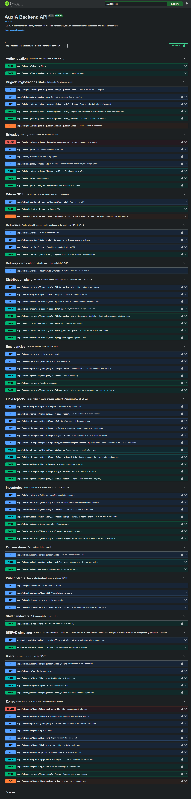
</p>

Inicio de sesión con la cuenta de administrador de la organización de prueba COER. La respuesta 200 trae el token, su tipo, su vencimiento a las 8 horas, el usuario, la organización y el rol `ORGANIZATION_ADMIN`. La contraseña y el token se ocultaron en la captura.

<p align="center">
  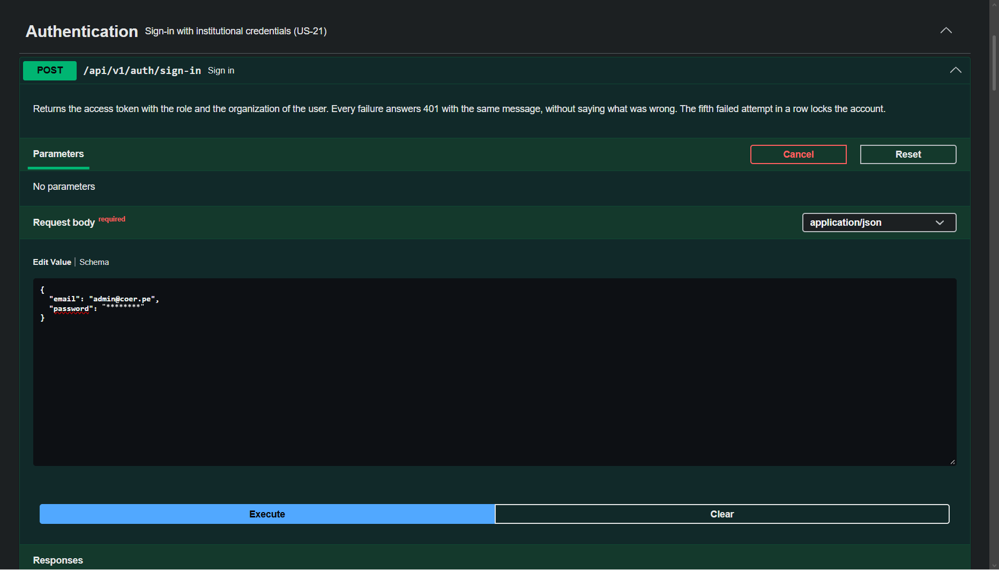
</p>

<p align="center">
  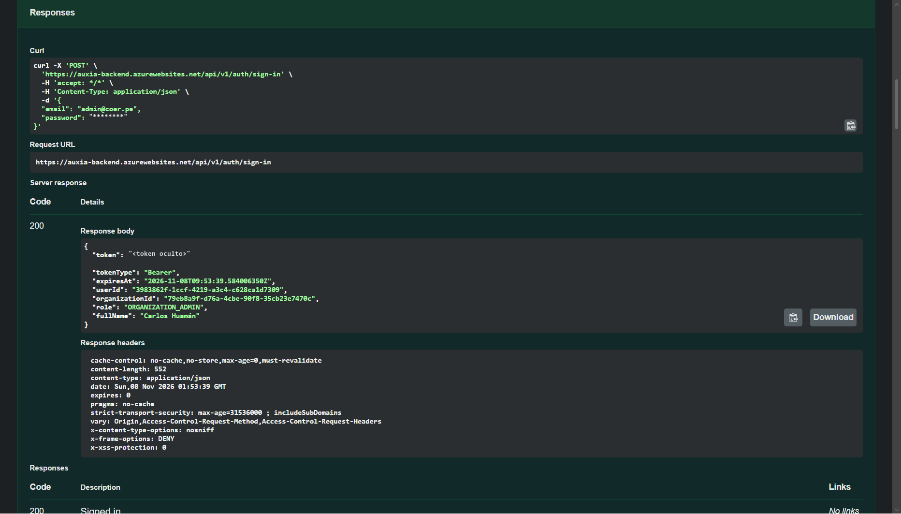
</p>

Verificación pública de una entrega, sin iniciar sesión. El backend recalcula el hash a partir de PostgreSQL y de los archivos de evidencia, lee el hash anclado en `DeliveryRegistry` y responde `verified: true` porque coinciden. La respuesta incluye el `transactionHash` con el que la entrega se registró en Sepolia.

<p align="center">
  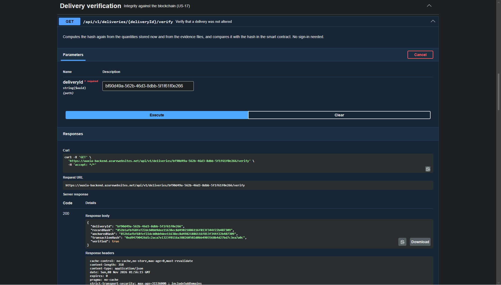
</p>

Swagger UI del AI Service muestra sus cinco endpoints. Todos, salvo `/health`, tienen candado porque exigen el header `X-API-Key`.

<p align="center">
  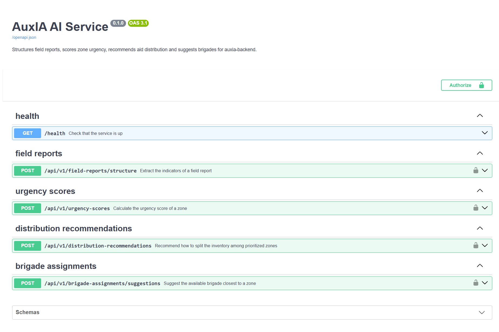
</p>

### Commits de documentación

| Repository | Branch | Commit Id | Commit Message | Commit Message Body | Committed on (Date) |
|---|---|---|---|---|---|
| Waqta-Labs/auxia-backend | feat/create-project | 9104549 | docs: add readme with setup and run instructions | Documents the stack and Spring Boot version, the database environment variables and the .env file, the dev and prod profiles, how to run and test the API, and the language and error conventions. | 26/10/2026 |
| Waqta-Labs/auxia-backend | feature/emergency-registration | 8dd4e0e | docs: document endpoints and database migrations in readme | Describe the Emergency Management package layout, the twelve endpoints of phase 1 and how the zone of a field report is identified. | 26/10/2026 |
| Waqta-Labs/auxia-backend | feature/ai-service-integration | 0c6dbda | docs: document the ai service integration in readme | Adds the AI_SERVICE_URL and AI_SERVICE_API_KEY variables, the new endpoints, how the urgency score is kept up to date, the most severe data rule, the score not available without population and what happens while the AI Service is down. | 26/10/2026 |
| Waqta-Labs/auxia-backend | feature/inventory-management | dde2fb0 | docs: document the inventory in readme | Adds Resource Management to the structure and documents the inventory endpoints, the available and reserved quantities, the rules that answer 400 and 409, and the context facade for the other bounded contexts. | 26/10/2026 |
| Waqta-Labs/auxia-backend | feature/ai-service-integration | c45bce9 | docs: document the population update and the zone report in readme | Adds PATCH /api/v1/zones/{id}/population-impact and GET /api/v1/zones/{id}/report to the endpoints, and explains how a zone without population gets its score and what the PDF includes. | 26/10/2026 |
| Waqta-Labs/auxia-backend | feature/brigade-management | d69f922 | docs: document the brigades in readme | Adds the brigade endpoints and the rules of availability, leaders and assignments. | 26/10/2026 |
| Waqta-Labs/auxia-backend | feature/identity-access | 1a00139 | docs: document identity access, roles and api security in readme | Adds the Identity Access endpoints, the role of each action, the new AUTH_JWT_SECRET and PLATFORM_ADMIN_KEY variables, how to use a token in Swagger UI and how the tests sign in. | 27/10/2026 |
| Waqta-Labs/auxia-backend | feature/pending-fixes | af4aaf6 | docs: document the health details of the dev profile | — | 27/10/2026 |
| Waqta-Labs/auxia-backend | feature/pending-fixes | 736de78 | docs: note that swagger ui stays on in prod | — | 27/10/2026 |
| Waqta-Labs/auxia-backend | feature/distribution-plans | 65c18ed | docs: document the distribution plans in readme | — | 28/10/2026 |
| Waqta-Labs/auxia-backend | feature/distribution-plans | 1c96862 | docs: document how approved plans count in a new recommendation | — | 28/10/2026 |
| Waqta-Labs/auxia-backend | feature/validation-cleanup | 6173722 | docs: describe the columns of the zone entity as they are mapped | The javadoc of ZoneJpaEntity still said the last aid received was not mapped, which stopped being true with the traceability phase; it now describes the manual priority columns instead. | 31/10/2026 |
| Waqta-Labs/auxia-backend | feature/idle-resource-savings | 6aebb69 | docs: describe how the database sleeps while the api is idle | Explains the connection pool limits, the liveness probe that does not wake the database and when the anchoring retry stops. | 01/11/2026 |
| Waqta-Labs/auxia-backend | feature/citizen-field-reports | 65cb765 | docs: document the sos endpoints of citizens | Explains the contract of the public field reports, how an SOS is placed, its stages, the limit per address and the V10 migration. | 06/11/2026 |
| Waqta-Labs/auxia-ai-service | feature/project-setup | 412cd88 | docs: document setup and backend contract in readme | Documents how to configure, run and test the service, and the contract agreed with auxia-backend: camelCase JSON, a single error format with 400 for validation, modelVersion in every response, and a request and response example for each endpoint. | 26/10/2026 |
| Waqta-Labs/auxia-ai-service | feature/field-report-structuring | f98d2b3 | docs: describe the rules-v1 extraction in readme | Explain how the structuring endpoint reads a field report: counts written with digits, the damage level dictionary where the highest level wins, and the needs dictionary. | 26/10/2026 |
| Waqta-Labs/auxia-ai-service | feature/urgency-score | 0b38237 | docs: document the rules-v1 urgency score in readme | Replaces the illustrative response of the urgency score with the real rules-v1 output and documents the weights, the priority thresholds and how topFeatures are chosen. | 26/10/2026 |
| Waqta-Labs/auxia-ai-service | feature/distribution-recommendation | 316f4b7 | docs: document the rules-v1 distribution in readme | Replaces the illustrative response of the distribution recommendation with the real rules-v1 output and documents the rations, the proportional split capped by demand and the coverage. | 26/10/2026 |
| Waqta-Labs/auxia-ai-service | feature/allocated-demand | 1c776bb | docs: document alreadyAllocated in the recommendation contract | — | 28/10/2026 |

## 7.2.1.7. Software Deployment Evidence for Sprint Review

Durante el Sprint 1 se desplegaron cinco de los seis productos. Se crearon las cuentas y los recursos en Azure, Neon, Vercel y Etherscan, se configuraron las variables de entorno de cada servicio y se conectó la Landing Page a su repositorio para que se publique sola. Las comprobaciones de esta sección se hicieron el 7 de noviembre de 2026 contra los servicios publicados.

### Backend API

El App Service `auxia-backend` corre en Linux con Java 21 SE, en la región Brazil South y el plan `asp-auxia` (B1), dentro del grupo de recursos `rg-auxia`. Su comprobación de estado está al 100 % y responde en `auxia-backend.azurewebsites.net`. `/actuator/health/liveness` devuelve `{"status":"UP"}`. Las releases `v0.1.0` y `v0.1.1` están marcadas en `main`. La versión 0.1.1 dejó que la base de datos de Neon se suspenda cuando la API está inactiva, por lo que la primera petición después de un periodo sin uso tarda unos segundos.

<p align="center">
  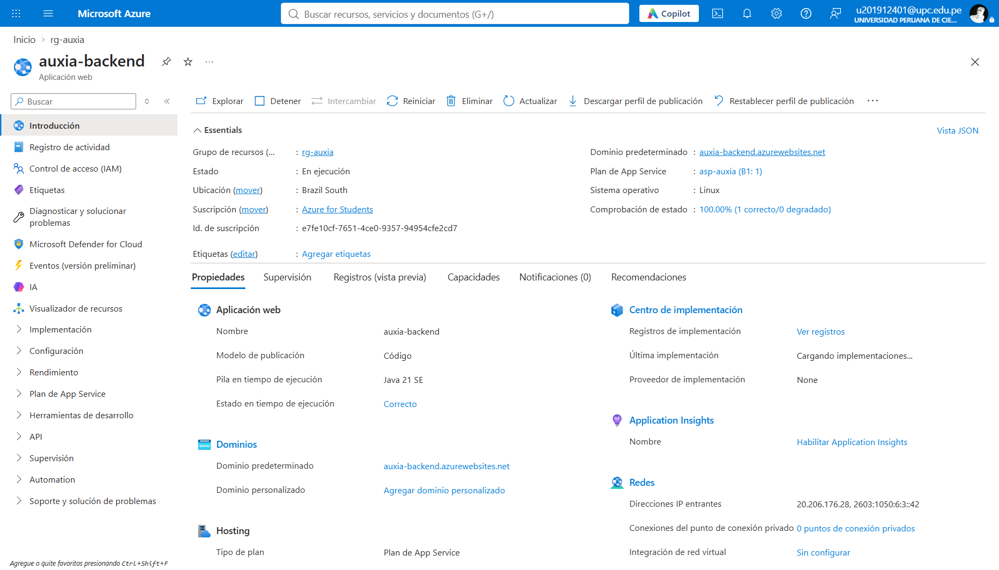
</p>

La configuración se hace con variables de entorno del App Service: conexión a Neon, AI Service, secretos de los tokens, almacenamiento, blockchain, correo y SINPAD. Los valores no se muestran en el portal ni se guardan en el repositorio.

<p align="center">
  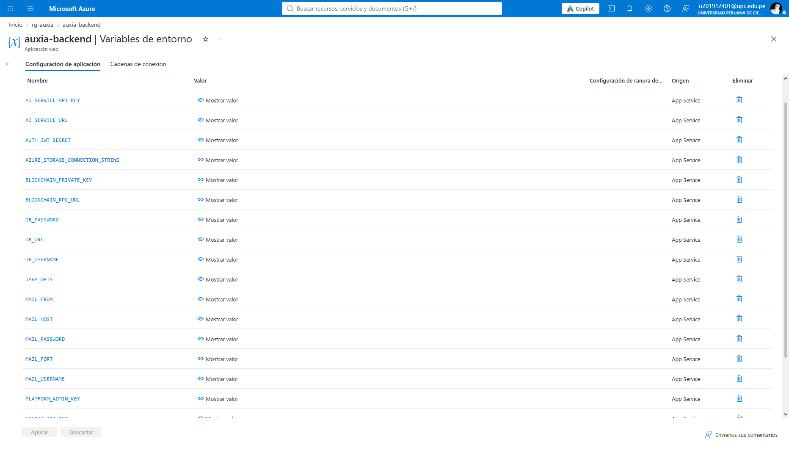
</p>

### AI Service

El App Service `auxia-ai-service` corre en Linux con Python 3.12, en el mismo grupo de recursos, región y plan que el backend. `/health` responde `{"status":"UP","version":"0.1.0","modelVersion":"rules-v1"}` y los endpoints protegidos rechazan las llamadas sin API key.

<p align="center">
  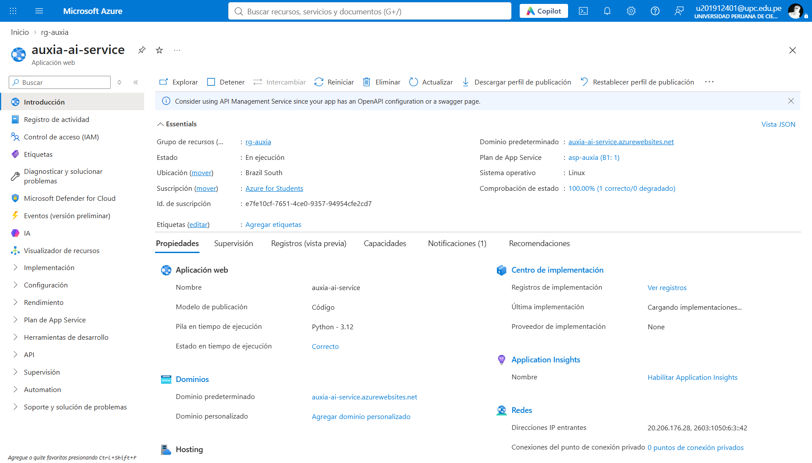
</p>

### Base de datos y evidencias

La base `neondb` del proyecto `auxia` de Neon, en la rama `production`, tiene un schema por bounded context. La captura muestra el schema `resource_management` con dos asignaciones de brigada completadas para la zona "Sector Alto Perú".

<p align="center">
  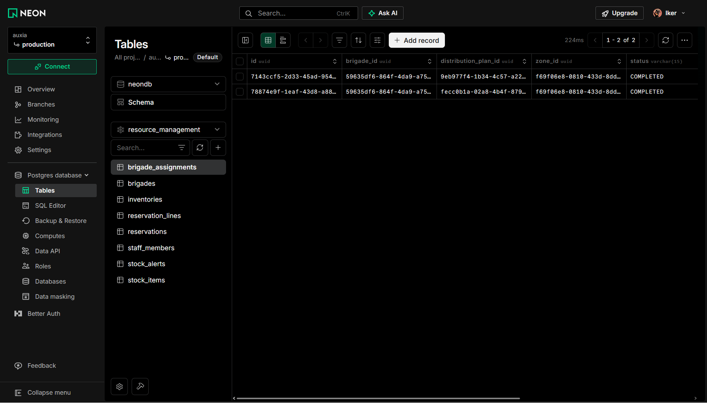
</p>

El contenedor privado `evidences` de la cuenta de almacenamiento `auxiaevidences` guarda los archivos de cada entrega en una carpeta con el identificador de la entrega. Las dos carpetas corresponden a las entregas registradas en el entorno desplegado.

<p align="center">
  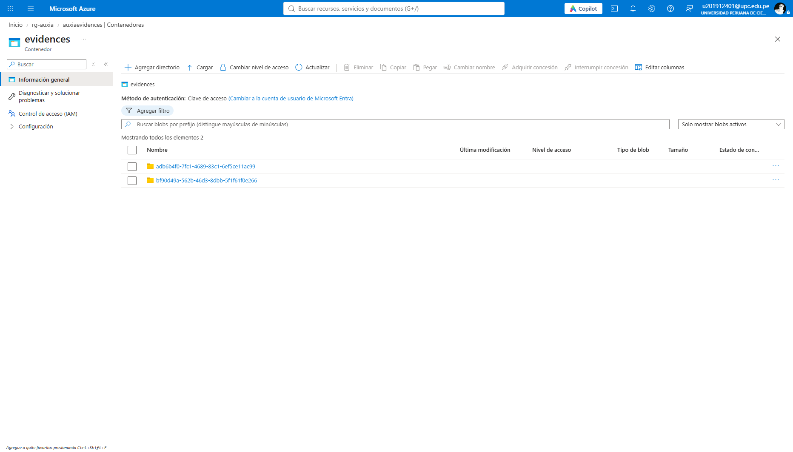
</p>

### Smart contract

`DeliveryRegistry` está desplegado en Sepolia en la dirección `0xe678347E182cbf00031401C97284AaB1C6b8148c` (bloque 12008166). La marca de la pestaña Contract indica que el código fuente está verificado en Etherscan. La lista muestra las 12 transacciones `Register Delivery` que envió la wallet dueña del contrato; la primera, `0xc8d7079f…`, es el anclaje de la entrega `adb6b4f0-7fc1-4689-83c1-6ef5ce11ac99`, cuya verificación pública devuelve `verified: true`.

<p align="center">
  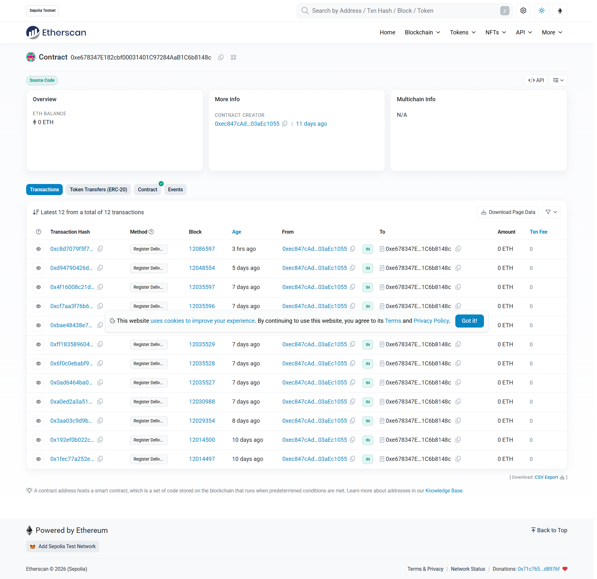
</p>

### Landing Page

El proyecto `site` de Vercel está conectado al repositorio de GitHub y publica en producción cada push a `develop`. El despliegue actual está en estado Ready y responde en https://site-two-mu-26.vercel.app.

<p align="center">
  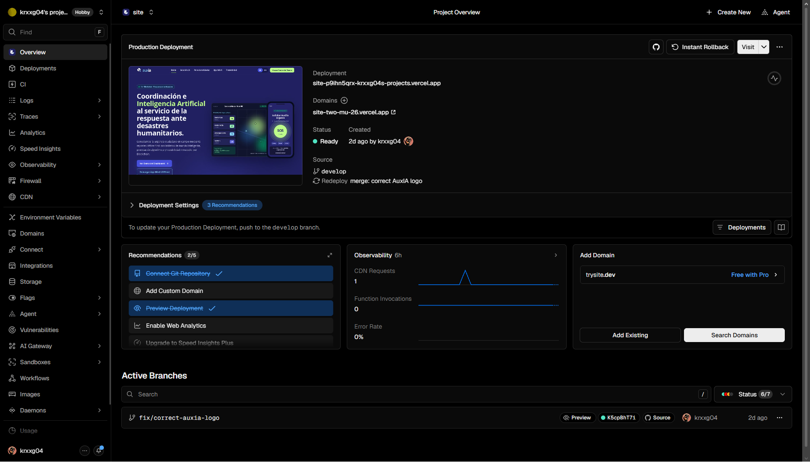
</p>

### Aplicación móvil

La aplicación se compiló para Android y se probó en el emulador contra el backend de Azure: el SOS con GPS, foto y audio adjuntos llega al backend, y el registro de un brigadista queda pendiente de aprobación con su credencial. El workflow CI de GitHub Actions verifica el formato, el análisis estático y las pruebas en cada pull request y en cada merge a `develop`; las 36 ejecuciones del Sprint 1 terminaron en verde.

<p align="center">
  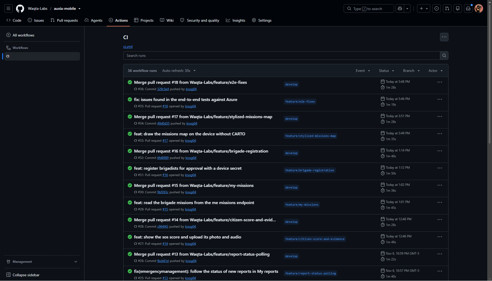
</p>

### Web App

La Web App no se desplegó en este Sprint; su repositorio está creado y sin código. Cuando se publique, su dominio debe agregarse a `CORS_ALLOWED_ORIGINS` del Backend API, que hoy solo admite `localhost:5173` y `localhost:3000`.

## 7.2.1.8. Team Collaboration Insights during Sprint

## 7.2.2. Sprint 2

El Sprint 2 se desarrolló entre el 9 de noviembre de 2026 y el 12 de noviembre de 2026, que son las fechas del primer y el último commit de la Web App en ese periodo. En ese tiempo se implementó y desplegó la primera versión de la Web App (Centro de Mando y Consulta pública), que consume el Backend API y el AI Service construidos en el Sprint 1.

## 7.2.2.1. Sprint Planning 2

El Sprint Planning 2 definió el alcance del segundo Sprint a partir del Product Backlog de la sección 3.4. El equipo comprometió las historias que se resuelven en la Web App, con las pantallas de los mock-ups del capítulo VI. El servicio de cada historia ya existía desde el Sprint 1; en este Sprint se construyó la interfaz que lo usa, por eso algunas historias aparecen también en el Sprint 1.

| Campo | Valor |
|---|---|
| **Sprint #** | Sprint 2 |
| **Sprint Planning Background** | |
| Date | 2026-11-09 |
| Time | Por completar |
| Location | Por completar |
| Prepared By | Castillo Garay, Ainhoa Lucia |
| Attendees (to planning meeting) | Barturen Panez, Iker Gabriel / Castillo Garay, Ainhoa Lucia / Nakamurakare Teruya, Alex Tomio / Trillo Hernandez, Anghel Melanie |
| Sprint 1 Review Summary | El Sprint 1 completó las 37 historias comprometidas (146 Story Points): el Backend API, el AI Service y el smart contract quedaron desplegados en Azure y Sepolia, la Landing Page en Vercel y la aplicación móvil conectada al backend. La Web App quedó pendiente para este Sprint. |
| Sprint 1 Retrospective Summary | Por completar |
| **Sprint Goal & User Stories** | |
| Sprint 2 Goal | Entregar la primera versión de la Web App, conectada al Backend API desplegado, para que una autoridad pueda iniciar sesión, priorizar las zonas afectadas, aprobar planes de distribución, administrar el inventario y las brigadas y auditar la trazabilidad de las entregas, y para que cualquier persona pueda verificar una entrega. Métrica de cumplimiento: las pantallas de las historias del Sprint funcionan contra el Backend API de Azure, la compilación de producción no tiene errores y la Web App queda publicada en https://auxia-web.netlify.app con el inicio de sesión funcionando. |
| Sprint 2 Velocity | 56 Story Points comprometidos para el Sprint, con 83 horas de trabajo estimadas (1 hora por Story Point más las tareas generales). |
| Sum of Story Points | 56 |

Las historias incluidas en el Sprint 2 son las siguientes, en el orden del Product Backlog:

| User Story Id | Título | Story Points | Pantallas |
|---|---|---|---|
| US-04 | Calcular el score de urgencia de una zona | 8 | Dashboard (W_01), Priorización con IA (W_03) |
| US-05 | Visualizar la explicación del score de una zona | 3 | Priorización con IA (W_03) |
| US-06 | Ordenar y filtrar zonas según score de urgencia | 3 | Priorización con IA (W_03), Mapa GIS (W_02) |
| US-07 | Ajustar manualmente la prioridad de una zona | 3 | Priorización con IA (W_03) |
| US-11 | Generar una recomendación de distribución | 8 | Priorización con IA (W_03), Logística de campo (W_05) |
| US-12 | Aprobar una distribución recomendada | 3 | Priorización con IA (W_03), Logística de campo (W_05) |
| US-14 | Justificar el rechazo o modificación de una recomendación | 2 | Priorización con IA (W_03) |
| US-09 | Consultar el inventario disponible | 3 | Inventario |
| US-08 | Registrar ingreso de recursos al inventario | 3 | Inventario |
| US-10 | Recibir alerta de inventario bajo | 3 | Alertas de inventario |
| US-17 | Consultar el estado de verificación de una entrega | 3 | Auditoría y Trazabilidad (W_06) |
| US-19 | Exportar el historial de entregas de una zona o periodo | 5 | Auditoría y Trazabilidad (W_06) |
| US-21 | Iniciar sesión con credenciales institucionales | 3 | Inicio de sesión |
| US-22 | Asignar roles y permisos según responsabilidad | 3 | Logística de campo (W_05) |
| US-26 | Verificar la validez pública de una entrega mediante su código | 3 | Verificación pública |

Los Story Points son los del Product Backlog. Las historias que también están en el Sprint 1 se contaron allí por su servicio y aquí por su interfaz web.

## 7.2.2.2. Sprint Backlog 2

El objetivo del Sprint 2 es dejar publicada la primera versión de la Web App. El tablero del Sprint se gestionó en Trello, con las mismas columnas del Product Backlog, y las historias comprometidas se descompusieron en los tasks de la tabla. Todos los tasks terminaron en `Done` antes del cierre del Sprint, el 12 de noviembre de 2026.

<!-- Pendiente: agregar aquí la captura del Board del Sprint 2 en Trello y su enlace público. -->

**Sprint #:** Sprint 2

| User Story Id | User Story Title | Task Id | Task Title | Description | Estimation (Hours) | Assigned To | Status |
|---|---|---|---|---|---|---|---|
| US-04 | Calcular el score de urgencia de una zona | T-01 | Mostrar el score de urgencia en la tabla de zonas | Muestra el score y el nivel de prioridad de cada zona en la pantalla de priorización con IA (W_03), ordenada por urgencia. | 4 | Castillo Garay, Ainhoa Lucia | Done |
|  |  | T-02 | Resumir la situación en el dashboard | Construye el dashboard (W_01) con los indicadores de solicitudes activas, casos críticos, brigadas desplegadas y suministros verificados, y la lista de las zonas más urgentes. | 4 | Castillo Garay, Ainhoa Lucia | Done |
| US-05 | Visualizar la explicación del score de una zona | T-03 | Explicar el score en el panel lateral de la zona | Muestra en el panel lateral las variables que más pesan en el score, las necesidades y los datos de la zona, con el texto "por qué está priorizada". | 3 | Castillo Garay, Ainhoa Lucia | Done |
| US-06 | Ordenar y filtrar zonas según score de urgencia | T-04 | Filtrar y ordenar la tabla de zonas | Agrega el filtro por rango de score y por necesidad y el orden por score y alfabético (ascendente y descendente) con un menú desplegable propio. | 2 | Castillo Garay, Ainhoa Lucia | Done |
|  |  | T-05 | Construir la pantalla del mapa GIS | Implementa el mapa GIS (W_02) con el mapa de calor de prioridad, el detalle de cada zona y la búsqueda por departamento, provincia, distrito o coordenadas. | 1 | Castillo Garay, Ainhoa Lucia | Done |
| US-07 | Ajustar manualmente la prioridad de una zona | T-06 | Marcar o quitar la prioridad manual de una zona | Permite a la autoridad marcar una zona como prioritaria con un motivo y quitar la marca desde el panel lateral. | 3 | Castillo Garay, Ainhoa Lucia | Done |
| US-11 | Generar una recomendación de distribución | T-07 | Generar la recomendación de distribución | Llama al backend para generar los planes de distribución de la emergencia y muestra la cobertura de cada zona y las zonas que quedan sin atender. | 4 | Castillo Garay, Ainhoa Lucia | Done |
|  |  | T-08 | Ordenar y mostrar mejor las zonas para asignar brigadas | Mejora el orden y la presentación de las zonas en la pantalla de logística de campo (W_05) para elegir a qué zona asignar una brigada. | 4 | Castillo Garay, Ainhoa Lucia | Done |
| US-12 | Aprobar una distribución recomendada | T-09 | Aprobar el plan y asignar la brigada | Permite aprobar un plan de distribución y pedir la asignación de la brigada disponible más cercana, con el estado actualizado en pantalla. | 3 | Castillo Garay, Ainhoa Lucia | Done |
| US-14 | Justificar el rechazo o modificación de una recomendación | T-10 | Pedir el motivo al rechazar un plan | Agrega el diálogo que exige un motivo al rechazar un plan de distribución y lo envía al backend. | 2 | Castillo Garay, Ainhoa Lucia | Done |
| US-09 | Consultar el inventario disponible | T-11 | Consultar el inventario y sus recursos | Construye las vistas del inventario y de sus recursos con el stock disponible y reservado, en la versión de la autoridad y en la del administrador. | 3 | Castillo Garay, Ainhoa Lucia | Done |
| US-08 | Registrar ingreso de recursos al inventario | T-12 | Agregar recursos y gestionar el stock | Permite agregar recursos nuevos al inventario, reponer el stock y ajustarlo con un motivo. | 3 | Castillo Garay, Ainhoa Lucia | Done |
| US-10 | Recibir alerta de inventario bajo | T-13 | Mostrar las alertas de stock bajo | Agrega la pantalla de alertas del inventario con el estado de cada alerta y el recurso que quedó bajo su mínimo. | 3 | Castillo Garay, Ainhoa Lucia | Done |
| US-17 | Consultar el estado de verificación de una entrega | T-14 | Construir la vista de trazabilidad | Implementa la pantalla de auditoría y trazabilidad (W_06) con el libro de entregas, el hash de cada una y su estado de verificación en Blockchain, y el registro de una sola entrega. | 3 | Castillo Garay, Ainhoa Lucia | Done |
| US-19 | Exportar el historial de entregas de una zona o periodo | T-15 | Descargar el reporte de entregas en PDF | Agrega el diálogo para elegir la zona o el periodo y descargar el PDF de auditoría que genera el backend. | 5 | Castillo Garay, Ainhoa Lucia | Done |
| US-21 | Iniciar sesión con credenciales institucionales | T-16 | Construir la pantalla de inicio de sesión | Implementa el formulario con correo y contraseña, la sesión con token, el cambio de idioma y los mensajes de error del backend. | 3 | Castillo Garay, Ainhoa Lucia | Done |
| US-22 | Asignar roles y permisos según responsabilidad | T-17 | Restringir cada pantalla según el rol | Define qué roles ven cada pantalla (autoridad, administrador de la organización y auditor) y oculta lo que no les corresponde. | 2 | Castillo Garay, Ainhoa Lucia | Done |
|  |  | T-18 | Crear brigadas y agregar sus miembros | Permite al administrador crear brigadas y agregar o quitar miembros; la autoridad ve las brigadas en modo de solo lectura. | 1 | Castillo Garay, Ainhoa Lucia | Done |
| US-26 | Verificar la validez pública de una entrega mediante su código | T-19 | Construir la verificación pública de entregas | Implementa la página pública donde cualquier persona ve el hash de una entrega y comprueba su validez sin iniciar sesión. | 3 | Castillo Garay, Ainhoa Lucia | Done |
| — | Tareas generales (sin User Story) | | | | | | |
|  |  | T-20 | Configurar el proyecto de la Web App | Crea el proyecto React con Vite y la estructura de Clean Architecture por bounded context, los alias de importación, las rutas, el contexto de autenticación y la internacionalización en español e inglés. | 5 | Castillo Garay, Ainhoa Lucia | Done |
|  |  | T-21 | Construir el diseño del centro de mando | Define la paleta y el layout con barra lateral y barra superior, y los componentes compartidos de las pantallas. | 4 | Castillo Garay, Ainhoa Lucia | Done |
|  |  | T-22 | Desarrollar el mapa propio de Perú | Programa el motor de mapa sobre canvas con los límites de departamentos, provincias y distritos, el mapa de calor y la agrupación de marcadores, sin servicios externos. | 8 | Castillo Garay, Ainhoa Lucia | Done |
|  |  | T-23 | Registrar zonas desde el mapa GIS | Permite registrar una zona nueva sobre el mapa, con sus coordenadas y su impacto en la población. | 3 | Castillo Garay, Ainhoa Lucia | Done |
|  |  | T-24 | Construir la página de perfil | Muestra los datos de la cuenta, la brigada del usuario y las preferencias de idioma, y borra los datos de la sesión anterior al cambiar de usuario. | 3 | Castillo Garay, Ainhoa Lucia | Done |
|  |  | T-25 | Desplegar la Web App en Netlify | Crea el proyecto en Netlify, configura las variables de entorno, las rutas de la aplicación y los orígenes permitidos (CORS) con el equipo del backend. | 3 | Castillo Garay, Ainhoa Lucia | Done |
|  |  | T-26 | Publicar la versión 1.0.0 | Crea la rama release/v1.0, publica la release v1.0.0 y la integra en develop con el pull request 1. | 1 | Castillo Garay, Ainhoa Lucia | Done |

La estimación de horas de cada historia es el producto de sus Story Points por 1 hora, repartido entre sus tasks. Las tareas generales no dependen de una historia en particular y se estimaron por separado.

## 7.2.2.3. Development Evidence for Sprint Review

Durante el Sprint 2 se hicieron 34 commits en el repositorio de la Web App, todos de la cuenta `noaa01100001`, y se mergeó 1 pull request (el de la release v1.0.0 a `develop`). El avance por pantalla fue el siguiente:

- **Configuración:** el proyecto React con Vite, la estructura de Clean Architecture por bounded context, las rutas, el idioma y la autenticación.
- **Inicio de sesión y dashboard:** la pantalla de acceso con el cambio de idioma y el dashboard con los indicadores, la vista previa del mapa y las zonas más urgentes.
- **Mapa GIS:** el mapa propio de Perú con el mapa de calor de prioridad, el registro de zonas desde el mapa y su vista previa en el dashboard.
- **Brigadas y logística:** la creación de brigadas y de sus miembros por el administrador, la vista de solo lectura de la autoridad y el orden de las zonas para asignar brigadas.
- **Trazabilidad:** el libro de entregas, el registro de una entrega, la descarga de reportes y la verificación pública de una entrega.
- **Inventario:** la vista de la autoridad y del administrador, el registro de recursos, la gestión del stock y las alertas de stock bajo.
- **Perfil:** la página con los datos de la cuenta, la brigada y las preferencias.
- **Release:** la versión v1.0.0, integrada en `develop` mediante el pull request 1.

La tabla lista los commits de implementación del Sprint. El commit de documentación está en la sección 7.2.2.6. La Web App no tiene commits de pruebas (sección 7.2.2.4). Los mensajes de estos commits no tienen cuerpo.

| Repository | Branch | Commit Id | Commit Message | Commit Message Body | Committed on (Date) |
|---|---|---|---|---|---|
| Waqta-Labs/auxia-web | develop | c641a85 | feat: Initial Setup and structure planning | — | 09/11/2026 |
| Waqta-Labs/auxia-web | develop | 08072b5 | feat: Routes, Language and Auth configuration | — | 09/11/2026 |
| Waqta-Labs/auxia-web | develop | a47ade4 | feat: Sign In initial view | — | 10/11/2026 |
| Waqta-Labs/auxia-web | develop | 44d302b | feat: Sign In version 1.1 | — | 10/11/2026 |
| Waqta-Labs/auxia-web | develop | 539ffba | feat: Dashboard initial implementation | — | 10/11/2026 |
| Waqta-Labs/auxia-web | develop | c745ce5 | feat: Authority Read-Only view of Brigades | — | 11/11/2026 |
| Waqta-Labs/auxia-web | develop | c776287 | feat: Addition of members in Brigades by Admin | — | 11/11/2026 |
| Waqta-Labs/auxia-web | develop | c8c8367 | feat: Creating Brigades | — | 11/11/2026 |
| Waqta-Labs/auxia-web | develop | 834be51 | feat: Minor design fix | — | 11/11/2026 |
| Waqta-Labs/auxia-web | develop | 1a95b16 | feat: Traceability View | — | 11/11/2026 |
| Waqta-Labs/auxia-web | develop | 45c940f | feat: Traceability record of a single Delivery | — | 11/11/2026 |
| Waqta-Labs/auxia-web | develop | b0e533f | feat: Traceability reports download building | — | 12/11/2026 |
| Waqta-Labs/auxia-web | develop | 84b4737 | feat: Traceability public verification | — | 12/11/2026 |
| Waqta-Labs/auxia-web | develop | d2b02a6 | feat: Traceability public verification version 2.0 | — | 12/11/2026 |
| Waqta-Labs/auxia-web | develop | 3c99e32 | feat: Inventory initial view | — | 12/11/2026 |
| Waqta-Labs/auxia-web | develop | c5e08fc | feat: Adding Resource to Inventory | — | 12/11/2026 |
| Waqta-Labs/auxia-web | develop | d3c16c0 | feat: Adding new resources to Inventory | — | 12/11/2026 |
| Waqta-Labs/auxia-web | develop | 25712c3 | feat: Desgin improvement | — | 12/11/2026 |
| Waqta-Labs/auxia-web | develop | add43cc | feat: Stock management in Inventory | — | 12/11/2026 |
| Waqta-Labs/auxia-web | develop | eb742ed | feat: Alerts for stock in Inventory | — | 12/11/2026 |
| Waqta-Labs/auxia-web | develop | 482b200 | feat: Inventory Resources view | — | 12/11/2026 |
| Waqta-Labs/auxia-web | develop | 0bc7e55 | feat: Inventory View for Authority | — | 12/11/2026 |
| Waqta-Labs/auxia-web | develop | 9d09d55 | feat: Design Improvement | — | 12/11/2026 |
| Waqta-Labs/auxia-web | develop | 34414cc | feat: GIS Map initial implementation | — | 12/11/2026 |
| Waqta-Labs/auxia-web | develop | e0dab55 | feat: GIS Map addition of Zones | — | 12/11/2026 |
| Waqta-Labs/auxia-web | develop | ffd4450 | feat: Update of Dashboard Map | — | 12/11/2026 |
| Waqta-Labs/auxia-web | develop | 33cd64a | feat: Update of Dashboard Map | — | 12/11/2026 |
| Waqta-Labs/auxia-web | develop | e94a9e6 | feat: Better sort of zones for brigade assignment | — | 12/11/2026 |
| Waqta-Labs/auxia-web | develop | d3ad1e2 | feat: Better show of zones for brigade assignment | — | 12/11/2026 |
| Waqta-Labs/auxia-web | develop | 55dcf7c | feat: Profile initial version | — | 12/11/2026 |
| Waqta-Labs/auxia-web | develop | c37bf0b | feat: Profile final version | — | 12/11/2026 |
| Waqta-Labs/auxia-web | develop | 8e61e26 | feat: Profile version 2.0 | — | 12/11/2026 |
| Waqta-Labs/auxia-web | release/v1.0 | 630dad3 | Release v1.0.0 | — | 12/11/2026 |
| Waqta-Labs/auxia-web | develop | 11ccde1 | Merge pull request #1 from Waqta-Labs/release/v1.0 | — | 12/11/2026 |

## 7.2.2.4. Testing Suite Evidence for Sprint Review

La Web App no tiene una suite de pruebas automatizadas en este Sprint: el Sprint 2 se dedicó a construir y publicar las pantallas, y las pruebas automatizadas del producto están en el Backend API, el AI Service, el smart contract y la aplicación móvil (sección 7.2.1.4). La Web App se verificó con estos controles:

| Control | Herramienta | Qué verifica |
|---|---|---|
| Análisis estático | ESLint, con la configuración `eslint.config.js` del repositorio | Errores de código y de hooks de React. |
| Compilación de producción | `npm run build` (Vite) | Que todo el proyecto compila. Netlify lo ejecuta en cada despliegue y no publica si falla. |
| Pruebas manuales | Google Chrome y Opera, contra el Backend API desplegado en Azure | Los flujos de cada pantalla con datos reales, con las herramientas de desarrollo abiertas para revisar la consola y las peticiones. |

Los casos de prueba manual siguen las tareas de las entrevistas de validación de la sección 7.3 y los criterios de aceptación del capítulo III:

| Caso | Historia | Pasos | Resultado esperado |
|---|---|---|---|
| M1 | US-21 | Iniciar sesión con una cuenta de autoridad y con una contraseña incorrecta. | Con la cuenta correcta se abre el dashboard; con la incorrecta se muestra un mensaje de error sin revelar qué dato falló. |
| M2 | US-22 | Abrir las pantallas con una cuenta de autoridad, de administrador y de auditor. | Cada rol solo ve las pantallas que le corresponden. |
| M3 | US-04, US-05, US-06 | Abrir la priorización, filtrar por rango de score, ordenar y abrir el panel lateral de una zona. | La tabla muestra las zonas filtradas y ordenadas, y el panel explica las variables que más pesan en el score. |
| M4 | US-11, US-12, US-14 | Generar la recomendación, aprobar un plan y rechazar otro con un motivo. | El plan aprobado cambia de estado y el rechazo exige un motivo. |
| M5 | US-08, US-09, US-10 | Agregar un recurso, reponer su stock y bajarlo de su mínimo. | El inventario muestra el stock actualizado y aparece una alerta de stock bajo. |
| M6 | US-17, US-19 | Abrir el libro de trazabilidad, ver el registro de una entrega y descargar el reporte en PDF. | La entrega muestra su hash y su estado de verificación, y se descarga el PDF. |
| M7 | US-26 | Abrir sin iniciar sesión el enlace de verificación de una entrega. | La página pública muestra el hash y si la entrega es válida. |

## 7.2.2.5. Execution Evidence for Sprint Review

Las capturas muestran la Web App publicada en https://auxia-web.netlify.app funcionando contra el Backend API de Azure, con la cuenta de una autoridad.

### Inicio de sesión

La pantalla de acceso pide el correo institucional y la contraseña, avisa que la cuenta se bloquea tras cinco intentos fallidos y permite cambiar el idioma entre español e inglés (US-21).

<p align="center">
  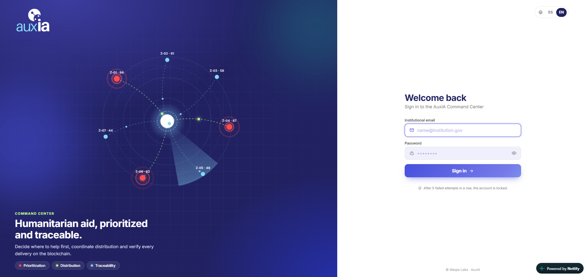
</p>

### Dashboard

El dashboard resume la emergencia activa: solicitudes activas, casos críticos, brigadas desplegadas y suministros verificados. Incluye la vista previa del mapa con el mapa de calor, la lista de las zonas más urgentes y la tabla de trazabilidad en Blockchain (W_01).

<p align="center">
  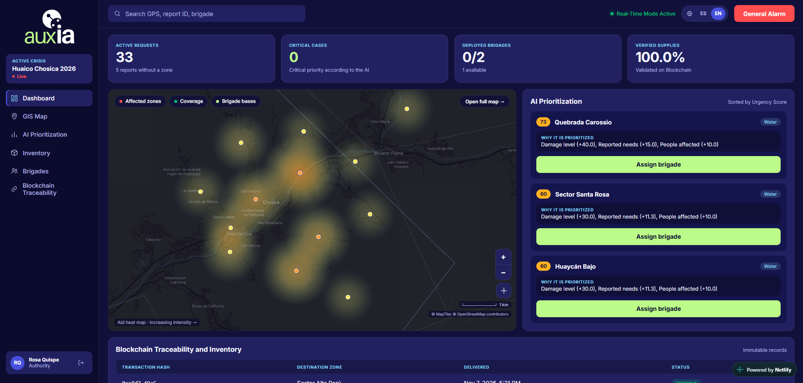
</p>

### Mapa GIS

El mapa propio de Perú dibuja los límites de departamentos, provincias y distritos y el mapa de calor de la prioridad de las zonas. Permite buscar un lugar o unas coordenadas y registrar una zona nueva sobre el mapa (W_02).

<p align="center">
  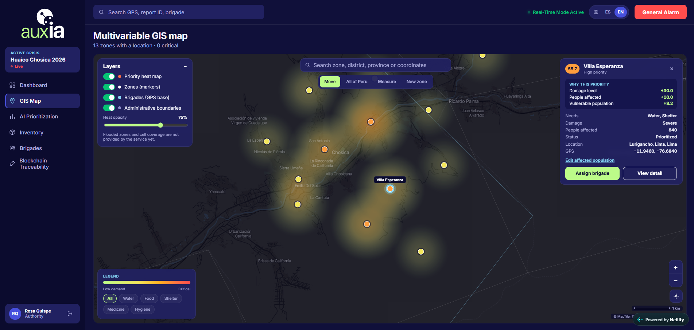
</p>

### Priorización con IA

La tabla ordena las zonas por score de urgencia, con filtros por rango de score y orden alfabético. El panel lateral explica las variables que más pesan en el score y las necesidades de la zona (W_03; US-04, US-05, US-06).

<p align="center">
  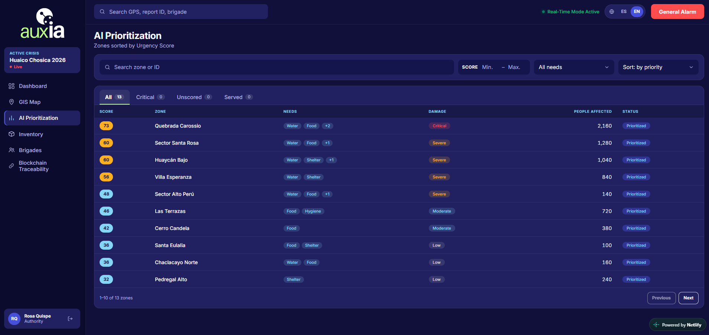
</p>

### Logística de campo

La pantalla lista las brigadas con su estado, su misión y sus miembros. El administrador crea brigadas y agrega miembros; la autoridad las ve en modo de solo lectura (W_05; US-22).

<p align="center">
  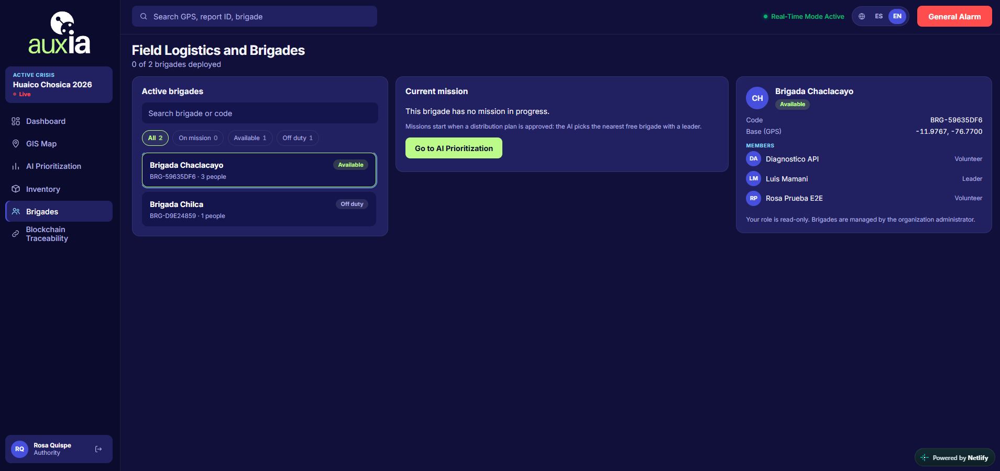
</p>

### Inventario

El inventario muestra los recursos con su stock disponible y reservado, permite agregar recursos y reponer o ajustar el stock (US-08, US-09).

<p align="center">
  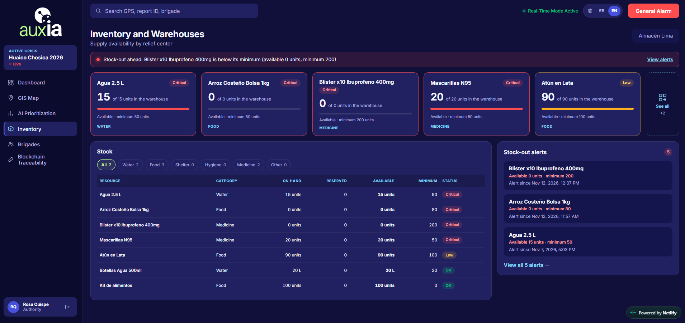
</p>

### Alertas de inventario

La pantalla de alertas lista los recursos que quedaron por debajo de su stock mínimo (US-10).

<p align="center">
  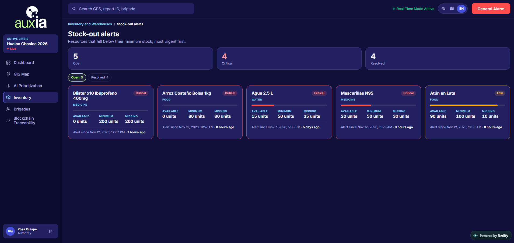
</p>

### Auditoría y trazabilidad

El libro de trazabilidad lista las entregas con su hash y su estado de verificación en Blockchain, abre el registro de una entrega y descarga el reporte en PDF (W_06; US-17, US-19).

<p align="center">
  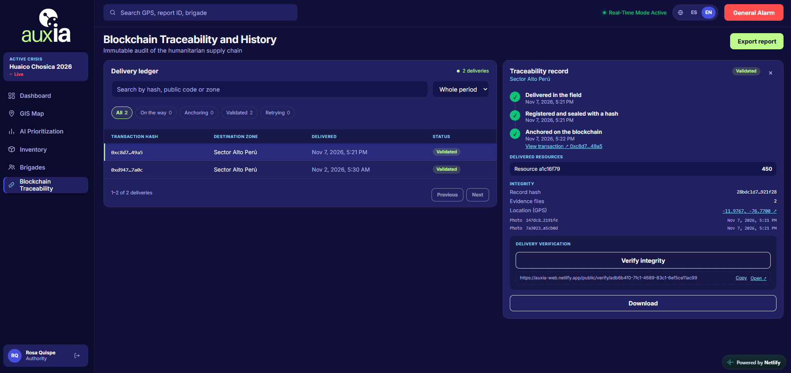
</p>

### Verificación pública

Cualquier persona abre el enlace de una entrega, sin iniciar sesión, y comprueba su hash y si es válida (US-26).

<p align="center">
  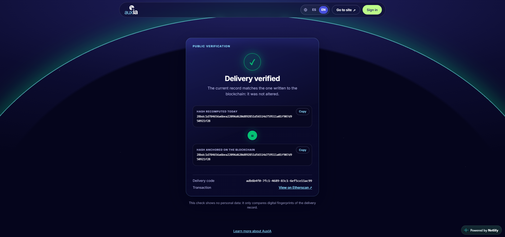
</p>

### Perfil

El perfil muestra los datos de la cuenta, la brigada del usuario si es brigadista y las preferencias, como el idioma, y permite cerrar sesión.

<p align="center">
  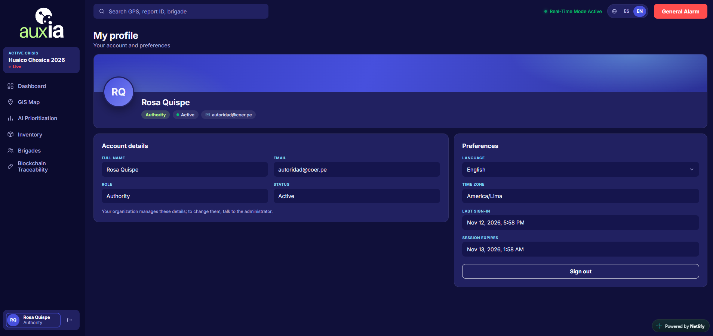
</p>

## 7.2.2.6. Services Documentation Evidence for Sprint Review

La Web App no expone servicios propios: consume el Backend API, cuyos endpoints están documentados con OpenAPI en Swagger UI (sección 7.2.1.6) y cuya versión desplegada es la que se usa. La tabla resume qué endpoints llama cada pantalla; todos cuelgan del prefijo `/api/v1` y, salvo el inicio de sesión y la verificación pública, llevan el token en `Authorization: Bearer <token>`.

| Pantalla | Endpoints que consume | Historias |
|---|---|---|
| Inicio de sesión | `POST /auth/sign-in` | US-21 |
| Perfil | `GET /users/me`, `GET /me/missions` | US-21 |
| Dashboard, Priorización con IA y Mapa GIS | `GET /emergencies`, `GET /emergencies/{id}/zones`, `GET /emergencies/{id}/field-reports`, `GET /zones/{id}`, `GET /zones/{id}/score`, `POST /emergencies/{id}/zones`, `PATCH /zones/{id}/population-impact`, `PUT` y `DELETE /zones/{id}/manual-priority` | US-04, US-05, US-06, US-07 |
| Planes de distribución | `POST /emergencies/{id}/distribution-plans`, `GET /zones/{id}/distribution-plans`, `GET /distribution-plans/{id}`, `POST /distribution-plans/{id}/approve`, `POST /distribution-plans/{id}/reject`, `POST /distribution-plans/{id}/brigade-assignment` | US-11, US-12, US-14 |
| Logística de campo | `GET /brigades`, `POST /brigades`, `GET /brigades/{id}`, `POST /brigades/{id}/members`, `DELETE /brigades/{id}/members/{memberId}`, `PATCH /brigades/{id}/availability` | US-22 |
| Inventario y alertas | `GET /inventories`, `POST /inventories`, `POST /inventories/{id}/resources`, `POST /inventories/{id}/resources/{resourceId}/restock`, `PATCH /inventories/{id}/resources/{resourceId}/adjustment`, `GET /inventories/{id}/alerts` | US-08, US-09, US-10 |
| Auditoría y trazabilidad | `GET /deliveries`, `GET /deliveries/{id}`, `GET /deliveries/report` | US-17, US-19 |
| Verificación pública | `GET /deliveries/{id}/verify` | US-26 |

Los errores del backend (RFC 9457) se traducen en mensajes de la interfaz en español e inglés, y una sesión vencida (401) lleva de nuevo al inicio de sesión.

### Commits de documentación

| Repository | Branch | Commit Id | Commit Message | Commit Message Body | Committed on (Date) |
|---|---|---|---|---|---|
| Waqta-Labs/auxia-web | develop | c5329f8 | docs: Netlify.toml creation | — | 12/11/2026 |

## 7.2.2.7. Software Deployment Evidence for Sprint Review

Durante el Sprint 2 se desplegó la Web App, el último de los seis productos. Las comprobaciones de esta sección se hicieron el 12 de noviembre de 2026 contra el servicio publicado.

### Netlify

El proyecto `AuxIA-Web` de Netlify está conectado al repositorio `auxia-web` de GitHub y publica en producción cada push a la rama `release/v1.0`. Como la aplicación está en la carpeta `auxia-web-app`, esa carpeta es el directorio base; el comando de compilación es `npm run build` y el directorio publicado es `dist`. La web responde en https://auxia-web.netlify.app.

<p align="center">
  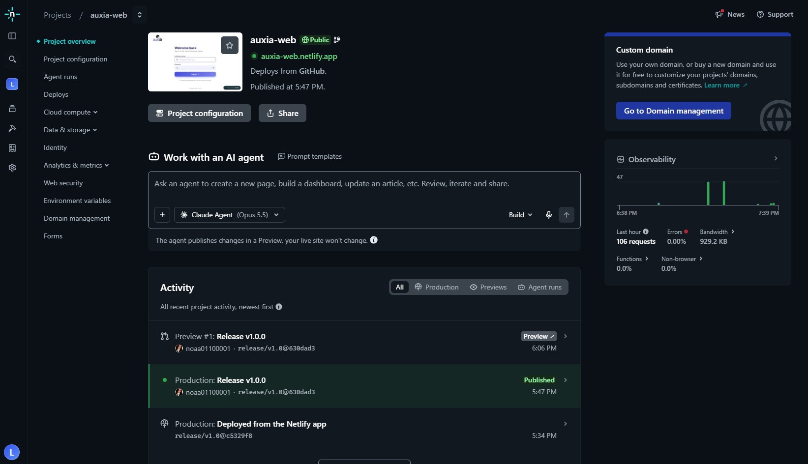
</p>

Las rutas de la aplicación se resuelven en el navegador: `netlify.toml` redirige cualquier ruta a `index.html`, así que recargar una pantalla interna como `/profile` no da error 404. Los archivos de `/assets` se guardan en caché por mucho tiempo porque su nombre incluye un hash.

### Variables de entorno

La configuración se hace con variables de entorno de Netlify, que Vite escribe en el código al compilar. Por eso no son secretas y hay que volver a desplegar después de cambiarlas.

| Variable | Uso |
|---|---|
| `VITE_API_URL` | URL del Backend API en Azure. |
| `VITE_AI_URL` | URL del AI Service en Azure. |
| `VITE_USE_MOCKS` | `false` en producción, para usar el backend real. |
| `VITE_MAP_TILES_URL` | Mosaicos de calles de MapTiler bajo el mapa propio. La clave se restringe a los dominios `localhost` y `auxia-web.netlify.app` en el panel de MapTiler. |
| `VITE_MAP_ATTRIBUTION` | Atribución que se muestra sobre el mapa. |

<p align="center">
  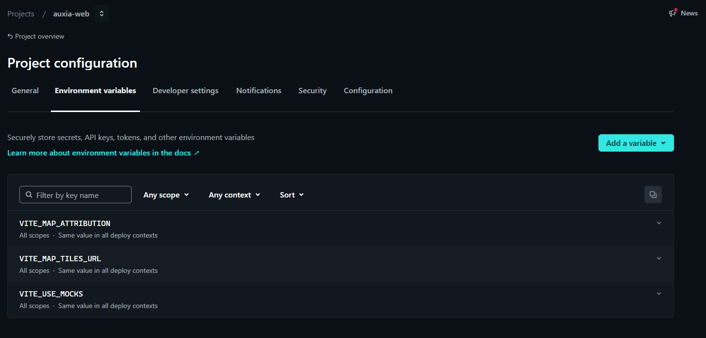
</p>

### Orígenes permitidos en el backend

El navegador bloquea las llamadas de https://auxia-web.netlify.app al backend hasta que su origen se agrega a `CORS_ALLOWED_ORIGINS` del Backend API y a los orígenes permitidos del AI Service. El equipo del backend los agregó en los dos servicios y, con ello, el inicio de sesión funciona en producción.

### Release

La versión `v1.0.0` se preparó en la rama `release/v1.0` y se integró en `develop` con el pull request 1 (commit `11ccde1`).

<p align="center">
  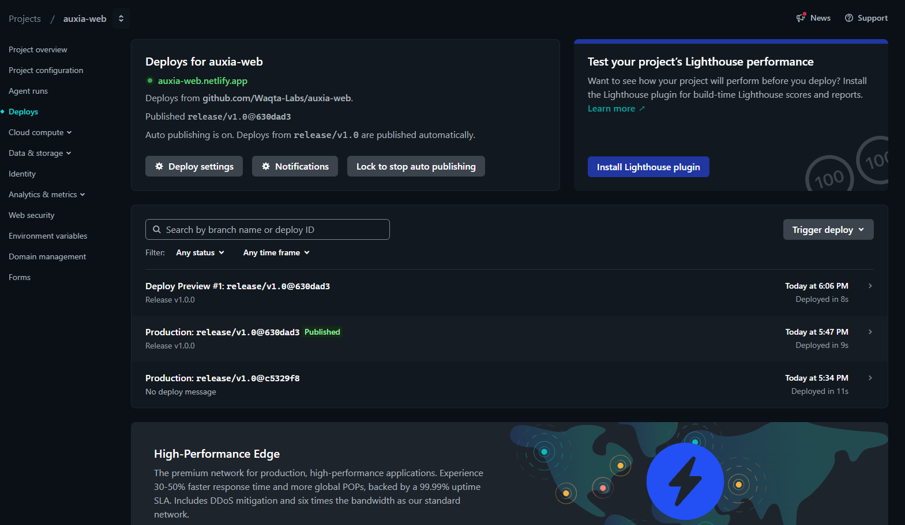
</p>

## 7.2.2.8. Team Collaboration Insights during Sprint

En el Sprint 2 la Web App avanzó sobre el trabajo del Sprint 1: consume el Backend API, el AI Service y las historias que ya estaban implementadas. La coordinación con el equipo del backend fue necesaria para publicar la web: ellos agregaron el dominio de Netlify a los orígenes permitidos de los dos servicios.

La gráfica de contribuidores de GitHub muestra los commits del Sprint 2 por integrante. Todos los commits de la Web App en este periodo son de la cuenta `noaa01100001`, de modo que la gráfica solo tiene una serie.

<p align="center">
  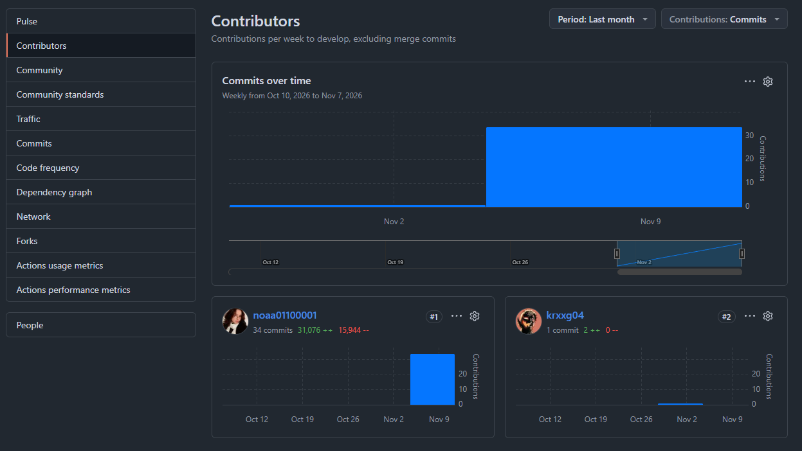
</p>

El resumen de actividad (Pulse) muestra el movimiento del repositorio durante el Sprint 2: los pull requests, los commits y las ramas con actividad.

<p align="center">
  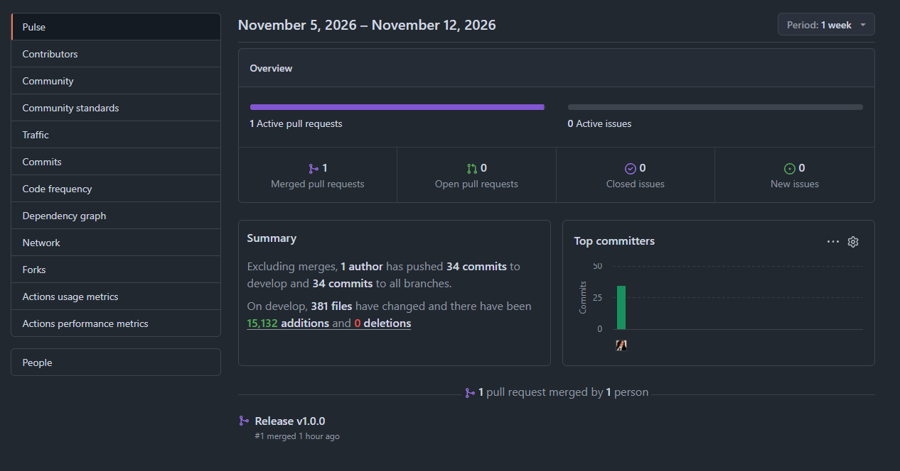
</p>

## 7.3. Validation Interviews

En las entrevistas de validación, representantes de los dos segmentos objetivo recorren la Landing Page y las aplicaciones resolviendo tareas concretas mientras el equipo observa. El objetivo es comprobar si entienden los productos y pueden cumplir sus tareas principales, y detectar problemas de usabilidad, de arquitectura de información y de diseño inclusivo antes del Sprint 2. Cada sesión se graba en video y se evalúa con el formato de heurísticas del Anexo D del enunciado.

## 7.3.1. Diseño de Entrevistas

### Qué se valida

| Producto | Versión usada en la sesión | Segmento |
|---|---|---|
| Landing Page | Versión publicada en https://site-two-mu-26.vercel.app | Ambos |
| Aplicación móvil, rol ciudadano | Build de Android conectado al backend de Azure, en un teléfono o en el emulador de Android Studio | Ciudadanos afectados |
| Aplicación móvil, rol brigadista | Build de Android con una cuenta de brigadista de prueba | Autoridades y equipos de respuesta |
| Web App (Centro de Mando y Consulta pública) | Prototipo interactivo de Figma de la sección 6.5 | Autoridades y equipos de respuesta |

La Web App se valida con su prototipo porque no tiene una versión implementada en este Sprint. El enunciado admite que la validación se haga sobre los prototipos de las experiencias digitales.

### Estructura de cada sesión

Cada sesión dura entre 20 y 30 minutos y se hace de forma presencial o por videollamada. Según los medios disponibles, se usa una de dos modalidades:

- **Interacción directa.** El participante usa el producto en su dispositivo o con control remoto de la pantalla del entrevistador.
- **Sesión guiada.** Cuando el participante no cuenta con un teléfono Android, el entrevistador comparte la aplicación en el emulador de Android Studio y presenta cada pantalla en pocas palabras. Luego le plantea la tarea y el participante indica qué acción haría (qué botón tocar, qué opción elegir o dónde buscar); el entrevistador la ejecuta tal como se la indican.

La sesión sigue estos pasos:

1. **Presentación y consentimiento (2 min).** Se explica el objetivo, que se evalúa el producto y no a la persona, y se pide permiso para grabar.
2. **Datos del participante (2 min).** Nombre, edad, distrito, ocupación y experiencia previa con emergencias, para el registro de la sección 7.3.2.
3. **Tareas (15 a 20 min).** El participante resuelve cada tarea en voz alta, diciendo lo que piensa y lo que espera que pase. El entrevistador no ayuda salvo que la persona se bloquee por completo; en ese caso explica el paso y anota la tarea como completada con ayuda.
4. **Preguntas posteriores (5 min).** Preguntas abiertas sobre la experiencia completa.

Para cada tarea se registra si se completó sin ayuda, con ayuda o no se completó, la modalidad de la sesión y los comentarios del participante. Al terminar cada tarea, el participante califica del 1 (muy difícil o confuso) al 7 (muy fácil o claro) qué tan fácil o claro le resultó.

### Segmento Objetivo #1: Ciudadanos afectados por desastres

| N.° | Tarea | Producto | User flow y pantallas | Historias |
|---|---|---|---|---|
| C1 | Explicar con sus palabras qué es AuxIA y encontrar cómo obtener la aplicación. | Landing Page | Hero, módulos clave y flujo del proceso | US-27, US-29 |
| C2 | Elegir el rol de ciudadano y pedir auxilio con el botón SOS sin conexión a internet. | Aplicación móvil | Registro y selección de rol (A_01) → SOS 1-Toque (A_03) | US-35 |
| C3 | Completar el detalle de la emergencia: personas afectadas, estado del acceso, audio y foto. | Aplicación móvil | Detalle de emergencia (A_04) | US-01, US-35 |
| C4 | Recuperar la conexión y comprobar si el reporte ya fue recibido y priorizado. | Aplicación móvil | Mis reportes (A_05) | US-24, TS-C06 |
| C5 | Revisar qué datos guarda la aplicación en el teléfono y cambiar el idioma. | Aplicación móvil | Red y almacenamiento (A_06) | — |

En la sesión guiada, las tareas C2 a C5 se plantean como situaciones: el entrevistador describe el contexto (por ejemplo, "no tienes señal y necesitas ayuda médica") y el participante indica cómo lo resolvería con la aplicación. Para que la emergencia simulada coincida con los datos del entorno desplegado, la ubicación del emulador se fija en la zona "Sector Alto Perú" de la emergencia "Huaico Chosica 2026", y la falta de señal se simula con el modo avión.

Preguntas posteriores:

1. ¿Qué fue lo más fácil y lo más difícil de pedir auxilio con la aplicación?
2. Si estuviera en una emergencia real y sin señal, ¿confiaría en que su pedido de ayuda va a llegar? ¿Qué le daría más seguridad?
3. ¿Entendió en qué estado estaba su reporte en cada momento? ¿Qué palabra o pantalla le confundió?
4. ¿Hubo algún texto, ícono o color difícil de leer o de entender?
5. ¿Recomendaría la aplicación a su familia o vecinos? ¿Por qué?

### Segmento Objetivo #2: Autoridades responsables de atender desastres

| N.° | Tarea | Producto | User flow y pantallas | Historias |
|---|---|---|---|---|
| A1 | Encontrar en la Landing Page qué ofrece AuxIA a las autoridades y cómo entrar al Centro de Mando. | Landing Page | Sección de autoridades e indicadores | US-28, US-30 |
| A2 | Identificar la zona más urgente de la emergencia y explicar por qué tiene esa prioridad. | Web App (prototipo) | Dashboard (W_01) → Mapa GIS (W_02) → Priorización e IA Explicable (W_03) | US-04, US-05, US-06 |
| A3 | Generar un plan de distribución para la zona más urgente, ajustar una cantidad y aprobarlo. | Web App (prototipo) | Priorización (W_03) → Plan de distribución (W_08) → Logística de campo (W_05) | US-11, US-12, US-13 |
| A4 | Comprobar que una entrega quedó registrada y verificada en Blockchain. | Web App (prototipo) | Auditoría y Trazabilidad (W_06) | US-17 |
| A5 | Iniciar sesión como brigadista, abrir la misión asignada y verificar la entrega con su evidencia. | Aplicación móvil | Inicio de sesión (A_10) → Misiones y mapa (A_07) → Verificar entrega (A_08) | US-15, US-16, US-21 |

Preguntas posteriores:

1. ¿La explicación del score le alcanzaría para justificar ante otra autoridad por qué atendió primero una zona?
2. ¿En qué parte del proceso de distribución sintió que perdía el control de la decisión?
3. ¿La verificación en Blockchain le resultó comprensible? ¿Cómo se la explicaría a un ciudadano?
4. ¿Qué información le faltó para decidir que esperaría encontrar en el Centro de Mando?
5. ¿Qué tendría que cambiar para que su institución adopte la herramienta en una emergencia real?

### Participantes y registro

Se entrevista a entre 3 y 5 personas por segmento. Para el segmento de autoridades se busca a personal de defensa civil, de gobiernos locales o de organizaciones de ayuda humanitaria, y al menos uno de los participantes debe haber trabajado en campo para evaluar el rol de brigadista. Cada entrevista se graba completa; después se edita un video de 3 a 5 minutos por entrevista, con un título que indica el nombre del participante, su segmento y la fecha, y se publica en Microsoft Stream.

### Evaluación heurística

Los problemas observados se evalúan con el formato del Anexo D del enunciado, que considera tres grupos de criterios:

- **Usabilidad:** las diez heurísticas de Nielsen (1994), como visibilidad del estado del sistema, coincidencia con el mundo real, control y libertad del usuario, consistencia y prevención de errores.
- **Diseño inclusivo:** los principios de diseño inclusivo de Microsoft (s.f.), que piden reconocer la exclusión, aprender de la diversidad y resolver para una persona y extender a muchas. En AuxIA se revisan en particular el contraste, el tamaño de los textos y de las áreas táctiles, y el uso sin conexión.
- **Arquitectura de información:** si el contenido se puede encontrar, si es comprensible y si es usable, de acuerdo con los sistemas de organización, etiquetado, navegación y búsqueda de la sección 6.2.

Cada problema recibe una severidad de 1 (superficial) a 4 (muy grave), según la escala del Anexo D, y una recomendación de corrección para el Sprint 2.

En las sesiones guiadas no se pueden evaluar los aspectos que dependen del uso físico del teléfono, como el tamaño de las áreas táctiles, la vibración del SOS o el uso con una sola mano. Esos criterios solo se evalúan en las sesiones de interacción directa, y la modalidad de cada entrevista queda indicada en la sección 7.3.2.

## 7.3.2. Registro de Entrevistas

## 7.3.3. Evaluaciones según heurísticas

## 7.4. Video About-the-Product
